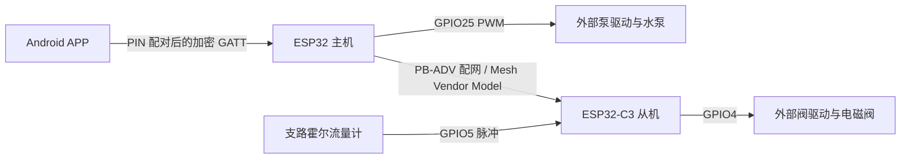

# 水泵多路控制系统交接文档

> 2026-10-25 当前软件候选：主机 `182ab692`、从机 `60d8ad44`，协议 V6；最多五台，五路候选并发 5，正式默认并发仍为 1。已加入结果持久化屏障、配置截止与维护许可互锁；本地按钮默认禁开，必须先获主机维护许可。APP 137 项 JVM 测试、主从及 SDK 离线测试通过。暂无实机测试条件，B/C/D 未验收，完整 Application/NVS/RTOS 故障注入仍需补证。详见 [本次实施记录](docs/BASIC_FIVE_OFFLINE_ACCEPTANCE_20261025.md)。以下实机与版本记录均为历史时点。

> 2026-10-23 深夜实机排查：COM9 主机 `56e9a678`、COM6 从机 `f0f1957d` 已烧录普通固件并更新各自 dist。发现窗口缓存已验证有效；从机 PB-ADV 成功获得地址 `0003`，后续模型配置仍有分段丢失/超时。后台 HELLO 曾到达并登记为 slot=1、同步 epoch=34；最后一次快照 online=1（此前为 0），管理状态仍 CONFIG_TIMEOUT，尚未 READY，不代表链路稳定。未清 NVS、未启用从机、未启动泵阀。详情与日志见 [配网诊断](docs/PAIRING_DIAGNOSIS_20261023.md)，以下“未刷写”为各历史阶段记录。

> 2026-10-23：主机现已迁移至 ESP32-C3 Super Mini / 4MB，水泵 GPIO4，原生 USB 维护；从机增加 GPIO3 接地轻触按键，按住开阀、松开关阀。当前配置与验证入口见 [C3 迁移说明](docs/ESP32_C3_MIGRATION.md)。本轮未刷写；下文 S3 和其他产物为历史记录。

> 2026-10-21 单台删除：APP 1.2.2 与配套主从机固件已增加从机删除、目标确认、离线结果区分、删除日志恢复及旧任务地址保留。入口、产物和软件/实机验证边界见 [单台删除说明](docs/SLAVE_REMOVAL.md)。本次未安装或刷写；下文产物记录为各自历史时点。

> 2026-10-21 主控硬件迁移（历史）：当时目标为 ESP32-S3 N16R8，水泵 PWM=GPIO4，bootloader=0x0。见 [S3 迁移说明](docs/ESP32_S3_MIGRATION.md)；下文 ESP32 / GPIO25 / 0x1000 属于历史记录。

> 2026-10-19 后续修复：最新软件候选主机 `4c3a56d9`、从机 `80ba7f64`，见 [从机离线修复与验收](docs/SLAVE_OFFLINE_FIX_20261019.md)。已完成构建及故障恢复回归，未刷写、未完成实机验收。下文保留交接时点记录；版本、NVS 格式和验收进展以最新修复报告为准。

交接基准：2026-10-19，Asia/Shanghai。覆盖 Android APP、ESP32 主机、ESP32-C3 从机三个独立 Git 仓库。本文以本次 Git 更新后的源码和本机验证为准；历史实板记录单独标注，不表示最新版本已部署。

## 1. 接手先看

| 项目 | 当前结论 |
| --- | --- |
| Git 更新 | 三仓库均已快进到远端 `main`，无合并冲突；具体提交见第 2 节 |
| 本次软件验证 | 主机 23 组测试通过；从机流量测试通过；Android 74 项单元测试通过；角色边界检查通过，APP 路径遗漏另做补充扫描 |
| 当前功能 | 手机 PIN 配对、加密 GATT、从机组网与启用、统一/逐阀水量、逐路调度、任务去重与重启对账、独立限时试泵、三档 PWM |
| 当前规模 | 32 个逻辑槽位，默认并发 1；没有 32 台实机吞吐或同时出水验收结论 |
| 最新硬件状态 | 本次未连接设备核验版本，未烧录、未修改设备 NVS、未执行泵阀输出命令 |
| 固件包 | 本机两份 `dist/manifest.json` 都是 10 月 17 日的包，镜像匹配各自清单，但源码已变化，不能作为最新源码产物发布 |
| APP 安装包 | 本次只重新运行单元测试，未重新 assemble APK；已有 APK 与最新提交的对应关系未建立 |
| 升级关键点 | 主机 NVS 已由格式 1 升到格式 2；先备份再升级，回退不能只换旧固件 |
| 尚待完成 | 当前源码重新构建、打包、实机迁移验证、真实手机与实际水路验收 |

**三项现场规则：** 主机当前上电输出关闭、低档、无启动锁，不需要每次 USB 复位；从机当前 GPIO6 联锁禁用；从机入网不等于已启用，必须通过 APP 明确执行启用。

本次交付只修改文档。完整机器可读证据见 [本机核验记录](docs/HANDOVER_VERIFICATION_20261019.json)。原 10 月 17 日交接文档保存为 [历史交接](docs/HANDOVER_20261017_HISTORY.md)，其中端口、启动锁和存储格式等表述不适用于当前版本。

## 2. 仓库、目录与提交基线

| 角色 | 本机目录 | origin | 本次更新后的 main |
| --- | --- | --- | --- |
| 主机 | `D:/pump/pump-muti` | [pump-muti](https://github.com/zhangym3/pump-muti) | `ad43f28bcef9ac4477d2c8428f000195e77d383c` |
| Android | `D:/pump/pumpmutiapp` | [pump-muti-app](https://github.com/zhangym3/pump-muti-app) | `4c8ea4a4169dc9805bd27d141e95c96b9c15d16f` |
| 从机 | `D:/pump/pump-muti-slave` | [pump-muti-slave](https://github.com/zhangym3/pump-muti-slave) | `56821a3fd071347f505d532620e7e4f628ebdbdf` |

更新前短提交分别为主机 `6c0a5b4`、APP `52a5259`、从机 `157bd16`。本次没有创建提交或推送远端。之后开发时，先检查各仓库 `git status --short`，分别提交；三个仓库之间没有统一的原子发布提交。

最终检查时，从机 `platformio.ini` 有本地未提交端口覆盖：远端提交为 COM4，工作区为 COM6。本次保留该配置，没有覆盖或提交；主机和 APP 未发现产品源码的本地修改。本交接新增/更新的文件位于主机仓库。

仓库名称与本地目录并不完全相同：Android 的 origin 名为 `pump-muti-app`，本地实际目录是 `pumpmutiapp`。不要照抄上游文档中的 `D:/pump-muti/...` 或旧用户目录。

## 3. 系统结构与责任边界



- APP：选择主机、系统配对、连接管理、设备清单、参数输入、任务确认、持久化请求身份与历史、结果显示。已受理任务由主机自主执行，手机不逐阀下发子任务。
- 主机：BLE 安全入口、Mesh Provisioner、节点登记、客户端去重账本、逐路任务调度、泵 PWM、本地截止保护、汇总与重启后对账。不包含本地阀门或流量采集逻辑。
- 从机：Mesh Node、本地阀门、脉冲计量、目标判断、租约截止、无流量与超时处理、尾流结算、执行栅栏与终态保存。不承担 Provisioner 或主机调度职责。

手机不直接连接从机 GATT。从机只提供 PB-ADV 配网，无 PB-GATT / Proxy 路径。主从的共享协议文件是各仓库内独立副本，修改后必须同步并检查一致性。

## 4. 源码导航

以下路径相对本节所述仓库；跨仓库链接采用本机实际目录。

| 模块 | 入口 | 接手时重点 |
| --- | --- | --- |
| 主机启动 | [src/main.cpp](src/main.cpp) | safeOff、NVS、硬件、Mesh、网关、登记与恢复顺序 |
| 主机业务入口 | [src/application.cpp](src/application.cpp) | 文本命令、受理与持久化、结果更新、组网/测试互斥 |
| 主机调度 | [src/master_scheduler.cpp](src/master_scheduler.cpp) | PREPARE/START、批次、续租、停止、迟到终态对账 |
| 泵控制 | [src/pump_safety_controller.cpp](src/pump_safety_controller.cpp) | 启动状态、授权、截止、试泵与 PWM |
| 主机硬件配置 | [include/board_profile.h](include/board_profile.h) | GPIO25、20kHz、并发 1、commissioned |
| BLE 入口 | [src/control_gateway.cpp](src/control_gateway.cpp) | 安全配对、GATT、缓冲、通知与优先停止 |
| Mesh 管理 | [src/mesh_management.cpp](src/mesh_management.cpp) | 扫描、PB-ADV、配置、登记、角色恢复与重置 |
| Mesh 传输 | [src/mesh_transport.cpp](src/mesh_transport.cpp) | Vendor 消息、队列、错误处理 |
| 持久化 | [include/persistent_state.h](include/persistent_state.h)、[src/storage.cpp](src/storage.cpp) | 格式 1 导入格式 2、旧 ABI、启动 epoch、读回校验 |
| 共享协议 | [include/protocol.h](include/protocol.h)、[include/control_request.h](include/control_request.h) | 操作码、显式小端、请求解析、逐阀计划与去重 |
| 从机执行器 | [flow_job_controller.cpp](../pump-muti-slave/src/flow_job_controller.cpp) | 阀状态机、脉冲、租约、结算、标定与启用前置条件 |
| 从机应用 | [application.cpp](../pump-muti-slave/src/application.cpp) | Commission、LeaseAck、CommandReply、USB K 修改 |
| 从机接线 | [board_profile.h](../pump-muti-slave/include/board_profile.h)、[PINOUT.md](../pump-muti-slave/docs/PINOUT.md) | GPIO4/5、当前禁用 GPIO6 |
| APP BLE | [MasterBleManager.kt](../pumpmutiapp/app/src/main/java/com/cczb/app/MasterBleManager.kt) | 绑定后发现服务、CCCD 加密、MTU、逐行通知 |
| APP 请求/状态 | [MasterProtocol.kt](../pumpmutiapp/app/src/main/java/com/cczb/app/MasterProtocol.kt)、[MasterControlViewModel.kt](../pumpmutiapp/app/src/main/java/com/cczb/app/MasterControlViewModel.kt) | 接受与写入分离、恢复、停止、能力门控 |
| APP 账本/历史 | [MasterLedger.kt](../pumpmutiapp/app/src/main/java/com/cczb/app/MasterLedger.kt)、[MasterHistory.kt](../pumpmutiapp/app/src/main/java/com/cczb/app/MasterHistory.kt) | 原身份/序号恢复、旧记录兼容、结果合并 |
| APP 水量与界面 | [VolumeRules.kt](../pumpmutiapp/app/src/main/java/com/cczb/app/VolumeRules.kt)、[ValveAmounts.kt](../pumpmutiapp/app/src/main/java/com/cczb/app/ValveAmounts.kt)、[PumpScreens.kt](../pumpmutiapp/app/src/main/java/com/cczb/app/PumpScreens.kt) | 50mL 步进、32 槽计划、排序与单/双列适配 |

## 5. 硬件与当前接线

### 5.1 主机

| 项 | 当前配置 |
| --- | --- |
| 芯片 / PlatformIO board | 经典 ESP32，`esp32dev`，4MB Flash |
| 唯一构建环境 | `pump_master` |
| 泵输出 | GPIO25，3.3V，高有效，20kHz PWM |
| 档位 | 低/中/高 = 50/75/100%；停泵实际输出 0% |
| 板卡启用 | `commissioned=true` |
| 开机状态 | Off、fault=None、低档、输出关闭；默认冷却 1000ms 后可接受满足条件的任务 |
| 反馈输入 | 无主机流量、压力、缺水、实际转速或机械运行传感器 |

GPIO 接外部驱动输入，不能直接驱动电机；驱动规格需与 3.3V、极性和 PWM 频率匹配，输出应有外部下拉。`pump_command`、`PUMP_PWM output` 是软件输出命令，不是实物运行或停机反馈。

当前源码已经取消开机 `BOOT_LOCK`。枚举值与部分 APP 兼容界面仍保留，但不能据此认定当前固件开机锁定。USB 裸命令 `pump-reset` 用于符合空闲等条件时复位故障，不会恢复旧任务，也不是每次开机必需步骤。

### 5.2 从机

| 项 | 当前配置 |
| --- | --- |
| 芯片 / board | ESP32-C3 Super Mini；构建用 `esp32-c3-devkitm-1` |
| 唯一构建环境 | `valve_slave_c3`，4MB，DIO，Flash 40MHz |
| 阀输出 | GPIO4，高有效，外部驱动和下拉 |
| 霍尔输入 | GPIO5，内部上拉、下降沿计数，最小边沿间隔 100µs；输入电平不得超过 3.3V |
| GPIO6 | `SlaveInterlockEnabled=false`，当前不使用，不需短接 3.3V |
| USB | 原生 USB Serial/JTAG，GPIO18/19；波特率 115200，DTR/RTS=0；UART GPIO20/21 不是当前监控路径 |
| 首次启用 | 未保存启用标志时保持未 commissioned；入网本身不开阀 |

当前三线流量传感器方案禁用外部联锁，`interlock()` 固定返回 true。因此 `INTERLOCK enabled=0 ready=1 pin=6` 只说明软件旁路，不能解释成外部保护信号正常。未来若启用 GPIO6，应重新审核接线：健康为 3.3V 高电平、外接约 10kΩ 下拉用于断线检测，并重新验收。

`board::valveConfig().commissioned=false` 的编译期值会在启动时被 `storage.commissioned()` 覆盖；仅把头文件改成 true 不会完成当前固件的启用流程。

### 5.3 端口辨认

本次更新后 Git 提交中的默认端口为主机 COM3、从机 COM4；从机工作区保留本地覆盖 COM6。历史文档出现 COM5/COM6，其他机器可能不同。端口号不是设备身份，部署前通过设备管理器、串口信息和芯片探测确认，命令显式指定实际端口。本次没有核实现场当前连接端口。

## 6. 开发环境与可复现命令

### 6.1 固件

PlatformIO `espressif32@6.10.0`、ESP-IDF 5.4.0、C++17。本机 PlatformIO 未依赖全局 PATH，使用下列绝对路径。所有命令均应在对应仓库执行。

```powershell
# 主机：构建与无硬件测试
Set-Location D:/pump/pump-muti
& C:/Users/79622/.platformio/penv/Scripts/platformio.exe run -e pump_master
python tools/run_host_tests.py --compiler .pio/host-tools/ziglang/zig.exe
python tools/verify_architecture.py

# 从机：构建与无硬件测试
Set-Location D:/pump/pump-muti-slave
& C:/Users/79622/.platformio/penv/Scripts/platformio.exe run -e valve_slave_c3
python tools/run_host_tests.py --compiler D:/pump/pump-muti/.pio/host-tools/ziglang/zig.exe
```

主机测试脚本只编译独立 C++ 核心，不等于 ESP-IDF 固件构建。架构脚本还检查两仓库的 `protocol.h`、`protocol.cpp`、`control_request.h`、`PROTOCOL_VECTORS.md` 字节一致以及本地 manifest 的角色身份；它不检查旧包是否覆盖最新源码。

**脚本路径缺口：** `verify_architecture.py` 将 Android 定位到兄弟目录 `pump-muti-app`，本机是 `pumpmutiapp`；目录缺失时会静默跳过 APP 扫描。本次对实际 APP 源码另行扫描了同样的废弃迁移标记，未发现。后续应使脚本支持明确传入 APP 路径，并在目标缺失时失败，不能单凭该脚本 PASS 推断 APP 也已被检查。

### 6.2 Android

| 项 | 当前值 |
| --- | --- |
| applicationId | `com.cczb.app` |
| versionName / versionCode | `1.2.0` / `8`，版本号本身不能唯一识别当前提交 |
| min / compile / target SDK | 30 / 37 / 37 |
| Gradle / AGP / Kotlin | 9.6.0 / 9.4.1 / 2.2.10 |
| Compose BOM | 2026.02.01 |
| Java 源码目标 | Java 11；与执行 Gradle 的 JDK 版本是两回事 |
| 本机已验证 Gradle JDK | Android Studio 自带 JBR，`C:/Program Files/Android/Android Studio/jbr`，Java 25.0.3 |
| SDK | `C:/Users/79622/AppData/Local/Android/Sdk`，本机平台目录 `android-37.0` |

```powershell
Set-Location D:/pump/pumpmutiapp
$env:JAVA_HOME = 'C:\Program Files\Android\Android Studio\jbr'
.\gradlew.bat :app:testDebugUnitTest --no-daemon --console=plain --max-workers=2

# 发布前另行构建/静态检查；本次未执行以下任务
.\gradlew.bat :app:assembleDebug :app:lintDebug --no-daemon --console=plain --max-workers=2
# 有设备或模拟器时运行界面测试
.\gradlew.bat :app:connectedDebugAndroidTest --no-daemon --console=plain --max-workers=2
```

旧 README 中的 JDK21 或其他用户 SDK 路径不代表本机已安装。新机器应重新核对工具兼容性与 `local.properties`，不要复制个人 SDK 路径作为跨机器配置。

## 7. 手机连接、安全与报文边界

1. 主机需先配置有效六位 PIN。USB `pin NNNNNN` 接受 100000～999999，保存后重启；不接受前导零 PIN。无有效 PIN 时业务 GATT 不启用。PIN 属设备凭据，不写入交接文档和公开日志。
2. APP 扫描 `PUMP_MASTER_xxxx`，首次连接由 Android 系统配对窗口输入 PIN。安全配置是 Secure Connections + MITM + Bond，设备 Display Only，密钥分发 ENC|ID `0x03`，无 CTKD。
3. 等待 `BOND_BONDED` 后发现服务，完成加密 CCCD，再协商 MTU185；业务最低 MTU163。
4. 写命令后等待匹配身份/序号/epoch 的业务回复。GATT 写成功、CCCD 成功和任务已受理是不同事件。

| GATT 项 | UUID |
| --- | --- |
| 服务 | `A64D0001-2F9C-4B6E-8DB7-A570530E1000` |
| RX，写 | `A64D0002-2F9C-4B6E-8DB7-A570530E1000` |
| TX，读/通知 | `A64D0003-2F9C-4B6E-8DB7-A570530E1000` |

命令有效载荷上限 159 字节，接收文本行按 191 字节缓冲边界处理；通知以换行拼接，不能将 ATT 分片当成完整行。TX 读取只返回最近一行，不能代替完整通知流。`R` 行是任务受理/状态，`V` 行包含体积与 measured 覆盖，另有 LOCAL、PUMP_PWM、PUMP_TEST、FLOW、清单与 Mesh 状态。

历史 GATT147 故障与 OSI alarm 耗尽、Mesh 初始化后 MTU 改变有关。必须保留 `CONFIG_BT_ALARM_MAX_NUM=128` 和 **Mesh 初始化后恢复本地 MTU185** 两项修复。历史诊断见 [GATT147_DIAGNOSIS.md](docs/GATT147_DIAGNOSIS.md)。

## 8. 从机添加、登记、启用与清单

### 8.1 添加链路

APP 的“添加设备”由主机扫描未配网 Beacon，持续 15 秒，候选最多 8 个。候选 UUID 为 32 位十六进制，标记以 `dd dd 50 4d` 开始、UUID 第 10 字节（从 0 编号）表示从机角色 2；`PUMP_SLAVE_后缀` 由 UUID 内容派生，不应依赖普通 BLE 名称搜索。

选中候选后依次完成：PB-ADV Provision → Composition page0 → 校验 CID、主元素 Vendor Model → AppKey Add → Model Bind → C001 订阅 → 合法 HELLO → READY/槽位登记。配置消息一般 4 秒超时、存在约 7 秒回退等待、最多 3 次尝试；HELLO 等待 25 秒、配网链路期限 90 秒。组网忙时拒绝新输出类任务，停止和查询保留。

主机如果检测到历史遗留的 Node 角色，会清理本地旧 Mesh 角色并重启，保留应用 NVS。正常恢复后应见 `capable=1 phase=IDLE`。手机不需要发送迁移命令。旧 USB `mesh-migrate CONFIRM` 只保留兼容用途。

### 8.2 启用输出

入网、登记和执行启用是不同状态。APP 显式启用命令：

```text
commission EPOCH REQUEST SLOT CONFIRM
```

主机要求当前 epoch、合法请求号、空闲、存储正常、节点归本 Provisioner 所有、在线、无未知结果，并且泵阀不在输出。主机发送 CC Commission；从机验证存储、网络、空闲、有效 K/版本和联锁条件，写入独立 NVS `commissioned` 标志，随后回复 CD 并发送 HELLO。启用重启后保留；当前没有对称的远程“取消启用”命令。

源码只能验证数值与状态，不能自动验证真实接线或流量标定。当前联锁旁路，也不能借启用成功证明外部保护正常。

### 8.3 清单一致性

`inventory EPOCH REQUEST` 返回 `INV_BEGIN`、若干 `INV_NODE`、`INV_END`。APP 核验当前 epoch/request、数量、唯一地址/槽位后整批替换。`slot=0` 表示已配对但未完成控制槽位登记，不能出水；1～32 是逻辑槽位，与 Mesh 单播地址不同。

清单每行间隔约 100ms；APP 平时约 10 秒刷新、15 秒过期、接收超时 8 秒。缺包或超时不能解释为 0 台。在线通常依据 15 秒内有效 HELLO/状态更新；是否可执行还取决于登记的 K/版本和 commissioned。

### 8.4 重置的实际边界

`mesh-reset CONFIRM` 可由加密 GATT 或 USB 发出，APP 有二次确认。主机空闲且无未知结果等条件满足后返回 `OK mesh_reset_started`，删除本地 Provisioner 节点表和应用登记，随后返回 `OK mesh_reset rebooting` 并重启。PIN、请求账本与任务记录保留。

**当前实现只见主机本地 `delete_node_with_addr` 删除，并未显式向从机发送远程 Node Reset。** 因此不能承诺重置后原从机都会重新变成未配网候选；当前从机 USB 也没有受支持的 Mesh reset 命令。这是设备回收流程缺口，现场重置前应先确定从机重新入网方案，不能把擦整片 NVS 当常规步骤。

## 9. 水量规则与统一/单独设置

### 9.1 APP 新任务规则

- 每路目标 50～2000mL，必须为 50mL 整数倍；2000 是单路上限，多路总目标可超过 2000。
- 设置页保存全局“单路最长时间”，1～240 秒，仅保存在当前手机；所有新任务使用该值。
- 已受理任务使用受理时的时限和目标。恢复任务、复用历史不能覆盖全局设置；旧目标和实际出水量不按新范围截断。
- 单独设置使用稳定槽位/地址标识，按槽位排序，不因勾选重排；未选阀门不能编辑。正常宽度双列，窄屏/大字体单列。

### 9.2 命令格式

下列都是协议格式，变量需来自当前连接与持久化账本，不能把示例身份当现场固定值。

```text
start CLIENT_HEX SEQ EPOCH MASK_HEX ML MAX_MS
start-each CLIENT_HEX SEQ EPOCH MASK_HEX MAX_MS AMOUNTS_64HEX
query CLIENT_HEX ORIGINAL_START_SEQ
stop CLIENT_HEX SEQ EPOCH JOB_EPOCH JOB_ID
```

MASK 的 bit(slot-1) 对应槽位。主机固件保留统一模式较大的历史数值范围（1～1000000mL 且可计算合法目标脉冲），不能由此放宽 APP 的新任务规则。

`start-each` 需 `HELLO individual=1` 能力；缺省视为不支持，禁止发给旧固件。AMOUNTS 为 32 字节、64 位十六进制，槽位 1 对应首字节，槽位 32 对应末字节：选中值 `01`～`28` 表示 50～2000mL，未选必须 `00`。

例如 1 号 100mL、2 号 250mL，mask=3：计划为 `02` + `05` + 30 个 `00`。可用 Python `'0205' + '00' * 30` 生成，不能漏字节。整份计划作为一个自主任务持久化，手机断线后主机仍逐路执行，不需要手机为下一路发新启动。

## 10. 受理、重试、停止与重启对账

| 概念 | 约束 |
| --- | --- |
| 客户端身份 | 非零 64 位 client，需跨重启持久化；不能每次连接随机更换 |
| 请求号 | 非零 uint32 序号单调递增，不回绕；测试和定量共用持久化高水位 |
| 设备启动代 | epoch 每次主机启动持久化递增；新启动需当前 epoch |
| JobKey | 主机分配的 epoch:id；身份/请求号与任务号不是同一个概念 |
| 去重容量 | 最多 16 个客户端，无自动淘汰；满后 Capacity |
| 同号重试 | 完整参数相同返回原任务，不再出水；同号不同参数 Conflict；更小序号 Stale |
| 接受顺序 | 主机持久化请求和任务号后才 PREPARE；从机保存任务栅栏后才确认准备 |
| 停止 | 带明确 JobKey；旧停止包不能停止后续新任务；使用原任务账本定位 |
| 查询 | 使用被查询启动的原 client/seq，不为“查询”消耗一个新启动号 |

收到写入成功但业务回复丢失时，只能保留原身份/序号/完整计划重试或查询。重新分配序号可能变成第二次出水。APP 中未确认、未知、失败、已停止应保持不同语义；不能用一次查询失败解除尚未确认的启动。

主机重启会将之前未结束任务标为 Failed，并把未得到完整结果的选中节点并入 unknown。启动保持泵关闭，不自动恢复 START，也不补水。调度器恢复最近任务/结果，查询会尝试取得未知从机的终态；匹配且可信的迟到结果可更新调度与持久化账本，APP 合并时避免倒退。

存在持久化 unknown 时，新定量、试泵等输出操作受阻。应先查询和核对原任务；不能通过重启、换 client 或新任务掩盖未确认出水量。

`complete` 掩码表示已取得终态，不等于全部成功；`failed` 表示不能认定目标成功；`unknown` 表示缺可信最终结果；`measured` 表示总量的数据覆盖。未覆盖节点不能解释为 0mL。非目标原因、静默失败或截断结果不能显示为正常完成。

## 11. 调度与从机保护时序

当前最大并发为 1，按槽位处理批次：PREPARE → 等准备确认 → START → 等开阀状态 → 启泵与供水 → 停泵/关阀 → 尾流结算 → 下一路。

| 环节 | 当前默认 |
| --- | --- |
| PREPARE / START 重试 | 约每 150ms；阶段期限分别 10s / 4s |
| 主机发 Lease | 供水期间每 1s |
| 主机 LeaseAck 期限 | 2400ms；匹配当前任务、当前租约序号，重复 ACK 不刷新新鲜度 |
| 从机 Lease | 3000ms 本地截止；相同序号只回 ACK，不延长期限；过期后不能靠迟到租约复活 |
| ACK 错峰 | 从机按地址取模错峰，避免多节点同时回复 |
| 泵授权 | 有效期 1000ms；调度约每 250ms 更新 |
| 停止发送 | 主机先停本地泵，再群发 CLOSE；异常停止期间约 700ms 重发 |
| 收尾查询 | 约 300ms 轮询；Draining 最多 10s，未确认项标 unknown |
| 周期摘要 | 约 2s；只更新可信流量缓存，不推动状态机 |
| HELLO / 在线 | 从机约 10s HELLO，运行时新鲜度约 15s |
| 主机运行任务 | 5ms 控制周期，优先级 10，core1，任务看门狗 5s |

从机默认：开阀等待首流 5000ms；流动后无流量 1500ms；准备期限 10000ms；尾流静默 500ms；结算上限 3000ms；单路最长运行 240000ms；预关脉冲补偿 preclose=0。

从机状态依次为 Idle、Prepared、Opening、Running、Settling、Done/Fault。停止、失租约或急停立即撤销阀命令，但需完成 Settling 后才能得到可信尾流终态；Settling 时不能启用或修改 K。主机调度枚举顺序为 Idle、Preparing、Opening、Supplying、Draining、Between、Complete、Failed。

主机 Mesh 常规收/发队列各 48、紧急队列 12，网关命令 12/输出 32；溢出按 Transport 故障处理并撤销本地输出。队列容量不构成规模性能验收。

## 12. 流量系数、标定与历史解释

**K 的单位是每升脉冲数 pulses/L，不是 pulses/mL。** 默认 5880。合法数值 1～1000000，但数值合法不等于已物理标定。从机 HELP 仍写 `PULSES_PER_ML`，属于待修正文案。

```text
targetPulses = (targetMl * K + 500) / 1000    # 整数计算，四舍五入
measuredMl  = pulses * 1000 / K              # 整数计算，向下取整
K           = measuredPulses * 1000 / measuredMl
```

标定应在受控离线流程记录已知体积与脉冲后计算。等从机完全空闲，在从机 USB 发 `k K`，成功会递增 K 版本；再在主机 USB 用 `node SLOT ADDR_HEX K VERSION` 更新相同槽位的登记。主机不会用后续 HELLO 静默覆盖已登记的 K/版本，配置不一致会影响执行资格。

从机当前先验证 `canConfigure` 再保存，避免忙时把未生效 K 写入 NVS。已保存旧任务终态保留执行当时的 K，不能拿当前 K 重新解释历史出水量。目标脉冲取整、传感器误差与尾流会影响精度，实际精度需现场分水量、档位和水压验收。

## 13. 独立试泵与 PWM

独立试泵只驱动主机泵，不自动开阀、不生成流量结果。APP 提供 3/5/10 秒选择；固件允许 1～10000ms，主机本地截止，手机断开也会到时停止。它与定量任务、未知结算和组网操作互斥。

```text
pump-test CLIENT_HEX SEQ EPOCH DURATION_MS
pump-test-stop CLIENT_HEX START_SEQ EPOCH
pump-test-query CLIENT_HEX START_SEQ EPOCH
pump-speed EPOCH EXPECTED_REV LEVEL
```

测试同样先持久化客户端高水位再输出，重复启动不延长时间。先到的停止会留下同号停止标记，防止迟到启动再运行。`PUMP_TEST` 返回 client、seq、epoch、reply、state、op，APP 需关联原测试；确认终态后不能被迟到 RUNNING 恢复。

`PUMP_PWM` 中 epoch/rev 是调档比较并交换条件；LEVEL=1/2/3。成功调档才推进 revision，重启低档、revision 归零，档位不持久化。空闲选档不启泵，试泵运行中调档不延长原截止；定量运行中禁止调档。调档待确认时 APP 禁止新任务/测试；超时刷新状态或重连，不自动重发。

兼容协议 `pump-dry-test` 上限 3000ms、强制低档，当前 APP 没有该入口。“dry” 名称不代表有缺水检测，也不是允许设备无水运行的硬件结论。正常试泵/调档当前要求 fault=None；旧文档关于绕过并恢复 BOOT_LOCK 的描述已过时。

## 14. USB / GATT 命令速查

表中“加密 GATT”均指完成 PIN 绑定与加密后的主机业务连接。只读查询也可能返回运行期间变化的快照。

| 命令 | 通道 | 用途与限制 |
| --- | --- | --- |
| `hello`、`local` | 主机 USB / 加密 GATT | 当前 epoch、能力、泵命令与 PWM/测试状态 |
| `start ...`、`start-each ...`、`query ...`、`stop ...` | 主机 USB / 加密 GATT | 参数见第 9～10 节；停止优先处理 |
| `inventory EPOCH REQUEST` | 主机 USB / 加密 GATT | 完整节点清单 |
| `mesh-state EPOCH REQUEST` | 主机 USB / 加密 GATT | 当前组网状态，不带参数的写法不合法 |
| `mesh-scan EPOCH REQUEST` | 主机 USB / 加密 GATT | 扫描候选，从空闲状态发起 |
| `mesh-join EPOCH REQUEST UUID32HEX` | 主机 USB / 加密 GATT | 显式添加候选 |
| `mesh-retry EPOCH REQUEST ADDR_HEX` | 主机 USB / 加密 GATT | 重试已配网节点配置 |
| `commission EPOCH REQUEST SLOT CONFIRM` | 主机 USB / 加密 GATT | 持久化启用指定从机 |
| `mesh-reset CONFIRM` | 主机 USB / 加密 GATT | 删除主机本地从机表并重启；边界见第 8.4 节 |
| `pump-test...`、`pump-speed...` | 主机 USB / 加密 GATT | 独立试泵/调档，见第 13 节 |
| `pump-reset` | **主机 USB，裸命令** | 空闲等条件满足时复位故障，不启动旧任务 |
| `estop` | 主机 USB | 停止调度与本地泵输出 |
| `nodes` | 主机 USB | 登记槽位、地址、K、版本、在线与启用状态 |
| `node SLOT ADDR_HEX K VERSION` | 主机 USB | 空闲时修改登记；不是从机 K 写入命令 |
| `master ADDR_HEX` | 主机 USB | 修改应用主地址；应与 Mesh 配置一致 |
| `pin NNNNNN` | 主机 USB | 保存有效 PIN 后需重启 |
| `mesh-migrate CONFIRM` | 主机 USB | 历史兼容，正常新版自动恢复，不是手机操作流程 |
| `hello`、`local` | 从机 USB | 当前从机状态与流量/联锁快照 |
| `estop` | 从机 USB | 撤销阀命令并进入结算，不代表瞬间已取得最终流量 |
| `k K`、`master ADDR_HEX` | 从机 USB | 标定/主地址维护，需核对配套登记 |

**APP 复位兼容缺口：** APP 仍有旧 `pump-reset EPOCH REQUEST CONFIRM` 解析/界面代码，但当前主机没有实现这种 GATT 复位命令，也未声明相应能力。不能把该 UI 的存在当作手机复位可用；当前无开机锁，不需该步骤。

## 15. Mesh 二进制契约补充

Vendor CID=`0x02E5`（Espressif 开发标识，正式产品需评估自有 CID）、Model=`0x0001`、群组=`0xC001`、NetKey/AppKey index=0。所有多字节字段显式小端，禁止 memcpy 整个 C++ 结构作为线报文。下表字节数不包含 opcode、MIC、Mesh 分段开销。

| Op | 消息 | 载荷字节 |
| --- | --- | --- |
| C0 | PREPARE：key、ml、targetPulses、K、version、maxMs | 28 |
| C1 | START：key | 8 |
| C2 | LEASE：key、sequence | 12 |
| C3 | CLOSE：key、reason | 9 |
| C4 | STATUS_GET：key | 8 |
| C5 | STATUS：key、pulses、closePulses、K、revision、phase、reason、flags | 27 |
| C6 | SUMMARY：key、pulses、revision、phase、valveCommand | 18 |
| C7 | EVENT_ACK：key、revision | 12 |
| C8 | REQUEST：统一请求 / 逐阀计划请求 | 37 / 61 |
| C9 | RESPONSE：client、sequence、reply、key、phase、四个掩码、totalMl、measured | 46 |
| CA | HELLO：K:u32、version:u32、commissioned:u8 | 9 |
| CB | HELLO_REPLY：epoch:u32、pumpFault:u8、schedulePhase:u8 | 6 |
| CC | COMMISSION：request:u32 | 4 |
| CD | COMMISSION_REPLY：request:u32、reply:u8、commissioned:u8、K:u32、version:u32 | 14 |
| CE | LEASE_ACK：key、sequence:u32、reply:u8 | 13 |
| CF | COMMAND_REPLY：key、command:u8、reply:u8 | 10 |

key 为 epoch:u32 + id:u32。STATUS flags：bit0 阀命令、bit1 静默完成、bit2 结算截断。COMMAND_REPLY 用来表达拒绝，不能伪造任务 Fault/Done 终态。租约 ACK 不能由普通遥测替代。

现有 [PROTOCOL.md](docs/PROTOCOL.md) 已追加逐阀协议，但主表缺 CC～CF，部分启动锁描述过时；[PROTOCOL_VECTORS.md](docs/PROTOCOL_VECTORS.md) 的范围标题也有遗留。修改时同步主从契约文件，以当前编码器、解析器和测试为准。

## 16. 持久化、升级与回退

### 16.1 数据布局

| 项 | 主机 | 从机 |
| --- | --- | --- |
| ProfileId | `0x504D0001` | `0x56530002` |
| namespace / blob key | `pumpmulti` / `state` | `pumpmulti` / `state` |
| 当前格式 | 2，兼容导入格式 1 | 1 |
| 特殊数据 | PIN、槽位、16 客户端高水位、最近任务/结果、逐客户端计划 | K/版本、执行 fence、revision 预留、终态；另有 u8 `commissioned` 键 |

主机 `LegacyPersistentState` 保留格式 1 的完整顺序和字段，ESP32 ABI 静态断言大小 2040 字节；格式 2 在其后追加 `clientAmounts[16][32]`。导入旧记录时保留旧字段、清零新计划并写回格式 2。旧本地阀字段虽然不再使用，仍不能删除、重排或改变类型。不能用桌面编译的结构大小代替 ESP32 ABI 证据。

读写失败、magic/profile/长度/格式不符等情况保持输出关闭，不自动擦 NVS。每次写后读取并比较。计数达到上限时拒绝继续，不回绕绕过重放保护。从机每次启动为 revision 预留新计数区间，避免旧状态覆盖重启后的结果。

### 16.2 分区与镜像

两个工程当前分区一致：NVS `0x9000`，长 `0x10000`；phy_init `0x19000`，长 `0x1000`；factory app `0x20000`，长 `0x3E0000`。当前没有双槽 OTA 分区方案，维护走 USB。

| 镜像 | ESP32 主机偏移 | ESP32-C3 从机偏移 |
| --- | --- | --- |
| bootloader.bin | `0x1000` | `0x0` |
| partitions.bin | `0x8000` | `0x8000` |
| firmware.bin | `0x20000` | `0x20000` |

不要混刷主从镜像或套用默认 app `0x10000`。升级 app 保留 NVS；部署前重新核对实际分区表，不能跨不兼容分区假定备份范围仍适用。

### 16.3 推荐升级流程

1. 只读确认设备身份、空闲、泵阀命令关闭、没有活动测试与未结算任务；记录主从版本、节点地址、K/版本、PIN 管理状态和历史任务。
2. 将设备升级前固件与 NVS 做成配套备份。使用所安装 esptool 的 `--help` 核对版本语法；NVS 只读备份范围为 `0x9000 0x10000`，分别标记主/从、设备标识、时间、提交与 SHA256。备份包含网络/绑定/PIN 等信息，应按凭据保管。
3. 从确认的提交重新构建并打包，核对 manifest 的角色、芯片、源文件与镜像哈希；不要直接使用现有旧 dist。
4. 在实机部署窗口仅写正确目标分区并保留 NVS；本文不自动执行上传。启动后验证主机格式 1→2 导入、登记/客户端高水位/历史保留、新能力 `individual=1`、泵关闭和 Mesh 可用。
5. 在真实手机保留应用数据安装新 APK，核对请求恢复与能力门控。逐阀执行协议未改变从机 PREPARE/START，因此仅为逐阀计划功能不必强制升级从机；若需当前联锁/启用/ACK 等行为，必须核对已部署从机版本是否包含相应实现。
6. 最后执行受控实机验收并填写第 20 节，不用模拟器结果代替。

格式 2 写入后，旧格式 1 主机固件不能解码，回退旧 bin 会进入存储不可用状态。回退应使用匹配旧固件和升级前 NVS 备份，并核对升级后是否产生新任务：恢复旧高水位/fence 可能重新允许曾执行过的请求。只能在确认无在途/待重试操作的维护窗口安排，不能把旧备份当随时可还原的数据快照。

## 17. 构建产物与发布包管理

固件构建输出位于各自 `.pio/build/环境名`。在各仓库构建成功后执行：

```powershell
python tools/package_firmware.py
```

脚本检查镜像存在、firmware 时间不早于源码/配置、生成的目标芯片正确，再复制三个镜像并记录源码与镜像 SHA256；不会刷设备。时间检查不能替代内容哈希与实机验收。新包默认 `hardwareValidated=false`，不能无证据改成 true。

| 本机现有产物 | 当前核验 |
| --- | --- |
| 主机 `dist/pump_master/firmware.bin` | 988864 字节，SHA256 `3fa717cb8335180dcd2e6755eb9097ddccda74d441c38749fc735912a6488b78` |
| 从机 `dist/valve_slave_c3/firmware.bin` | 962368 字节，SHA256 `f21dc259663095715e1d951a3947a6d9bd9db647951a6245121eb1ec004db46c` |
| 两份 manifest | UTC 2026-10-17 15:37 左右；`hardwareValidated=false`；镜像哈希与清单一致，源文件与当前提交不一致 |
| APP `D:/pump/pumpmutiapp/app/build/outputs/apk/debug/app-debug.apk` | 现存文件 SHA256 `b5ec4f81eef1066b8a3025b42f98f1174ed050b8d71adefeb3459a23fac8f9e5`；本次未重建，不作为新提交已出包证据 |

当前主机 manifest 还缺新文件 `include/persistent_state.h`。核验旧包时既要检查已记录文件是否变化，也要检查新增源码是否未进入清单，不能只比较旧清单的已有条目。完整差异与全部镜像哈希见 [核验 JSON](docs/HANDOVER_VERIFICATION_20261019.json)。

发布包应同时包含三仓库提交、工具版本、固件 manifest、APK 哈希、NVS 备份索引、测试报告和实机验收记录；PIN/网络密钥/备份内容不进入普通源码提交。

## 18. 本次验证与历史证据

### 18.1 本次更新后本机执行

| 检查 | 结果 | 范围 |
| --- | --- | --- |
| 三仓库 Git 更新 | PASS | main 快进，无冲突，HEAD 与拉取后的 upstream 一致 |
| 主机 host tests | 23 组 PASS | 核心泵/调度/去重/逐阀计划/存储迁移等桌面测试 |
| 从机 host tests | PASS | 输出 `slave flow tests passed`，无硬件流量控制回归 |
| Android testDebugUnitTest | 74 PASS | 11 份 XML，failures=0、errors=0、skipped=0；本次 Gradle BUILD SUCCESSFUL |
| verify_architecture.py | PASS | 主从静态边界、共享契约、manifest 角色；APP 路径遗漏已注明 |
| 实际 APP 路径补充扫描 | PASS | 未发现脚本禁止的旧迁移状态标记；不等同完整架构或 UI 测试 |
| 本地旧镜像完整性 | PASS | 镜像与各自 manifest 一致；**不满足最新源码对应性** |

Android 报告位于 `D:/pump/pumpmutiapp/app/build/reports/tests/testDebugUnitTest/index.html`，XML 在同仓库 `app/build/test-results/testDebugUnitTest`。本机记录见 [HANDOVER_VERIFICATION_20261019.json](docs/HANDOVER_VERIFICATION_20261019.json)。

本次未重新执行 ESP-IDF 完整构建、打包、assemble APK、lint、Android 仪器测试、实板部署或水路测试。因此上述 PASS 不代表当前版本已完成发布验收。

### 18.2 上游及历史记录

[UI_INDIVIDUAL_VALIDATION_20261019.md](docs/UI_INDIVIDUAL_VALIDATION_20261019.md) 是上游随提交带来的软件验收记录，记载主从构建通过、Android 74 单测、18 模拟器界面测试、APK 构建，以及 lint 0 errors / 20 warnings。它同时明确串口/真实手机连接消失，未刷最新实机、未真实出水。其路径属于另一工作目录，不能照抄为本机产物证据。

[SLAVE_DISCOVERY_DIAGNOSIS.md](docs/SLAVE_DISCOVERY_DIAGNOSIS.md) 记录了较早实板从机可发现修复；[GATT147_DIAGNOSIS.md](docs/GATT147_DIAGNOSIS.md) 记录了较早真实手机 PIN/GATT 验证。这些证据早于当前逐阀计划、存储升级等变更，不能推出最新提交已在硬件运行。

## 19. 已知缺口与排障顺序

| 现象 | 优先检查 | 避免的误判 |
| --- | --- | --- |
| 主机无业务 GATT | PIN 是否有效、启动日志、蓝牙初始化 | 不要直接清空 NVS/绑定 |
| Android 配对后 147/断开 | 是否重启、alarm 池、Mesh 后 MTU185、BONDED 与 CCCD 顺序 | 不把所有 147 都认定为 PIN 错 |
| 手机搜不到从机 | 应从主机组网页扫描；从机未配网 Beacon、PB-ADV、C3 蓝牙配置 | 从机不是手机直连 GATT 设备 |
| C3 `status=0xc op=0x200b` | BLE5 feature 关闭、BLE4.2 启用，defaults 与生成 sdkconfig 同时核对 | 不仅改 defaults 后沿用旧生成配置 |
| `capable=0` / 旧角色 | 等主机自动恢复重启，再带当前 epoch 查询 mesh-state | 不让手机发送旧迁移流程 |
| 已入网仍不能执行 | slot 是否 0、READY/HELLO、在线、commissioned、K/版本 | 入网成功不等于已启用 |
| `INTERLOCK ready=1` | 同时看 enabled；当前 enabled=0 | 不表示真实外部保护闭合 |
| 单独设置不可启动 | `individual=1`、每路规则、64 位十六进制计划、选中掩码 | 不把缺能力旧固件当支持 |
| 存储错误 | 芯片/profile/格式、备份、读写返回值、是否误降级 | 不自动 erase 修复 |
| NOT_READY/BUSY | 冷却、活动任务/试泵/组网、unknown、泵故障、从机结算 | 当前正常开机不需要 BOOT_LOCK 解锁 |
| 停止后仍有脉冲 | 阀命令关闭与 Settling、尾流静默、最终 flags | 不在关阀瞬间认定最终体积 |
| 重启后结果未知 | 原 client/seq 查询、JobKey 匹配、从机终态保存 | 不自动补发新出水或将未知当零 |
| 重置后找不到旧从机 | 从机可能仍已配网，当前缺远程 Node Reset | 不承诺主机清表等于从机退网 |
| 测试通过但实际 APP 未被边界检查 | 本地目录名与脚本预期 | PASS 可能跳过不存在的 APP 目录 |
| 现存 bin/APK 看起来最新 | 比较提交、manifest 源码覆盖与哈希 | 文件存在、版本号相同不代表对应最新代码 |

维护优先级建议：

1. 先完成最新源码构建/打包和格式 1→2 的真实设备保留数据升级验收。
2. 补完整从机退网/回收方案，验证“重置从机组网”端到端行为，再作为常规现场流程。
3. 修正架构脚本 APP 路径漏检，统一文档中 BOOT_LOCK、GPIO6、NVS 格式、K 单位与操作码表；当前主机 README 已随本交接修正关键描述。
4. 在实际泵驱动、供电和水路上测 PWM/阀时序、流量精度与故障关断；是否增加缺水/压力/硬件联锁应作为明确硬件需求评审。
5. 再评估多节点拥塞、丢包、配置恢复、NVS 寿命与客户端容量。提升并发前先做水力与供电验证，不能只改 MaxConcurrent。

## 20. 实机接手验收单

以下是待执行清单，空框表示本次没有完成，不是已有验收证据。输出测试需在现场具备合适水路、容器和断电手段后进行。

- [ ] 记录主从实物标识、实际端口、芯片、固件提交/哈希、APP 提交/哈希和操作人员。
- [ ] 空闲只读检查：泵/阀命令关闭，无活动试泵/任务，unknown 处置明确。
- [ ] 各设备 NVS 与升级前固件备份完成，校验可读、标识匹配，凭据保存位置明确。
- [ ] 主机格式 1→2 升级后保留 PIN、绑定/网络、登记表、客户端高水位、最近任务与结果；无自动恢复出水。
- [ ] 主机上电 GPIO25 实测关闭，低档；确认当前不依赖开机 USB reset。
- [ ] 真实 Android 首次配对、断开重连、BONDED、CCCD 加密、MTU185 和逐行通知正常。
- [ ] 主机扫描真实从机，PB-ADV 配网与模型配置 READY，清单数量/槽位正确。
- [ ] 从机未启用时不输出；显式启用持久化，重启后仍正确；GPIO6 禁用状态被现场人员知悉。
- [ ] 实测 GPIO25 的 20kHz/三档占空比；独立试泵不自动开阀，手机断开仍按 3/5/10s 截止。
- [ ] 统一模式 50/2000mL 边界和单独模式不同目标正常，按槽位逐路执行，手机断连不中断已受理任务。
- [ ] 相同请求重试不二次出水，同号改计划 Conflict，旧停止不影响新任务。
- [ ] 无流量、租约丢失、通信异常、从机/主机中途重启、紧急停止均撤销输出，结果未证实时保持 unknown。
- [ ] 尾流静默、截断、迟到终态与查询对账正确，实际计量误差有测量记录。
- [ ] 多台在线、离线恢复、K/版本不一致、组网中断、清单缺包与超时不会造成误启动或错误清空列表。
- [ ] Mesh 重置后的从机退网/重入网路径明确并验证；不能仅凭主机重启认定完成。
- [ ] 发布包、测试报告、现场日志、未解决问题及负责人签收齐全；日志中凭据已妥善处理。

## 21. 交接资料与待补信息

| 资料 | 用途 |
| --- | --- |
| 本文 [HANDOVER.md](HANDOVER.md) | 当前综合交接入口 |
| [核验 JSON](docs/HANDOVER_VERIFICATION_20261019.json) | 本机 Git 基线、旧产物哈希/源码差异、测试结果与未执行项 |
| [历史交接](docs/HANDOVER_20261017_HISTORY.md) | 原文件留档，不作为当前操作说明 |
| [逐阀 UI 软件验收](docs/UI_INDIVIDUAL_VALIDATION_20261019.md) | 上游软件/模拟器验收及未刷实机说明 |
| [PROTOCOL.md](docs/PROTOCOL.md) | 详细协议背景，遗留差异参照本文更正 |
| [COMMISSIONING.md](docs/COMMISSIONING.md) | 现场背景，启动锁/启用/接线旧描述需以源码和本文校正 |
| [从机 PINOUT.md](../pump-muti-slave/docs/PINOUT.md) | C3 实物和引脚参考 |

以下信息在当前代码/会话中没有可确认值，接手时补齐，不虚构：项目负责人和运维联系人、设备序列号与安装位置、实际泵/驱动/阀/传感器型号、电源与水路规格、流量精度指标、现场已部署版本、凭据与备份保管位置、发布审批/签收人及维护窗口。
