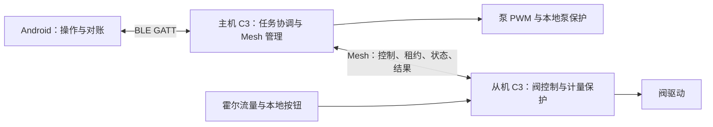

# 当前架构复评（2026-10-25）

评审对象为主机 `pump-muti`、从机 `pump-muti-slave`、Android `pumpmutiapp` 的当前工作区，包含既存未提交修改。本文以源码为准，历史方案只用于核对实施及验收记录。本轮未修改业务代码、烧录固件或操作泵阀。

范围补充：用户随后明确要求“一主最多五从、多路同时出水”。以下默认并发 1 是当前实现状态；最新交付目标为最多五路同时定量，实施与验收以 [基本功能优化方案](BASIC_FUNCTION_OPTIMIZATION_PLAN_20261025.md) 为准。

**总体判断：主从职责和设备本地保护方向正确，应保留；配置事务、整机状态、故障恢复和运行时限仍需收敛。当前属于安全逻辑较完整、通信可靠性尚未完成实机验收的工程样机。**

不能把“构建和离线测试通过”解释为“连接问题已根治”，也不能仅凭 C3 共用蓝牙控制器推断它就是当前故障根因。

## 1. 当前实际架构

| 层级 | 当前职责 | 评价 |
|---|---|---|
| Android | 手机 BLE 会话、命令提交、任务账本、查询对账、Mesh 管理界面、标定界面 | 执行真相留在设备端，方向正确；ViewModel 职责过于集中 |
| 主机 ESP32-C3 | 手机 GATT、Mesh Provisioner/Config Client/Vendor Model、泵 PWM、任务协调、持久化 | 角色清楚；无线、管理、控制和持久化的运行边界仍紧密耦合 |
| 从机 ESP32-C3 | 阀输出、霍尔流量、定量关阀、租约保护、本地按住开阀、结果留存 | 计量与关阀下沉合理；本地操作尚未完整进入主机可观测状态 |
| Mesh 承载 | 配网、配置、状态、控制、租约与结果传输 | 当前 Relay 关闭，按单跳部署使用；仍承担完整 Mesh 管理与 SAR 复杂度 |
| 软件交付 | 三仓、协议一致性检查、固定 SDK 补丁、host harness、构建身份 | 已有可复现基础；重复的通信基础设施需要统一版本管理 |

当前生产默认并发为 1；5 路是候选构建配置。32 个逻辑槽位不等于已证明可稳定管理或并发运行 32 台设备。

证据：主机 `src/main.cpp:8`、`include/board_profile.h:10`；从机 `include/board_profile.h:12`；主机 `src/mesh_transport.cpp:83`。

## 2. 应保留的基础

1. **设备自主执行，手机负责交互与对账。** Android 先保存请求再发送，GATT 写成功不等同于任务受理；断连不会自动重放启动请求。任务按 client/seq/job/epoch/mask 对账，终态不倒退。
2. **主机协调泵，从机本地计量与关阀。** 从机 tick 自行检查租约、最长运行、无流量和目标量，远端消息丢失不会取消本地保护。
3. **先保存授权边界，再执行动作。** 主机先持久化任务受理，从机 PREPARE 先保存防重放 fence；重启不继续旧任务、不自动补出水。
4. **有明确的启动和停机顺序。** 主机收到 START 及新鲜租约确认、等待阀输出提前量后才开泵；停机先停本地泵，再尝试无线关阀。
5. **通信异常采用保守策略。** 业务发送治理器跟踪真实 SDK/SAR 完成，限制分段并发；异常后冻结新授权，不通过伪造完成来释放在途请求。
6. **核心控制可脱离硬件测试。** 调度器、泵保护、阀控制与硬件通过接口分隔，适合验证乱序、重复、超时、重启等边界。

证据：主机 `src/application.cpp:149`、`src/master_scheduler.cpp:166`、`:500`、`src/storage.cpp:41`；从机 `src/flow_job_controller.cpp:65`、`:186`；Android `MasterControlViewModel.kt:548`、`:881`、`MasterTaskReconciliation.kt:8`。

启动证明仍然只是软件命令与协议确认；当前没有机械阀位反馈，不能将 START ACK 视为已测得阀门完全打开。

## 3. 已确认的问题及条件性风险

### 3.1 从机终态结果缺少持久化屏障——已确认缺陷，优先修复

从机循环先执行 `valve_.tick()`，随后接收新命令，最后才由 `periodic()` 保存终态。tick 刚把旧任务置为 Done/Fault 时，同轮合法的新 PREPARE 可覆盖旧任务；新 fence 写入还会清除 `resultValid`。第 381 行“保存终态快照”的注释下实际调用的是霍尔诊断，未完成结果保存。

另一个问题是结果保存失败后仍更新 `savedKey_ / savedRevision_`，同一终态不会再次触发保存。

影响主要在任务结果留存、计量对账与掉电恢复；本轮未发现它会直接复活旧任务或绕过关阀保护。修复应在接受下一任务前保存待结算终态，并只在成功后更新保存标记；失败时保持输出关闭、保留待保存结果并阻止覆盖。

证据：从机 `src/application.cpp:279`、`:378`、`:385`；`src/flow_job_controller.cpp:54`、`:65`；`src/storage.cpp:45`。

### 3.2 本地按钮与远程任务没有共享完整整机状态——已确认缺口

实际阀输出为远程 `valveCommand` 与 `localOn_` 的组合，Mesh 状态只编码远程任务的 `valveCommand`，Hello 也不包含本地占用。已有本地/远程互斥及松开关阀，但主机无法完整观察按钮运行状态，可能先显示空闲，直到 PREPARE 返回 Busy。

集中供水场景还需要明确按钮语义：按钮只开阀不会自动请求主机开泵；若主机正在给另一支路供水，本地开阀可能改变公共水路的流量分配。这是由共享水路决定的条件性风险，尚无本轮实测记录。

建议增加整节点运行快照，表达运行来源、占用、实际输出命令、计量归属及故障。若按钮需要主机供水，则必须进入主机的供水仲裁；若定位为独立维护操作，则应定义与正式定量任务的互斥范围。

证据：从机 `include/flow_job_controller.h:54`、`:68`；`src/application.cpp:13`、`:185`、`:287`。

### 3.3 Mesh 配置事务闭环弱于业务任务闭环——已确认保证缺口

配置流程已有单请求在途、每步最多 3 次尝试、15 秒 SDK 响应超时、12 秒 SAR 清理退避，以及步骤/尝试/等待状态展示。不能将其描述为完全没有状态机或无限快速重试。

不足是配置事件仅携带地址、opcode、结果，按当前目标和步骤匹配；跨步骤旧事件可排除，同 opcode 的旧尝试与新尝试没有独立代际关联。具体是否会发生误归因，需要结合固定 SDK 的回调生命周期验证。不能在回调到达时贴上“当前 attempt”就宣称关联问题解决。

等待响应主要依赖 SDK timeout 回调。配置阶段没有独立总截止；如果预期回调缺失，本地状态机没有完整的最终退出保障。界面 `remainingMs` 目前只是退避剩余时间，不是配置事务总剩余时间。

建议封装管理事务，提供 operation/step/attempt 与可关联的底层 trace、应用层绝对截止、明确失败出口、幂等状态查询及对账。业务治理器和管理配置不必强行使用同一消息格式，但应统一资源预算、生命周期记录和故障解释。

当前业务与管理入口已有 idle/managementBusy 互斥，不能断言它们必然同时运行。周期状态、SDK 内部流量和手机通信是否竞争，仍需测量。

证据：主机 `src/mesh_management.cpp:22`、`:109`、`:308`、`:350`；`include/mesh_config_retry.h:7`、`:28`；`src/application.cpp:149`、`:695`。

### 3.4 保护逻辑正确，但最坏响应时限尚未建立——已确认耦合、待实测影响

主机 5 ms 循环同时执行 Mesh 管理、队列处理、保护 tick、调度、日志、状态发布和同步 NVS。部分标定状态在泵已输出后同步提交；从机也在应用任务里执行 NVS commit 和读回校验。循环每轮只获取一次 `now`，阻塞后的保护判断可能使用较早时间。

因此“每 5 ms 调用一次”是调度目标，并非已证明的最坏关断时间。当前没有证据表明 C3 计算能力必然不足，也没有本轮测量证明这些写入已经造成超时。5 秒任务 watchdog 不能替代毫秒级保护时限。

建议先测控制 tick 最大间隔、Flash 提交时长、租约处理延迟和实际输出关断延迟。再按结果把日志、管理及存储推进移到独立事件/工作队列，控制路径保持有界。持久化异步化必须保留“保存成功后才受理/授权”的门槛。单独增加高优先级任务也不能自动消除 Flash、蓝牙栈或中断造成的停顿。

证据：主机 `src/application.cpp:960`、`:979`、`:992`；`src/storage.cpp:67`；从机 `src/application.cpp:378`、`:393`、`src/storage.cpp:31`。

### 3.5 故障停机已有，受控恢复不足——明确设计取舍

发送治理器可永久锁存传输异常；从机再锁存 `transportFault_`，无线自行恢复后也不能重新开阀，通常需要受控重启。这避免了旧授权复活，但瞬态故障会转化为长期不可用。

应区分可重试丢包、会话重建、传输资源状态不可信、持久化损坏和物理联锁等故障。恢复必须先确认输出关闭、在途请求已处理、任务终态已核对，再允许明确的新任务。底层无法可信重建时，受控重启仍可作为恢复步骤；不能直接清锁并继续旧任务。

证据：从机 `include/mesh_tx_governor.h:108`、`:198`；`src/flow_job_controller.cpp:137`；`src/application.cpp:376`。

### 3.6 三端模块集中、存储与共享组件维护成本上升——已确认维护问题

- 主机 Application 约 1,000 行，集合管理、任务入口、标定、清单、存储和发布；Android ViewModel 约 1,100 行，集合 BLE、协议、轮询、账本、Mesh、标定和文案。应按职责拆协调器，避免继续添加跨模块条件分支。
- Android BLE 回调投到主线程后，任务和历史同步写 AtomicFile。慢存储可能延迟 UI、回调与查询；建议串行 IO 层并保留发送前落盘门槛。当前没有证据证明它是主从 Mesh 配置失败根因。
- 主从 NVS 依赖原生结构体 blob、布局和历史字段；从机还保留旧主机节点表等字段。兼容旧数据有必要，后续应通过显式版本编码和迁移测试缩小存储格式，避免直接删字段破坏已有设备。
- 主从复制发送治理器、SDK 脚本和补丁，当前复核未见这些文件的语义漂移；现有架构检查仅强制四类协议契约一致。应扩大一致性检查，或提取版本化共享通信组件。
- 现场手册仍有经典 ESP32/GPIO25/BOOT_LOCK 等过时内容；当前主机实际为 C3/GPIO4，启动进入 Off。接线、启动和恢复手册应与具体镜像身份绑定。

证据：Android `MasterBleManager.kt:377`、`MasterControlViewModel.kt:341`、`:483`、`:1086`；主机 `include/persistent_state.h`、`tools/verify_architecture.py:36`、`docs/COMMISSIONING.md:9`、`src/pump_safety_controller.cpp:8`；从机 `include/storage.h:7`。

## 4. 通信路线的判断

**本轮建议：先收敛现有实现并完成证据闭环，暂不直接重写为另一套无线协议。**

| 产品条件 | 路线判断 | 必须解决的内容 |
|---|---|---|
| 需要无布线、多跳扩展或 Mesh 生态 | 保留 Mesh 有价值 | 验证实际拓扑、统一管理事务、限制资源、完成手机共存与现场干扰测试 |
| 长期只是少量单跳私有节点 | 重新核算 Mesh 成本，可评估更简单的私有承载 | 配对、密钥、信道、重发、幂等、租约和结果恢复仍然需要设计 |
| 固定安装且能布线 | RS485 等有线方案值得优先比较 | 总线隔离、布线、寻址、端接、故障检测；业务保护继续本地执行 |
| 已测得手机 GATT 与主从通信的资源冲突无法在 C3 内满足时限 | 评估独立网关/通信芯片 | 增加芯片间协议、成本和恢复复杂度，不能只增加硬件而不验证新边界 |

ESP-NOW 仍使用 2.4 GHz，不能承诺替换后自动解决供电、线束、电磁干扰或共存问题。C3 单核也不能单独作为换芯片依据。

目前能确认历史快速重试放大了故障，不能确认首个丢段/丢 ACK 来自 RF、供电、外设、SDK 还是共存。新的 SAR trace、配置静默 A/B、幂等验证、重发参数单变量测试及外设对照仍需现场完成。

## 5. 建议的收敛边界

- **控制层：** PumpSafetyController、MasterScheduler、FlowJobController 保留；输出授权、租约、关断与终态转换继续由设备端掌握。
- **管理层：** MeshCoordinator 负责扫描、配网、配置、删除及事务恢复；CalibrationCoordinator 负责标定；通过事件与控制层交互。
- **存储层：** 管理任务受理、fence、结果和迁移；显式向调用方返回提交完成事件。关键保存失败阻止后续动作。
- **传输层：** 统一资源预算、诊断身份与故障分类，维持有界队列。通知允许丢失的部分依靠快照查询与对账补齐，关键状态不以单次 notification 为交付证明。
- **手机层：** BLE 会话、Repository、任务对账、Mesh/标定协调器与 UI 状态分离，统一查询预算。
- **整机状态：** 配网状态、配置状态、在线状态、commissioned、业务可用性分别表达；READY 只说明对应管理步骤完成，不能代表泵阀已获业务运行许可。本地按钮和远程任务共享占用及输出快照。

无需引入额外中间件或完全重写三仓；优先以现有接口和状态机做增量拆分。

## 6. 整改顺序及验收门槛

| 顺序 | 工作 | 验收门槛 |
|---|---|---|
| 1 | 修复从机终态落盘屏障与失败重试 | 覆盖 tick 终态与新 PREPARE 同轮、写失败、重复报文、重启；旧结果保存失败时不能被覆盖 |
| 2 | 明确本地按钮的整机模式，补统一状态 | 主机能观察本地占用和输出；按钮与远程任务在共享泵场景下有明确仲裁，松开/异常关阀可验证 |
| 3 | 封装有截止的配置事务 | 超时/丢回调均能最终退出；旧回调不误推进新操作；幂等写入通过设备状态核对 |
| 4 | 冻结可回放的主从/APP/SDK 基线并完成通信验收 | 双端日志可关联；完成已有方案要求的至少 20 轮配置/只读通信验收，逐轮记录结果与耗时；不能以一次 READY 替代 |
| 5 | 测量运行时限并隔离阻塞路径 | 在手机连接、日志和存储等负载下，记录保护 tick 与实际关断最坏延迟；满足按水路风险确定的时限 |
| 6 | 建立受控恢复 | 断连、主从重启、发送完成缺失、存储失败均不会复活旧任务，恢复后仅允许新授权 |
| 7 | 收敛三端模块、持久格式和共享 SDK 组件 | 迁移数据可验证、共享契约无漂移、现场文档与镜像一致；根据实测再决定承载或芯片调整 |

前四项是近期主要交付范围；第 5、6 项涉及输出验证，应按现场条件安排。20 轮只是现有方案的工程验收门槛，不构成长周期可靠性的统计证明。当前正式默认并发为 1；按最新需求交付最多五路同时运行，须先补齐端到端能力、全局维护互锁、五台通信及并发水路验收，不能仅切换候选构建参数。

## 7. 本轮验证范围

- 主机、从机、Android 源码及现有方案记录的并行只读审查，关键时序由主审复核。
- `python tools/verify_architecture.py` 本轮通过：主机仅 Provisioner/泵职责，从机仅 Node/阀/流量/联锁职责。
- 本轮未重新运行完整构建、host tests 或 Android 测试；2026-10-24 的通过记录仅是历史离线结果。
- 本轮未采集新的设备日志，未烧录、清除 NVS、复位网络或操作输出，因此不能宣称当前连接故障已定位或验收通过。

后续判断应以当前源码、固定镜像和双端实测证据共同为准。历史实施与尚未验收项见 `docs/MESH_SAR_ROOT_CAUSE_FIX_PLAN_20261024.md:204`。
