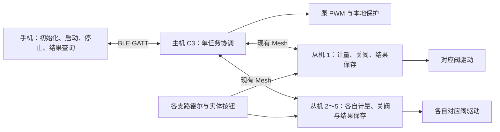

# 最基本功能整体优化方案：一主最多五从（2026-10-25）

方案对象：ESP32-C3 主机、ESP32-C3 从机、Android APP 当前工作区。

**交付目标：一台 ESP32-C3 主机，支持 1～5 台 ESP32-C3 从机；一次选择任意 1～5 路同时出水，各路独立计量、到量关阀。保留固定泵速、整任务停止、结果查询和维护模式下的实体按钮，并按五台同时在网、五路同时出水验收。**

2026-10-25 范围修订：用户已明确“最多一主五从”和“需要多路同时出水”，取代此前单从、单路运行的范围。首版同时运行能力必须达到 5，不能用五台已登记、轮流出水或串行分批代替。

实施路线是保留现有硬件、Mesh、协议和设备控制器，缩小功能入口，补齐影响基本闭环的缺陷。先完成最多五路同时定量，再考虑各路不同目标量、自动标定、复杂恢复和架构扩展。

本文是待实施方案。现有连接故障尚未完成实机根因验证，以下验收均为目标，不能作为已经修复或已经通过的记录。源码依据及整体评价见 [架构复评](ARCHITECTURE_REASSESSMENT_20261025.md)；既有通信诊断记录见 [SAR 修复方案](MESH_SAR_ROOT_CAUSE_FIX_PLAN_20261024.md)。

## 1. 首版范围

| 功能 | 首版要求 |
|---|---|
| 手机连接 | 连接主机，读到主机身份、运行状态和故障；蓝牙连接与业务就绪分别显示 |
| 添加从机 | 支持 1～5 台，逐台搜索 → 选择目标 → 配网/配置 → HELLO 与能力核对；已有节点优先读取、核对和重试配置 |
| 首次初始化 | 每台分别核对接线、有效 K、版本及固定 PWM；逐台人工 Commission 并回读确认 |
| 定量出水 | 多选 1～5 路，输入统一的“每路目标水量”和共同最大时限；所选路同时供水，各自到量关阀 |
| 停止 | 手机可停止当前远程任务；主机先停止本地泵，再发送关阀；界面等设备确认 |
| 结果 | 显示所选每路进度、最终计量和结束原因，汇总本任务；可查询当前任务，空闲时可查询最近一次结果 |
| 断连与重启 | 手机断连后设备自主执行；重连查询原任务；主从重启不续跑、不自动补水 |
| 实体按钮 | 主机进入整机维护模式并授权指定一路后，按住开阀、松开关阀；不触发主机水泵，自动任务期间五路均禁止本地开阀 |

使用边界：一台主机、最多五台登记并启用的从机、一部手机、一台共享水泵及最多五条各带霍尔与阀的支路。五台需同时保留登记、在线和独立状态；不能靠删除/重新添加来切换使用。一次只接受一个整机任务，该任务内部允许 1～5 路同时运行。

为复用现有启动协议，首版采用所选各路相同目标量，不把总水量平均分配。例如选三路、填写每路 500 mL，三路各出 500 mL，汇总目标为 1500 mL。各路可以先后到量，先完成的一路关闭后，其余路继续；最后一路结束后停泵。这里的“同时”指共同供水期间有重叠，不要求五个 GPIO 在同一毫秒翻转。

容量限制在 APP 和主机登记入口共同执行，第六台明确返回容量已满；搜索到候选设备不等于已经登记。主机配置、HELLO 自动登记、维护添加等入口遵循同一限制。保留现有 `MaxNodes=32`、任务掩码和 NVS 数组布局，增加产品容量策略，不把数组改成 5 破坏已有数据。如果旧设备已登记超过五台，保留数据、允许查询和旧任务对账，阻止继续新增并提示维护选择，不自动删除节点。

首版暂缓：各路自定义不同目标量、逐路单独停止、运行中追加支路/水量、运行中调速、三档自动标定、普通用户泵测试入口、复杂历史统计、完整删除重配向导、自动解除传输故障、未知结果人工结案解锁、多跳扩容、替换无线承载、双芯片和大规模模块重写。

隐藏入口时保留兼容处理：旧任务、旧泵测试、旧标定会话仍须能停止、查询和对账，不能因入口消失而永久锁住基本功能。维护诊断渠道保留。

## 2. 保留的最小架构

- 手机负责用户操作与任务对账；执行不能依赖手机持续在线。
- 主机负责最多五台从机的登记与状态、一个任务内的最多五路并发、共享泵输出、整机维护互锁及逐路结果留存。
- 各从机独立负责本支路阀输出、计量、到量关阀、租约与无流量保护；K、版本、启用状态和故障不能跨节点复用。
- 继续使用 `PumpSafetyController`、`MasterScheduler`、`FlowJobController`。首版只提取配置事务和结果保存的小接口，不先拆完 Application/ViewModel。

必须保留：消息认证、任务身份、防重复执行、先保存再授权、租约、最长运行、无流量、尾流结算和异常关断。它们是基本出水能力的一部分。

## 3. 两条完整操作流程

### 3.1 首次初始化

1. 手机连接主机，读取 Build ID、协议能力、泵状态与已登记节点。
2. 展示已登记的最多五台从机，按地址/稳定别名区分；目标已登记时先核对现有地址与状态，未登记时才搜索并添加。扫描结束必须给出找到/未找到，配置结束必须给出成功/失败。
3. 按 Composition → AppKey → Bind → Subscription → HELLO 推进，显示当前步骤、次数和总剩余时间。
4. 逐台读取从机 K/版本、能力、启用状态以及主机实际 PWM 档位；核对该支路有效计量参数。
5. 维护人员确认各支路接线和运行限制后，逐台显式 Commission 并回读确认。一台 READY 不能代表五台都就绪，Mesh READY 也不等于允许出水。
6. 核对主机报告的运行并发上限为 5、所有接入共享泵的登记支路已退出维护且关阀/模式核对完成；所选支路还须无未决任务、无故障、参数匹配且状态新鲜，才进入“可启动”。

固定 PWM 从现有档位中选择一个实测可起泵、符合驱动要求的档位。日常页不提供调速；主机重启后重新设置并回读。不要假定 65% 一定适用于现场泵。

计量只验收该档位：每路分别核对有效 K/版本，复用现有维护设置/标定途径，不新增三档自动流程，也不改变三档存储格式。主机使用三档校准记录时，应核对该节点当前档有效 K；没有该记录时核对其基准 K。默认 K 不能视为已完成现场标定，也不能把一路的 K 复制给另外四路。

固定 PWM 不等于固定支路流量。五路同时开、部分路先关、剩最后一路时，流量和尾流都会变化。必须验证一个固定档位下 1～5 路运行的可用流量、压力及逐路精度；改变泵速、K、传感器或水路后重新验证。若单路正常而五路不足流、末路过压或误差超标，先处理实际泵选型、驱动、支路阻力/稳压及计量条件；未通过前不能把候选五路构建交付为正式版本。

### 3.2 日常出水

1. APP 列出最多五台从机，用户选择 1～5 路，输入每路目标量与最大时限；启动前保存所选 slot/地址、每路目标及有效 K/版本快照。
2. APP 先保存请求，再发送一次启动；显示“等待设备接受”。GATT 写成功不能代替业务接受。
3. 主机按一个 JobKey 和多位 mask 保存整任务受理；所选各从机 PREPARE 先保存防重放边界。全部参与节点完成启动和新鲜租约确认、各自满足阀提前量后，才给共享泵供电；任一路准备失败不进入部分供水。
4. 每路独立计量、到量关阀并结算尾流，其他未完成支路继续供水；全部到量后停泵。人工停止或任一参与支路运行故障，主机先停泵，再请求本任务所有未确认关闭的支路关阀，首版不继续剩余路。
5. 各从机保存本路终态 → 上报 → 主机保存本路结果及任务报告 → 确认；APP 对齐整个 mask 的逐路终态并保存后显示整任务完成。
6. 结果待核实、停止待确认、存储异常时，不允许另起新任务。手机重连只查询原任务。

进度属于运行中估计；最终计量以对应任务、对应支路的已保存终态为准。汇总总量不能替代逐路结果，一路未知时整任务不能显示“全部完成”。重启中断或计量不能确认时显示“已中止/结果待核实”，不显示虚假成功。

## 4. 必须落实的代码调整

### 4.1 主从结果保存与确认闭环：出水验收前置项

**已确认缺陷：**从机 tick 产生终态后，同轮新 PREPARE 可能在保存前覆盖它；新 fence 又会清除旧 `resultValid`。保存失败后仍更新保存标记，导致不再重试。主机普通 Result 分支通常先 ACK、后由 periodic 保存，且周期保存失败仍设置 `savedJob_=true`。

最小修复契约：

| 环节 | 必须满足的顺序和失败行为 |
|---|---|
| 从机产生终态 | 先关闭输出、固定待保存快照；在接收可能替换旧任务的 PREPARE 前完成结果保存屏障 |
| 从机存储 | 写入及读回成功才更新 `savedKey/savedRevision`，才允许上报可确认的终态；失败保留快照、阻止新开阀、有界重试，耗尽后明确存储故障 |
| 主机接收结果 | 校验源地址、任务节点快照、JobKey、revision 和完整终态；先供调度器执行对应安全动作，再把已接纳的本路结果与任务报告持久化；保存成功后才发送该 revision 的 ResultAck；一路正常完成不误停仍运行的其他路 |
| 主机保存失败 | 先停泵、阻止新任务；不发送成功 ACK、不标记已保存、不向 APP 发布可恢复完成；保留待提交状态供有界处理 |
| 从机替换任务 | 旧终态持久化成功后才能被新 PREPARE 替换；ACK 只用于停止重传，不作为新任务放行条件 |
| 主机接受下一任务 | 上一任务报告与整个 selected mask 的逐路结果已保存、`unknown=0` 且无待提交快照后，才能持久化并接受下一任务；不能仅检查 scheduler 已停止或某一路结束 |
| 重复/丢失 ACK | 对已持久化且字段完全相同的结果可重复 ACK，避免重复写 Flash；错误 key/revision 的 ACK 无效；ACK 丢失只造成重报，不阻止合法下一任务 |
| 设备重启 | 从机恢复旧结果并重新报告；主机从持久化快照核对后可补 ACK；从机若提升 revision，需先重新落盘，再由主机接纳、保存和确认 |

关闭输出、紧急停机和只读查询不受结果屏障阻塞。本地按钮不替换远程结果：旧结果保存成功、且获得整机维护互锁许可后，才可按既有保护使用，不要求等待旧结果的无线 ACK；存储故障仍禁止新开阀。待提交结果存在时，APP、USB、泵测试、标定等所有新运行入口均须受保存门槛约束。

`TargetClosed` 等关断证明与故障告警应及时进入控制通道，不能为等待最终计量落盘而延后整机停泵；它们不代表最终 Result 已保存，也不能提前向 APP 宣告计量完成。需要新增非最终告警时，明确其身份、重报和接纳规则，不绕过最终结果保存后才能 ACK 的约束。

不要仅在从机循环里移动一行，也不要把 RAM 已接收视为主机已落盘。当前 `scheduler.result()` 返回 true 不一定表示 status 已接纳该 key/revision，不能据此无条件 ACK；重复结果应按明确字段比对，避免比较结构体 padding。保持现有 `ValveStatus` 和 NVS ABI；通过快照、成功标记及门禁实现。保存次数按结果 revision 控制，不在每次轮询或重复包时提交。

不增加“从机等 ACK 才接下一任务”的双端互等：现有主机接受新任务会覆盖最近任务记录，ACK 丢失后再重启可能缺少旧 ACK 的重发依据。由主机先保存上一任务再受理下一任务，即可满足最近任务留存边界，无需新增 ACK 的 ACK 或第二套历史存储。

停止入口须先通过来源/任务身份校验并执行关断，不能被普通运行入口的 `storageHealthy`、待保存或管理 Busy 门禁提前挡住；查询可返回故障和待核实状态。

本方案只保证当前/最近一次结果的留存。只有原任务已对账后，才允许用户明确启动下一任务；跨多次任务的永久设备历史不属于首版范围。

已知恢复限制：从机仅剩 fence、没有可信原计量时，`Reboot/Unknown` 不能被解释为成功结果。当前没有人工结案解锁接口；首版继续冻结并显示“结果无法核实，设备停用，需维护处理”。维护处理先保存日志、任务身份和未知记录，现场核查；重复查询、重启、`pump-reset`、清网或删除手机记录都不能被当作安全解锁办法。后续若要求这类故障后恢复使用，须另做保留未知事实的持久化结案机制；本方案不通过清零 unknown 绕过。

### 4.2 Mesh 配置：能够结束、解释失败、受控重试

沿用固定 `pump-sar-4` SDK、每步最多 3 次尝试及 12 秒退避。只保留一个在途管理操作，管理与出水互斥；重复点击只返回现有操作状态，不新建并行操作。手机断连不取消设备上的配置事务，重连后读取同一操作。

五台逐一配置，操作记录带目标地址/slot，界面显示当前目标及进度 `i/5`。某节点配置失败只标该节点未就绪；若 SDK 资源状态不可信则进入整机传输隔离，不能继续配置其他四台。不能用最后一个全局 READY 覆盖整组节点状态。

补充应用层截止，并使用实际单调时间检查；以下是待实测的保守初值：

| 项目 | 当前实现/核算 | 首版计划 |
|---|---|---|
| 扫描 | 当前 15 秒 | 到期输出扫描结束/未发现；不继续显示正在搜索 |
| 单次 SDK 响应 | 当前超时 15 秒 | 保留；另加 18 秒“未收到终结回调”检测 |
| 单配置步骤 | 理论最长 `3×15+2×12=69` 秒 | 本地步骤上限 75 秒 |
| 四步配置与 HELLO | 理论 301 秒，含 HELLO 25 秒 | 配置全程上限 330 秒，包含 HELLO |
| Provision 与配置 | 理论 391 秒，含 Provision 90 秒 | 总上限 420 秒；扫描另算 |

这些是应用层截止目标，需测量循环阻塞造成的检查延迟，不能宣传为硬实时保证。

计时起点固定：18 秒检测仅在等待 SDK 终结回调时生效；75 秒从该步首次提交起算，重试不重置；330 秒从配置事务开始起算，包含 HELLO；420 秒从 Provision 开始起算，扫描另算。任一截止触发先锁定失败/隔离状态，迟到回调不得重新推进已结束操作。

上述截止均按单节点计算。五台串行配置的预算上界为 `5×330=1650` 秒；五台全新 Provision 加配置为 `5×420=2100` 秒，扫描另算。它们是各节点截止相加的最坏预算，不是典型耗时，也不承诺五台共用 330/420 秒；首版不引入并行配网。

必须区分两种结束：

- SDK 正常返回超时且生命周期可确认：按现有退避继续，有界耗尽后 FAILED。
- 本地发现回调缺失、资源状态不可信或总截止到期：停止推进，进入 `RESTART_REQUIRED` 或等价隔离状态，阻断新管理请求，输出保持关闭。保留 NVS 和已有配网；完成对账后通过受控重启恢复，不假定旧 SAR 已释放。

状态至少包含 `operation、step、attempt、remainingTotalMs、reason、recoveryAction`。退避剩余时间与总剩余时间分别表达。失败界面指出是未发现、Provision 超时、AppKey/Bind/Subscription 失败、HELLO 未确认或需要重启，避免统一停在“配置 Mesh”。

当前回调只带地址/opcode 等信息，本地 operation/generation 只是诊断身份，不能自动识别同 opcode 旧尝试的迟到回调。底层关联不可信时先隔离；完成固定 SDK 的生命周期验证后再允许恢复。不能靠增加重试次数掩盖这一问题。

若固定基线再次出现相同 SAR 故障，使用已有双端 trace 核对分段、ACK、超时和上下文；有证据后再做静默或重发参数的单变量对照。截止和提示优化只能保证失败可控，不能代替无线根因修复。

### 4.3 最多五路同时运行：复用调度器，补齐整机门禁

现有 `MasterScheduler` 已有多节点 mask、每节点状态/租约、批次及结果；`pump_master_five_candidate` 已能把并发参数设为 5，但当前正式默认仍为 1，候选配置未完成硬件验收。实施时复用此路径，完成以下契约后再把五路参数纳入正式交付，不另写五套独立任务。

| 环节 | 首版要求 |
|---|---|
| 任务准入 | 一个 JobKey、1～5 位 mask、统一每路目标量与最大时限；主机强制容量与并发上限，拒绝超限、过期库存、旧结果未结清及维护占用 |
| 非目标支路 | 所有接入共享泵的登记支路均须处于已确认的自动锁定/关闭状态；未参与支路也不能靠按钮分走本任务的水；未完成模式核对时整机禁止启泵 |
| 启泵屏障 | 本批等于完整 selected mask，不拆成顺序批次；全部参与节点 PREPARE/START 有效、已确认新鲜租约、分别满足至少 300 ms 阀提前量后才启泵 |
| 启动失败 | 任一路拒绝、超时或失去有效启动证明，整任务失败并关闭已打开的阀，不能让其余路先出水或静默改成顺序运行 |
| 运行与正常完成 | 各路按自己的霍尔、有效 K 和目标独立计量；一路正常到量仅关闭本路，其余继续；最后一路关闭证明到达即停泵，终态另等各路尾流结算和保存 |
| 运行故障 | 任一参与路无流/断流、超时、租约失效、存储故障或传输状态不可信，整任务停止；主机先停泵，再向所有未确认关闭的参与路关阀，不做带故障降级续跑 |
| 结果 | 每路保留独立计量、revision、结束原因；mask 中全部终态已保存才能显示整个任务已结算，一路未知不能被其余路成功或总量覆盖 |

启动时序、续租和结果交错必须在五路负载下实测。当前 Opening 从第一条 START 实际提交起有固定 4 秒截止，命令最多 3 次、间隔 1500 ms；从机从开阀起首次无流量保护为 5 秒。接近 4 秒才起泵时，最早开阀支路只剩约 1 秒起流余量，还要扣除循环阻塞及泵/水路建立流量的时间。必须记录最早开阀 → 全部启动证明 → PWM 起泵 → 每路首脉冲，覆盖丢包/重试与最远支路；超出保护允许窗口时应整批安全失败。时序不达标须先定位排队或起流条件，不能仅扩大启动/无流量时间来掩盖拥塞。

共享泵不改变逐路计量口径：不把总量分摊给五路，也不把所有支路流量的简单变化当作某一路无流判断。每一路使用自己的脉冲和保护状态；全局聚合仅用于显示和整任务判定。软件阀关闭证明只说明输出命令已关闭，实水验收还须核对非目标路及已完成路无继续出水。

当前主机只有泵输出控制，没有总流量、压力或泵运行反馈。带水前须确认泵/水路能承受 5→1 路变化及所有阀已关而关闭证明尚在传输的短暂时段；必要的旁通、泄压或硬件联锁由实际水路确定。不能把从机无流保护写成主机已具备干转/堵转检测，也不能把固定 PWM 写成恒压/恒流控制。

资源预算先保持现有治理：SAR 并发 2、SDK RX16/TX8、发送 tickets 8/队列 64/预留 16；容量 5 不等于把分段发送并发改成 5。现有租约错峰、发送确认及优先级继续复用，先测峰值和最坏延迟，再按证据调整。五台 Mesh ADV 从机不是五条手机式 GATT 连接，不能用控制器 `MAX_ACT=6` 直接推导容量已满或已通过。

### 4.4 实体按钮：整机自动运行与本地维护互斥

只在同一从机内做本地/远程互斥不足以支持共享泵。例如 A 已先到量，B 仍在出水；此时 A 按钮重新开阀，就会分走 B 的水。首版必须新增主机持有的整机维护锁，不能只靠 APP 禁用按钮、广播一个 Busy 或等待状态上报。

| 模式/交接 | 必须满足的行为 |
|---|---|
| 上电默认 | 本地许可无效，按钮不能开阀；主机泵保持关闭，完成旧任务、维护许可与节点模式核对后才允许自动任务 |
| 自动运行 | 全部接入共享泵的登记从机禁止本地开阀，覆盖准备、运行、一路先结束、尾流及结果结算；单路 Done 不自动放行按钮 |
| 进入维护 | 主机先停泵，确认无在途自动任务、所有支路输出关闭且尾流结束；持久化维护锁后，只向指定一路授予有期限的按钮许可；其他支路仍禁用 |
| 维护期间 | 主机禁止所有自动启动、试泵和标定启泵；获许可支路按住开阀、松开关阀，本地按钮仍不自动启动共享泵 |
| 退出维护 | 停止续发许可，退役当前许可；收到对应会话的退役确认、按钮稳定松开、阀输出关闭、尾流安静且无故障的证明后，才解除主机泵门禁；重新核对全部共享泵支路的自动锁定状态 |
| 许可过期/失联/重启 | 从机关闭输出并取消本地许可；主机继续保持禁止启泵，不能仅凭自己的超时推断远端已关闭；缺少退役及关闭证明时保持维护待核实 |

许可必须绑定主机 epoch/操作 generation、目标节点身份和从机本次启动会话。退役操作建立拒绝旧许可的序号边界，迟到、重复和乱序的旧 grant 不得在退役后重新启阀；从机重启后旧会话许可失效。主机发出许可前保存维护锁，重启后仍不能遗忘可能在途的许可。持久格式新增内容应独立版本化/迁移，保留现有任务结果和 `ValveStatus` ABI；具体字段和消息长度在实现前固定，并纳入发送预算及失败测试。

共享泵支路集合包括仍物理接入水路、曾有本地开阀资格的登记节点，不仅是本次 selected 或界面已启用节点。禁用、删除、换址和清单刷新不能清掉待退役许可及主机阻断记录；失联许可持有者须取得可信关闭证明，或在明确物理隔离后走维护处理，不能通过删除记录恢复启泵。关闭证明不能只检查 `!localBusy`，必须同时核对对应许可已退役及尾流结束。

按下防抖、松开关阀、上电按住不启动，以及本地无流量/最长运行保护继续有效。保护触发或许可退出后必须松开再按，不能因一直按住而在获新许可时自动重开。本地开阀仍须经过旧结果已保存和存储健康门禁；本地计量不计入旧远程结果。

新增独立的小型节点运行快照，表达模式、本地/远程/空闲、输出命令、占用、维护会话及故障，变化时上报并低频刷新。普通显示可复用当前 10 秒心跳节奏，超过 15 秒未更新显示未知；自动启动还须取得当前事务的明确模式/关闭证明，不能仅凭未过期心跳放行。普通心跳缺失由主机按许可/租约/关闭证明统一裁决，APP 不自行把任意节点离线扩展成整机故障。首版对模式尚未核对、关闭证明不可信的支路保守禁止整机新启动，不通过“未选中”绕过。

新能力位、许可/快照消息与退役应答需主从同步实现和校验；旧固件不能被误认为支持。协议兼容号在实施时统一递增，既有 opcode 不重排。当前 GPIO6 外部联锁未启用，本方案不把硬件联锁写成已有能力。

手机“停止全部本次任务”作用于当前远程任务；本地维护依靠松开按钮关阀，退出维护通过上述专用退役流程完成，不用旧任务 key 冒充通用阀控。无法完成软件互锁前，只能在物理隔离并锁止共享泵供电的台架条件下测试按钮，不能据此宣布五路产品验收通过。

### 4.5 APP：初始化、五路选择与单任务操作

复用现有页面与导航，整理状态和门禁，不先重写 BLE 或 Repository。

初始化页最多五行，逐台显示别名/稳定地址、在线、Mesh 配置状态、能力、Commission、有效 K/版本及本地/远程/故障。日常页复用现有多选 mask 和逐路进度卡片，明确标注“每路目标水量”，显示所选路数和汇总目标；不为五路分别发送五条启动命令。

主机在当前连接会话内回报产品容量和实际运行 `maxConcurrent`，APP 确认其至少等于所选数才显示“同时出水”并允许提交。旧固件缺少能力字段、默认仍为 1 或能力不匹配时明确提示升级/未支持，不能把界面文案改成同时而设备实际按顺序执行。

| 日常页状态 | 用户看到的内容/允许操作 |
|---|---|
| 未就绪 | 显示具体缺项：离线、未启用、配置中、参数不符、本地占用或故障；可初始化/查询 |
| 可启动 | 最多五路多选、每路目标量、汇总目标、最大时限和固定档位；允许提交一个整任务 |
| 等待接受 | 禁止再次启动，可查询；点击停止先记录停止意图，取得原任务身份后立即停止 |
| 执行中 | 显示所选每路计量/运行/到量/尾流/故障，提供“停止全部本次任务”，不提供调速和追加水量 |
| 停止待确认 | 明确区分已发停止与设备已停止；继续查询，不提前显示完成 |
| 完成 | 每路最终水量、结束原因及整任务汇总/身份；整个 selected mask 已对账才允许下一次 |
| 故障/结果待核实 | 显示故障/未知结果及恢复动作；允许查询，有可识别在途任务时允许停止，禁止新启动 |

连接状态独立显示。手机断连提示“连接中断，设备继续执行”，重连后查询原任务，不自动重发启动。请求先用 AtomicFile 保存、匹配业务接受、终态不倒退等现有机制继续保留。

启动请求和对账账本冻结 slot → 地址/别名、每路目标与 JobKey 的映射，LIVE、FLOW、VOLUME、终态和历史全部使用同一任务快照。库存刷新、节点重新排序或维护修改不能把在途数据归到另一路；完整 BEGIN/NODE/END 库存未校验或库存变化尚未核对时禁止新启动。保留既有逐路终态与 measured/unknown mask 交叉核对，不只看总进度到 100%。

当前停止协议需要 JobKey。启动已被主机接受但首回包丢失时，APP 尚不能直接发该任务的有效停止；应保存停止意图、查询原 client/sequence，取得匹配 JobKey 后立即发送现有停止命令。期间显示“正在确认原任务后停止”，不能显示已停止，也不能重发启动。停止意图随原请求保存，APP 重启对账后仍执行，不扩展成无任务通用停止协议。

停止写入在 APP 队列中优先处理，但仍可能等待当前 GATT 写入（现有上限 5 秒）。APP 停止不能当作实体急停；界面与验收必须区分手机发送、主机收到以及输出关闭的时刻。

## 5. 实施基线与参数口径

以下是 2026-10-25 当前源码值，用于防止继续沿用过时手册；实施后以对应镜像回读和参数清单更新。

| 项目 | 当前值/状态 | 首版处理 |
|---|---|---|
| 主/从芯片 | 均为 ESP32-C3 | 保持 |
| 主机输出 | GPIO4、20 kHz PWM；默认档位 65/80/100% | 选择一个现场验证档位；核对驱动是否支持频率与电平 |
| 从机接口 | 阀 GPIO4、霍尔 GPIO5、按钮 GPIO3 | 保持；GPIO6 外部联锁当前禁用 |
| 产品容量 / 存储容量 | 节点表、NVS 和 Provisioner 均为 32；扫描候选 8 | 产品层最多登记/启用 5 台；保留 32 槽格式，超限旧记录保留并维护处理 |
| 正式默认 / 五路候选并发 | 默认 1；`pump_master_five_candidate` 为 5 | 完成并发、互锁和实水验收后正式交付 5；一次所选不超过 5，不静默分批 |
| 协议/SDK | revision 5、RequiredFeatures `0x05FF`；SDK `pump-sar-4` | 固定基线；新增节点状态时同步管理版本/能力 |
| 主机租约 ACK 超时 | 8 秒 | 保持并实测停泵边界 |
| 从机租约 | 12 秒 | 保持并实测关阀边界，不能写成旧文档中的 3 秒 |
| 开阀提前量 | 300 ms | 保持；START 确认只证明输出命令，不证明机械阀位 |
| 远程开阀等待 / 首次无流 | Opening 4 秒 / 从机开阀后 5 秒 | 五路下联测实际首脉冲余量，不以放宽保护替代时序治理 |
| 远程运行上限 | 主/从当前均为 240 秒 | 任务最大时限不能超过此值；按实际水路设置更短值 |
| 本地保护 | 首次无流 5 秒、断流 1.5 秒、按住最长 60 秒 | 保持并验收 |
| 本地开阀资格 | 当前仅本节点本地/远程互斥 | 新增整机维护锁、单路期限许可及关闭/退役确认；默认禁用本地开阀 |
| 运行进度 | 当前 live telemetry 周期 2 秒 | 保持，不增加高频轮询 |
| 业务 SAR / SDK 分段预算 | SAR 并发 2、RX16/TX8 | 先保持；实测五路租约、进度与结果突发后再调 |
| 控制循环 | 5 ms 目标周期 | 测最坏间隔与关断延迟，不能等同于 5 ms 响应保证 |
| 启动状态 | 主机 Off；从机首次默认未 Commission | 保持，上电不自动运行 |

主机当前编译配置 `commissioned=true`，这不等于从机已启用，也不等于已验证外部接线；不要在 APP 虚构一条现有不存在的主机 Commission 流程。

统一更新主从 `docs/PROTOCOL.md`、README、主机 `docs/COMMISSIONING.md` 及 APP PWM/出水说明，清理 revision 4、GPIO25、BOOT_LOCK、旧租约、旧占空比及“逐路出水”等不一致描述。记录产品容量、实际并发能力、每路目标量语义、维护互锁，以及硬件输出无机械反馈的边界。

## 6. 实施顺序、文件范围和阶段出口

| 阶段 | 工作与主要落点 | 出口 |
|---|---|---|
| P0 基线冻结 | 保存三仓现有改动快照/文件哈希、构建身份、SDK 补丁、参数；不回滚既有修改 | 可关联的主从/APP 版本表，保留现有 NVS |
| P1 五节点配置闭环 | 主机 `mesh_management.cpp`、`mesh_config_retry.h`、登记/HELLO 入口，APP Mesh 清单与状态；补容量 5、逐台截止、失败隔离和去重 | 五台分别可识别/配置，第六台有明确拒绝；断回调、正常超时、重复点击均有确定出口；全程输出关闭 |
| P2 结果闭环 | 主从 `application.*`、存储接口及必要控制门禁；主机持久化后 ACK、从机终态屏障 | 同轮新任务、写失败、丢 ACK、重启测试通过；未完成前不做出水通过判定 |
| P3 五路并发与维护互锁 | 主机业务入口/`master_scheduler.*`、主从 `protocol.*` 与存储、从机 `flow_job_controller.*`/`application.*` | 同一任务可同时 1～5 路；全员启泵屏障、一路先完成、故障整批停及许可乱序/重启测试通过；未选支路按钮也受互锁 |
| P4 最简操作界面 | APP `MasterControlViewModel.kt`、`MasterProtocol.kt`、`MasterLive.kt`、现有界面/对账模块；并发能力、五行清单、多选及逐路 K/结果快照 | 初始化与并发日常流程闭环；不把串行冒充同时；保留旧会话停止/恢复及待受理停止意图 |
| P5 离线与输出关闭验收 | 主从 host tests、SDK harness、Android JVM 测试、构建和双端只读通信 | 下节 A/B 通过后才进入带水输出验证 |
| P6 实机基本功能验收 | 1～5 路同时定量、逐路先后关阀、整任务停止、维护按钮、断连/重启与保护，记录实际输出时间 | 下节 C/D 通过，形成最多五路同时运行的交付记录 |

P1 与 P2 可按文件职责并行准备；P3 依赖结果屏障契约，P4 依赖设备状态定义。每阶段只补必要接口；大拆模块、异步存储和共享 SDK 包提取后置。

若测得 Flash、日志或管理阻塞使关断时限不达标，先隔离实际阻塞路径，并保留“保存成功后才能受理/授权”的门槛；不能为性能去掉持久化屏障。单独增加高优先级任务也不能证明问题已解决。

## 7. 验收标准

验收按 A → B → C → D 推进。下面的次数和误差是首版工程目标；所有结果逐项记录 PASS/FAIL/未测，不用构建成功替代实机通过。

### A. 离线与构建

- 主从 host tests、协议/角色一致性、固定 SDK pinning/SAR harness/序列持久化验证、Android `:app:testDebugUnitTest` 通过；主从固件与 APK 构建成功，改动无空白错误。
- 新测试针对真实边界：终态产生同轮新 PREPARE、保存/读回失败、ACK 丢失后立即启动新任务、错误 revision、重启恢复、旧回调、单次/总截止、按钮与远程命令交错。
- 五路边界覆盖：1～5 位 mask 与第六台拒绝；全部 START/租约/提前量证明前泵不能开启；一路先完成其他继续、最后一路关闭即停泵、任一路故障整批停；旧固件并发能力不足时不静默分批。
- 维护许可覆盖：grant/退役乱序、grant 丢确认、许可过期、按钮一直按住、主从分别重启、失联节点删除/换址；任何未完成退役的许可都不能因超时或清单变化放行共享泵。
- 复用已有 1/2/5 节点模拟、SDK 故障 harness 和五路提前量用例，新增缺失边界即可；不另造框架，不把模拟运行时长当作真实无线或水路证据。
- 存储失败不能更新成功标记，未落盘结果不能获成功 ACK；关闭和查询不能被等待屏障阻塞。
- 实现层测试需要可注入存储与时间/事件边界，不能只测试控制器而遗漏 Application 的实际调用顺序。

### B. 五台同时在网的配置与只读通信：至少 20 个系统轮次

- 沿用原方案每目标 20 轮门槛：每轮五台始终同时上电/在网，逐台完成验证，共 20 个系统轮次、100 个节点轮次；不能分摊成每台 4 轮。手机连接与断开各至少 10 个系统轮次，覆盖至少 2 次整组冷启动；记录步骤、耗时、五台身份和双端日志。
- 每个系统轮次内，五台各覆盖四步配置及 HELLO；无法安全重复配置已有节点时，可用同等分段收发强度的双向状态操作替代，并写明覆盖范围。每台每轮另做 3 次只读核对，普通只读不能单独充当配置验收。
- 逐台核对地址、能力、K/版本、Commission 状态及输出关闭；所有轮次泵 PWM 与五路阀输出为 0，不为验收自动 Commission。不为凑轮次自动清网；全新配网单独记录。
- 每轮五台正常流程均在各自截止内成功，各自结束为 `READY、online=1、无 restart_required`；任一目标的 SeqAuth 出现 `Ran out of retransmit attempts` 或 `Incomplete timer expired` 即该系统轮 FAIL，最终 READY 不能抵消。无关地址噪声单列，失败原始记录不得丢弃。
- 故障注入另计：回调缺失或链路失败时，必须在对应截止及已测检查延迟内退出，给出恢复动作，不能卡住或放行新任务。
- 已配置节点重试时，必须通过固定 SDK 的查询/回读确认 AppKey、Bind、Subscription 的幂等结果；本地“已发送”不算核对成功。
- 重试不自动更换密钥、清 NVS 或删除节点；APP 重复点击、断连重连不产生并行配置。
- 验证已有五台重启后清单不丢、不换槽；APP/USB/HELLO 等入口添加第六台均有明确容量拒绝，已有五台不受误删除。混用旧能力固件时能指出具体未就绪节点。
- 同步记录五台 HELLO/租约/进度/结果突发的队列峰值、SAR 在途/失败、丢事件、最低空闲堆、任务栈水位及最坏控制循环间隔。五台一起上电和手机连接时也须通过，不能轮流只给一台供电。

20 个系统轮次是本次基本功能通信门槛，不是长周期可靠性证明；也不自动完成原根因方案的静默 A/B、外设隔离等独立实验。B 的输出始终为 0，租约/运行进度等实际业务负载指标在离线模拟及 C/D 运行时补齐，不为测量而绕过输出关闭约束。

### C. 带水基本功能

| 场景 | 首版通过标准 |
|---|---|
| 单路基准精度 | 五个支路分别单独运行，固定档位下每路 200 mL、500 mL 各 5 次；各路独立量杯/称重，最终实际量误差均 ≤ `max(10 mL, 目标量×5%)`，尾流计入结算 |
| 五路同时精度 | 五路同时运行，统一每路 200 mL、500 mL 各 5 个整任务；每路每次均满足上述误差，不能只验收五路相加总量；手机连接/断开均覆盖 |
| 中间组合 | 两路 10 种、三路 10 种、四路 5 种，共 25 个组合，每组合至少 1 个整任务，使用上述一个目标量；逐路精度同样达标。连同单路及全五路覆盖全部 31 种非空选择 |
| 同时与先后完成 | 各组合均不拆顺序批次，所选路在共同供水期均有真实出水；非目标路无出水；覆盖某路先到量、其他继续及 5→1 路变化，已完成路不重开，最后一路关闭证明触发停泵，逐路尾流分别结算 |
| 启动时窗 | 记录每路开阀/证明/首脉冲与泵 PWM 时刻；在实际五路、最远支路和重试条件下均不因等待其他节点误触发无流保护；若超过窗口，安全整批失败且无虚假成功 |
| 单任务与连续性 | 连续执行至少 10 个多路整任务，不重复执行、不丢旧结果；反复点击启动和协议重复包不产生第二个任务或第二次出水 |
| 人工停止 | 五路执行中停止至少 5 次；主机收到有效停止到泵输出关闭目标 ≤50 ms，随后确认全部参与阀输出关闭/结果结算；手机到主机的 BLE 等待另记 |
| 本地按钮 | 五路分别取得维护许可测试；按住开阀时主机泵不启动，释放到从机 GPIO 关闭目标 ≤50 ms；未授权路、上电按住、持续按住保护后均不自动开阀 |
| 跨支路互锁 | 自动准备/运行/一路已完成/尾流/结果待保存各阶段，按未选支路及已完成支路按钮均不能开阀；维护许可仍有效或退役待确认时，所有远程启动/试泵/标定启泵被拒绝 |
| 状态/许可丢失 | 状态过期显示未知；未取得可信关闭/退役证明不能新启泵；许可过期从机自主关阀，失联主机继续锁泵，迟到许可不重开 |

上述定量共 85 个整任务：单路 50、全五路 10、中间组合 25，可同时计入连续性、先后完成及手机共存验证，不重复做同样的出水。每个整任务按参与路数记录独立结果，形成组合 → 节点 → 实际量/误差的表。首版统一每路目标仍会因实际流速不同出现先后完成；必要时用已核对的支路阻力制造先后次序，验证某路提前关闭后其余路仍能正确计量。

另验证“主机接受多路启动但首回包丢失时，APP 点击停止”：保留停止意图，查得原 JobKey 后停止整个原任务，无二次启动、无虚假停止提示。库存刷新/排序不能改变正在显示的每一路归属。APP 显示的容量和并发均为 5，历史单路固件不能被误识别为五路同时版本。

50 ms 指电气输出命令，不含机械阀闭合/泵停转惯性；在手机连接、五路日志和存储负载下测量，记录最大值。若无法达到则该项 FAIL，处理阻塞后复测，不能把循环目标当测试证据。另记录最后一路电气关阀到主机 PWM 关闭的延迟，并核对实际水路的全关承压条件。精度不达标先核对各路霍尔计数、有效 K、实际流速范围和尾流，不能用总量准确抵消单路误差，也不能回退串行后仍称达到五路同时标准。

### D. 断连、重启和保护

- 五路执行时手机断连至少 3 次，主从仍自主逐路到量结束；重连恢复同一 JobKey 及五路结果，不重启原任务。
- 主从断网：主机按每个仍运行参与节点最近一次获确认租约的发出时刻计算 8 秒边界，任一路失去有效租约即整批停泵；各从机按最后有效租约的接收时刻计算 12 秒边界关阀，外加实测控制检查延迟。该量级是否符合现场水路风险须在带水验收前确认；不合适时先调整控制设计，不擅自缩短租约掩盖通信问题。
- 无流量、断流、最大时限分别验证；故障注入轮换覆盖五个支路，任一路故障均触发整任务停止，其他路不能继续出水；逐路结束原因与最终/未知计量一致。本地对应保护触发后必须松开再按。
- 五路运行中主机重启至少一次、每个从机分别重启至少一次：本机输出回到关闭，主机按故障/租约边界整任务停机，不自动续跑或补水；手机能查询各路中止或待核实，不把一台重启解释为其余四路全部成功。
- 在从机终态保存、主机保存、ACK、新 fence 的关键边界注入重启/存储失败；已保存结果可恢复，未证实结果显示未知，不虚报完成。
- 传输资源状态不可信时保持故障冻结；受控重启后，只有取得旧任务可信终态并完成对账，才允许显式的新任务。原计量不可恢复时继续冻结，首版不含人工结案解锁；界面必须明确这一限制，不能循环提示重试即可恢复。
- 维护期间主机、许可从机分别重启/失联；许可过期后从机关阀，主机保持泵禁止。重连完成同会话退役或新启动会话的可信关闭核对前不能恢复自动运行；延迟旧 grant、退役应答丢失、节点删除/换址都不能解除未决维护锁。

## 8. 失败时的处理与交付判定

出现停止失效、意外输出、旧任务复活、未保存结果被覆盖或存储故障，立即停止输出验收，回到对应闭环修复。固定基线重复 SAR 故障时，暂停增加重试，先完成双端证据关联；外设目前仍连接，未做隔离前不能排除供电、驱动和线束干扰。

首版完成须交付：

1. 一组匹配的主机固件、从机固件、APK，含 Build ID、文件哈希、SDK 补丁身份、协议能力和参数表。
2. 三端最小功能改动说明、离线报告、20 个系统轮次/100 个节点轮次通信原始记录、31 种支路组合覆盖与 85 个定量整任务记录、停止/维护互锁/故障验收记录；未测项单独列出。
3. 对应镜像的五台地址/别名/有效 K/版本清单、共享泵接线/水路条件、逐台初始化、同时出水、维护按钮及重启恢复说明，清楚区分重启与清网。

实施本方案不默认清除 NVS、重新配网、修改现场接线或操作泵阀；现场动作沿用会话中已有授权和实际条件，输出验证在明确的测试条件下执行。无法进行某项现场测试时标为未验收。

**最终判定：A/B/C/D 全部通过，才称为“一主最多五从、最多五路同时定量的基本功能已交付”。离线通过、错误提示改善、五台已登记、串行出水或单次五路成功，都不能单独达到这一标准。**
