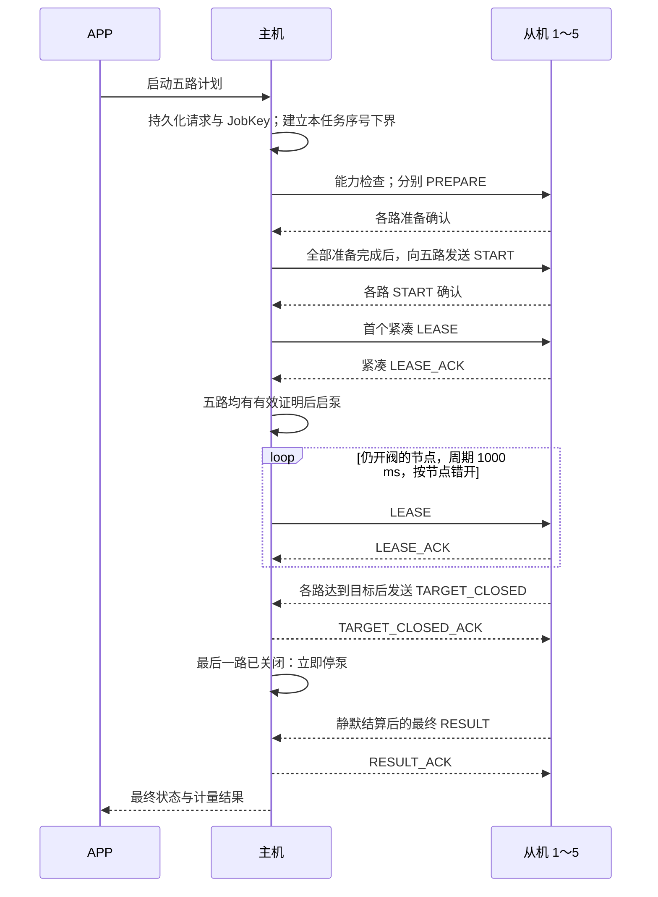

# 最多 5 路同时出水：启动、续租与关阀反馈修复方案

日期：2026-10-20。状态：方案已完成，代码尚未按本方案实施，尚未通过 5 台实机验收。

## 1. 交付目标与结论

**交付目标是最多 5 个从节点在同一批次中同时出水。** 五路可以设置不同水量；先达到目标的节点独立关阀，其余节点继续出水；最后一路关阀后主机及时停泵，之后收齐最终计量结果。逐路执行不能代替本目标。

采用两部分修复：

1. 修复启动握手：统一启动期限与租约证明年龄，减少重复命令确认，清除已失效的待发请求，补足精确日志。
2. 升级主从内部协议到 V4：正常续租、成功命令确认改为 8 字节非分段消息，增加 8 字节目标关阀事件及其确认；完成真实 5 路并发验收后，将生产 `MaxConcurrent` 改为 5。

V3 下的启动修复可作为对照候选，用来证明已消除现场失败；**最终 5 路交付使用 V4，不能只把并发常量改成 5 或扩大 SDK 缓冲池。** APP 启动、查询、停止及最终结果的字段布局保持兼容。

本方案的时限均为待验证的候选参数。软件测试、射频台架与实际水量三类验收必须分别记录，不能相互替代。

## 2. 证据、代码基线与尚未证明的事项

依据：[近期启动失败诊断](D:/pump/pump-muti/docs/RECENT_START_FAILURE_DIAGNOSIS_20261020.md)及其同名 JSON。原始日志位于 `D:/pump/pump-muti/.pio/diagnostics/recent-starts-20261020-203043/`。

| 已核实的事实 | 对修复的约束 |
| --- | --- |
| 任务 `142:74` 首次 Start 提交后 2400 ms 被取消；匹配且 OK 的首租约确认在 2680 ms 才到达 | 启动总期限需要覆盖真实握手时延 |
| 该确认的租约签发年龄为 1283 ms，现有启泵限制为不超过 1000 ms | 单独延长 2400 ms 总期限仍不完整 |
| 从机 CommandAck 分段占用出现 1116 / 646 ms，LeaseAck 又排队 459 ms | 300 / 600 ms 重试会制造重复确认；队列优先级不能抢占在途分段 |
| 本次故障期间 healthy 保持 1，faults、expired 未新增，未见非零发送错误 | 本次直接根因不是已证实的资源耗尽或离线 |
| 当前 `include/board_profile.h` 的 `MaxConcurrent=1` | 现有生产配置尚不支持五路同时出水 |
| 正常 Lease 为 12 字节、LeaseAck 为 13 字节，均分段 | 五路续租持续产生分段负载，需要消除这部分常态开销 |
| 从机进入 Settling 时不发状态；任务 `142:73` 有 TAIL_FLOW | 必须补及时关阀反馈，但不能据此认定所有尾流都是软件造成 |
| 当前租约匹配记录只有 3 条，运行期允许等待 8000 ms | 需扩展有界记录，防止较迟确认找不到原始签发时间 |

审计时 Git HEAD：主机 `96420a7`、从机 `f3494d7`、APP `24ddb0b`。主机已有未提交的白名单移除、诊断等变更；两端有 COM5 / COM6 配置。实施必须基于完整工作树保存差异，不能用上述 HEAD 覆盖已有修改。运行中的 build `18ed7b18 / c0f6b78c` 也不能等同于 Git HEAD。

尚未证明：另外 4 次零脉冲历史是否逐次具有相同根因；5 台同时运行的空口容量；关阀后的实际残流、机械密封及脉冲干扰比例；五路同时运行的泵流量、压力和计量精度。目前仅采集到地址 `0002` 的一台从机。

## 3. V4 正常时序与五路行为



- 五路启动属于同一批次，泵只启动一次；先取得确认的节点不能提前授权主泵。
- 先完成的节点从续租集合移除，但仍等待其最终 Result。只要还有正常出水的节点，主泵继续运行。
- 任一路发生拒绝、租约异常或本地故障，沿用整批先停主泵、再发 Close 的处理方式；不自动重复抽水补量。
- 某路在启泵前因残压达到目标并关闭：记录该路已关闭，停止向其发送 Start / Lease。若全部关闭则直接收尾；若仍有未完成节点，仅在其证明均有效后启泵。不能因迟到 StartAck 重新打开已关闭节点。
- 五路可以同批启动，但无线消息和阀门动作不会发生在完全相同的微秒。验收检查实际输出重叠及各路启动偏差。

## 4. 启动修复与候选时间预算

### 4.1 统一参数

| 参数 | 当前值 | 候选值与用途 |
| --- | ---: | --- |
| 能力探测阶段期限 | 10000 ms | 15000 ms，覆盖五台冷缓存探测；阀门仍关闭 |
| 主机 Prepare 阶段期限 | 10000 ms | 15000 ms，覆盖五路受控分段准备 |
| 从机 Prepared 等待期限 | 10000 ms | 20000 ms；只延长未开阀的准备状态 |
| 进入 Opening 后首个 Start 提交期限 | 与阶段期限混用 | 1000 ms；未实际提交即明确失败 |
| 首个 Start 提交后的固定启泵窗口 | 2400 ms | 4000 ms；重试不得延长 |
| 启泵租约证明年龄 | ≤1000 ms | **<2000 ms**，按 Lease 实际提交时间计算 |
| 单条能力 / Prepare / Start 的重试 | 300 / 600 / 1000 ms，阶段内持续 | 提交后间隔 1500 ms，最多 3 次提交，且不得越过所属阶段期限 |
| 正常续租间隔 | 1000 ms | 仍为每路 1000 ms；五路运行期相位按 0 / 200 / 400 / 600 / 800 ms 分散 |
| 主机运行期证明失效期限 | 8000 ms | 保持 8000 ms；按对应实际签发时刻计时 |
| 从机租约期限 | 12000 ms | 保持 12000 ms；重复序号不得续期 |
| 从机无首流 / 断流保护 | 5000 / 1500 ms | 保持 5000 / 1500 ms |
| 尾流静默 / 收尾上限 | 500 / 3000 ms | 保持 500 / 3000 ms |

首个启动租约应在对应 StartAck 接受后立即入队，不能为了运行期相位错开而再等 800 ms。取得首证明并启泵后，把下一次续租安排到“不早于上次实际提交 +1000 ms”的本节点相位点；允许这一次过渡间隔为 1000～不足 2000 ms，之后正常周期 1000 ms，另计不超过 50 ms 的控制 tick 余量。该过渡仍受 8000 ms 证明期限约束，不制造额外突发续租。

“阶段期限”和“从首个 Start 算起的期限”分开：尚未提交 Start 时使用 1000 ms 上限，首次提交后使用固定 4000 ms 上限，移除原来同时生效的散落 2400 / 4000 ms 条件。APP 受理到启泵还包括能力与准备阶段，不承诺总共 4 秒。

### 4.2 预算为什么暂定为这些数值

旧现场时序的 2680 ms 启动等待和 1283 ms 证明年龄均落在 4000 / 2000 ms 候选内；这只是覆盖已知失败的算术依据，不能证明五路上界。

无首流保护从从机第一次开阀计算。第一次开阀发生在主机首次提交 Start 之后，因此最早开阀节点需要满足：

```text
启动等待 4000 + 启泵至各路首脉冲 600 + 控制循环余量 50 + 保守余量 250
= 4900 ms < 无首流期限 5000 ms
```

五路实测必须证明**每一路**从启泵到首脉冲不超过 600 ms，以及首个控制循环和日志开销符合余量。若低档、管路排空或五路分流使该条件不成立，候选不能发布；优先缩短网络握手，或重新设计“已开阀、已供水”的两阶段控制并另行审查，不能直接放宽无流保护掩盖问题。

从机准备状态的延长与开阀保护不同：Prepared 不驱动阀门。验收还须保证第一台进入 Prepared 到收到 Start 小于 18000 ms，留出对 20000 ms 本地准备期限的余量。

### 4.3 启泵条件与记录

各节点新增并明确重置 `firstStartIssuedAt`、`startAckAt`、相应有效标志。不得依赖当前可能残留的 `openedAt`，也不得使用 0 时间戳代替“尚未发生”的状态。

只对本批尚未关闭节点检查：Start 已实际提交并被 SDK 接受、匹配的 StartAck 为 OK、Lease 已实际提交并被接受、匹配的 LeaseAck 为 OK、其签发时刻不早于 StartAck 接受时刻，且签发年龄小于 2000 ms。全部满足且未到固定期限才允许启泵。

ACK 先于本地 accepted 事件时先缓存，不提前授权；accepted 失败即按发送错误终止。第一次有效 StartAck 的接受时刻锁存，重复 OK 不刷新 startAckAt，也不改变第一次提交时刻、开阀时间、计量基线或任务期限。

租约记录数改为 `ceil(8000 / 1000) + 2 = 10`。每路每秒最多实际提交一次；不得因相位切换额外突发提交。cursor 显式模 10 回绕，避免 `uint8_t++ % 10` 在 255 回绕时跳槽。按现有字段每条预计 12 字节，32 槽增加约 `7 × 12 × 32 = 2688` 字节；以目标编译器 `sizeof` 和链接 map 为准。

## 5. V4 紧凑续租：消除五路常态分段

### 5.1 线格式

ProtocolRevision 改为 4；新增 `0x0040` 紧凑续租、`0x0080` 目标关闭事件、`0x0100` 紧凑成功命令确认能力，RequiredFeatures 从 `0x003F` 改为 `0x01FF`。两端实现一致，能力探测不兼容则拒绝启动。继续按协议与能力校验，不恢复 build hash 白名单。

| 消息 | V4 字段 | 字节 | 说明 |
| --- | --- | ---: | --- |
| C0 PREPARE | 原 35 字节字段，末尾追加 `leaseFloor:u32` | 39 | 完整 JobKey 保留；分段但只在准备阶段发送 |
| C1 START | 完整 JobKey | 8 | 保持原布局 |
| C2 LEASE | `epoch:u32, sequence:u32` | 8 | 正常续租非分段 |
| CE LEASE_ACK，成功 | `epoch:u32, sequence:u32` | 8 | 长度 8 明确表示 OK |
| CE LEASE_ACK，拒绝 | `epoch:u32, sequence:u32, reply:u8` | 9 | reply 必须非 OK 且在有效枚举内；异常路径允许分段 |
| CF COMMAND_ACK，拒绝 | 原 key、command、reply | 10 | V4 只用于非 OK 拒绝，保留详细原因 |
| D2 TARGET_CLOSED | 完整 JobKey | 8 | 只证明该路已因 Target 输出关阀 |
| D3 TARGET_CLOSED_ACK | 完整 JobKey | 8 | 与最终 ResultAck 独立 |
| D4 PREPARE_OK | 完整 JobKey | 8 | opcode 明确表示 Prepare 成功 |
| D5 START_OK | 完整 JobKey | 8 | opcode 明确表示 Start 成功 |
| C5 / C7 RESULT / RESULT_ACK | 保持原布局 | 27 / 12 | 保留最终计量、原因、revision、静默与截断状态 |

8 字节是本工程当前使用短 MIC 时的非分段业务载荷上限。必须同时通过实际 SDK trace 确认 V4 正常 C1 / C2 / CE / D2 / D3 / D4 / D5 均为 `seg=0`，不能只改治理器的布尔判定。

增加 D4 / D5 的原因是：即便正常续租不再分段，10 字节 StartAck 仍可能等在同 peer 的 PrepareAck 分段之后，再独占一次分段寿命，继续消耗 4 秒启动预算。V4 成功确认直接用 opcode 表达命令及 OK，完整 JobKey 正好占 8 字节；异常拒绝仍通过 CF 返回。V4 不接受 CF 的 OK 变体，以免两套成功格式混用。

### 5.2 不携带 job id 时如何防止串任务

不能简单截断 JobKey、使用概率 hash，或把没有序号的重复 Lease 当成新授权。V4 利用现有“启动 epoch 持久化递增、主机全局 Lease 序号不复用”的机制，并增加任务序号下界：

1. 新任务开始前，在传输锁内建立 LeaseScope：撤销所有旧任务尚未提交的授权消息，将当前授权作用域切换到新完整 JobKey，此后拒绝旧任务授权入队 / 提交，保留已经提交的真实 ticket；读取当前已分配的全局最大 Lease 序号，并取得 `leaseFloor = lastAllocated + 1`。该操作与 worker 分配序号是同一线性化顺序；序号已耗尽时建立失败，不能发 Prepare。
2. 本任务所有 Prepare 携带此下界。此时还没有任何本任务 Lease；同任务重复 Prepare 必须比较下界，变更则 Conflict。任务进入新一批时沿用同一有效作用域。
3. 序号在实际提交时由同一分配器全局递增，覆盖所有节点和全部任务；不能每节点、每任务、每批清零。新任务下界大于所有旧任务已经提交过的序号。
4. 从机只在本任务阀门已打开、epoch 等于完整任务 key.epoch、sequence 非零且不小于 leaseFloor 时处理续租；更新序号才延长租约，同序号仅重发确认，较小序号拒绝。已过期或已关阀状态不被复活。
5. 主机用来源节点、epoch、sequence 查本任务实际提交记录，恢复完整 JobKey；未知序号、旧记录或已取消任务的 ACK 无法成为启泵证明。
6. 主机重启前持久化新 epoch，然后才允许发送业务；从机重启关闭输出且不恢复开阀任务。序号达到上限拒绝继续分配，不能在同一 epoch 回绕。NVS 不能回退到会复用 epoch 的旧快照。

安全性依据是确定性的：同 epoch 的旧任务 Lease 都小于新下界；不同 epoch 的报文直接拒绝。即使旧 ACK 迟到，其序号也不匹配新任务提交记录。

序号不回绕，因此 V4 以“未见过序号 / 严格增大”判断，不再把新任务的第一个大序号与 0 做有符号半区比较。必须覆盖 `0x7FFFFFFF`、`0x80000000`、`0xFFFFFFFF` 和耗尽拒绝测试。

### 5.3 同步修正本地元数据与传输假设

当前治理器默认报文前 8 字节是 JobKey，Lease 序号位于偏移 8。V4 改格式后，这些假设必须一起修改。

- 为 `Packet` 增加只在本地使用的完整任务上下文，例如 `JobKey context`。发送 Lease / LeaseAck 时由已验证状态设置；不加入 `bytes`，不通过无线发送。
- C2 的序号分配偏移改为 4。授权 fence、pending 合并、提交回报、ACK 匹配和 trace 使用本地完整上下文；不能把 `(epoch, sequence)` 误解成 `(epoch, id)`。
- 接收包的 context 初始无效；经来源、活动任务及下界校验后才能关联到任务。未设置有效上下文的出站授权 Lease 不得进入队列。
- 成功 LeaseAck 只在相同 peer 和相同完整任务上下文内合并为较新序号，保留最初排队期限。负面确认不能被成功确认合并覆盖。
- 更新两端 opcode 注册表的最小长度、接收范围上界至 D5、接收类型过滤、urgent 分类、精确长度校验、冻结后的诊断允许表、TTL、优先级及 trace 解码。D4 / D5 映射回相应命令成功事件。旧 C0=35 / C2=12 / CE=13 以及 CF=OK 在 V4 中必须被拒绝，不能按前缀接受。
- D4 / D5 属于可推进启动的成功回复，冻结后不能加入诊断放行表；D2 / D3 只证明或确认关闭，可以在满足冻结恢复条件后作为非授权诊断消息发送。关闭事件与 Close 同为最高优先级；紧凑成功命令确认沿用原 CommandAck 的优先级。
- 两端共享治理器和诊断头保持逐字节一致。SDK 调用仍在锁外；不伪造完成事件，不提前释放 ticket，不扩大 SAR 并发。

本地上下文会扩大 Packet 及相关队列，需要把主从静态 RAM、接收队列、提交队列和任务栈一起计算到 map / 最小堆与栈高水位中，不只计算 10 条租约记录的增量。

### 5.4 五路容量预算

五路全开期间，每秒约 5 条 Lease + 5 条 OK Ack，共 10 条正常业务消息；V4 将其从分段消息改为非分段消息。五路 HELLO 及回复平均再增加约 1 条业务消息/秒。这里计算的是业务消息数，不是实际空口帧数，重传、转发、BLE 连接和射频争用需要另测。

维持主机 SAR limit=2、从机 limit=1，以及 Pending=64 / Reserved=16 / Tickets=8。正常 Lease 和关闭事件不受“同 peer 分段串行”规则阻挡，但仍受 BTC / ticket 和实际空口容量约束，不能宣称完全无等待。

准备阶段保留受控分段，避免把五条大 Prepare 同时塞进 SDK。主机采用滚动准入：保持现有最多一条普通分段在途，额外至多一条 Prepare 尚未提交，其余节点在 scheduler 中等待，按未确认节点公平轮询。不能让第五条 Prepare 在治理器队列等待接近 8000 ms，再用 15000 ms 阶段期限误以为不会过期。准入暂忙应返回“稍后再试”，不计实际提交次数，也不能映射为发送故障；真正入队失败 / 关键队列溢出仍执行原保护。重试不得饿死其他尚未首发的节点。

运行期周期调度错过相位时跳过已错过的周期，不追赶突发补发；每路两次实际提交至少间隔 1000 ms。运行期不恢复 SUMMARY 或周期 STATUS，避免为了显示流量重新增加常态分段负载。需要显示实时值的后续需求必须重新预算。

## 6. 重复抑制与旧阶段清理

以下均是有界操作，并与 worker 的 dispatch 使用同一传输锁。V3 对应 CommandAck，V4 成功确认对应 D4 / D5：

| 触发 | 处理 |
| --- | --- |
| 主机接受 PrepareAck / StartAck | 清理同 peer、同 JobKey、对应阶段尚未提交的请求副本 |
| 从机同一成功 CommandAck 已在途 | 完全相同 peer / key / command / OK 的新副本合并；不额外建立待发副本 |
| 在途确认已实际结束，主机仍重试 | 允许重发确认，恢复丢失业务 ACK；不永久禁回 |
| 从机合法处理 Start | 证明主机已越过 Prepare 阶段，清理该任务待发 Prepare OK；后续迟到重复 Prepare 不再制造旧阶段 OK |
| 从机合法处理新 Lease | 证明主机已取得 StartAck，清理该任务待发 Start OK；后续迟到重复 Start 不再制造旧阶段 OK |
| 同 command 出现拒绝 | 保留并优先处理拒绝，清理对应待发旧 OK；已在途消息仍正常跟踪 |
| 节点 Target 已关闭 | 清理该节点待发 Start / Lease，不影响本批其他仍运行节点 |

从机阶段证明按完整 JobKey 保存，进入新任务时重置。业务控制器的幂等语义仍然保留；这里抑制的是已经失去作用的成功回复流量。

不能用整个 JobKey 的取消 fence 清理某一路旧阶段：五路及其后续批次共享同一任务号，这会把仍需执行的节点一并禁用。禁止撤回已交给 SDK 的 ticket，重复抑制也不能把 SAR 结束当成业务确认已被收到。

## 7. 目标关阀反馈与最终结果分离

### 7.1 从机

本地 `shut(Target)` 完成输出关闭后，立即创建该任务的 TARGET_CLOSED 事件。它表达“阀门输出命令已关闭”，不声称有机械位置反馈，也不包含最终脉冲。

候选重试为首次立即发送，之后每 `250 ms + slot×10 ms`（slot=0～4）一次，最多 6 次；每次仍受治理器合并和固定 TTL 约束。收到匹配 ClosedAck 或最终 ResultAck 后停止重试并清理待发事件。达到重试次数后继续保存真实本地状态，按原最终结果流程收尾，不能重新开阀。

仅 Target 关闭生成该事件。Fault / Manual 等仍保留既有异常处理及最终 Result，不能伪装成目标成功。Target 关闭后收到已在途 Lease 时，回复当前关闭事件；进入终态后也可按原流程上报最终 Result，不能返回新的续租 OK。

### 7.2 主机

校验注册来源、完整 JobKey、本批节点及该路 Start 已提交的事实，锁存 closed 位；事件可以先于分段 StartAck 到达，因此不能强制要求 StartAck 已到。它不能设置 final / complete / measured，不能覆盖已有故障或最终计量。

重复事件重复确认。最后一条必要关闭事实到达后，在同次处理或下一控制 tick 停泵；继续等待各路静默结算。最终 Result 先到时可同时作为关闭事实，不必等待 D2。旧任务、非本批节点和下一任务的关闭事件不能改变本批状态。

事件丢失时从机会重试，最终 Result 也能补足关闭事实；两者均丢失则仍由运行期租约证明失效保护停泵。**当前该故障上界是最后有效 Lease 签发后 8000 ms 加控制循环余量，不是 500 ms。** 正常关阀的时延验收与完全失联的保护验收必须分列。

若泵或管路不能容许上述完全失联时的闭阀带压时长，则硬件旁路 / 联锁或更短且经过射频验证的主机证明期限是发布前置条件；现有主机没有压力反馈，软件不能提供未实现的压力保护。

### 7.3 收尾查询与计量

保留关阀后计量、500 ms 静默窗口和 3000 ms 收尾上限。进入 Draining 后先给主动终态和尾流结算留 3500 ms，再按全局每 1000 ms 查询一个缺失节点，替换当前每 300 ms 补查，以免结果重试再次挤占通道；10 秒收尾总期限保持有界。

最后仍缺结果则 UNKNOWN / Failed，不能把关闭事件转换成“0 mL 成功”，也不自动创建补抽任务。若及时停泵后仍出现 TAIL_FLOW，继续用关阀前后脉冲、真实称重 / 量杯、阀门与电气测量定位，不上调 quiet / settle 来隐藏故障。

## 8. 实施清单与顺序

| 阶段 | 文件与工程 | 实施内容 | 完成标准 |
| --- | --- | --- | --- |
| P0 证据回归 | 主机 `test/mesh_tests.cpp`、`test/core_tests.cpp`、诊断解析脚本 | 重放现场时序；独立控制 queued / committed / accepted / delivered / SAR end | 旧实现稳定复现 2400 ms 启动失败，新测试不依赖几十毫秒默认交付 |
| P1 启动与队列 | 主机 `include/master_scheduler.h`、`src/master_scheduler.cpp`；两端 `include/mesh_tx_governor.h`、`include/mesh_transport.h`、`src/mesh_transport.cpp`；从机 `src/application.cpp` | 统一期限、命令提交上限、10 条租约记录、阶段待发清理、在途重复 OK 抑制 | 已知现场时延模型可启动；超限模型明确失败，且不会无证明启泵 |
| P2 V4 紧凑控制 | 两端 `include/protocol.h`、协议编解码；主机 scheduler / transport；从机 `include/flow_job_controller.h`、`src/flow_job_controller.cpp`、application | LeaseScope、Prepare 下界与滚动准入、8 字节续租与成功命令确认、本地任务上下文、能力位与严格格式校验 | 跨任务 / 跨 epoch / 重复 / 序号边界测试全通过；正常 C2 / CE / D4 / D5 实际不分段 |
| P3 及时关闭 | 两端 application / transport / protocol；主机 scheduler；从机控制器或其状态变化出口 | D2 / D3 事件、重试、closed / final 分离、收尾查询节流 | 一路先关不影响其他路；最后一路关闭后及时停泵；最终计量完整 |
| P4 五路启用 | 主机 `include/board_profile.h`、两端测试与文档 | 台架候选将 MaxConcurrent=5，覆盖 1 / 2 / 5 路和不同水量；记录 RAM 与任务栈 | 全部发布门槛通过后，生产配置为 5 |
| P5 APP 兼容 | APP `MasterProtocol.kt`、`MasterHistory.kt` 及对应测试，均在 `app/src/.../com/cczb/app/` | 保持请求与结果格式；验证五路位图、逐路结果、异常及 UNKNOWN 显示 | 旧 APP 可控制新版主机，不把 FINISHED 当成成功；无需为内部 V4 新增手机线协议 |

主机 application 同时补 CommandAck 的 command / reply / applied 日志，以及 start_guard 的拒绝触发点。新增日志至少包含 peer、完整 key、epoch、sequence、首次 Start 提交、StartAck 接受、Lease 提交 / 接收、证明年龄、各节点 closed / final 位及具体失败原因。

内部触发原因区分 `START_DISPATCH_TIMEOUT`、`BOOTSTRAP_TIMEOUT`、`LEASE_PROOF_OLD`、`COMMAND_REJECT`、`TX_ERROR`、`PROTOCOL_MISMATCH`；仍可映射到现有外部 Reason，避免同时改 APP 存储格式。日志有界，不能在控制循环逐 tick 输出大量等待日志。

实际根目录：主机 [pump-muti](D:/pump/pump-muti/)、从机 [pump-muti-slave](D:/pump/pump-muti-slave/)、APP [pumpmutiapp](D:/pump/pumpmutiapp/)。实施时同步更新 `docs/PROTOCOL.md`、原最小交互方案及打包能力检查，明确新关闭事件取代“只保留终态即可及时停泵”的旧假设。

## 9. 验收矩阵

### 9.1 必须先补真实时延模型

现有仿真默认业务报文在 20～40 ms 交付，即使分段寿命设置成 3200 ms，也不会自然制造现场的业务确认排队。这不意味着业务交付必须等 SAR end；新模型要分别控制两者，覆盖两种合法先后顺序。

| 场景 | 必须验证的结果 |
| --- | --- |
| 旧 V3 原始时序：启动 2680 ms、首证明年龄 1283 ms、重复确认占道 | 旧实现失败可重现；P1 覆盖已知时序，重复流量实质下降 |
| V4 五节点启动，Prepare SAR 或已有非授权 SAR 有 1116 / 646 / 1514 ms 等占用 | 非分段成功命令确认、Lease / Ack 不被同 peer SAR 限制阻挡；全部证明有效后一次启泵 |
| 证明年龄 1999 / 2000 ms；启动时间 3999 / 4000 ms | 明确边界，等于期限即不能启泵；不因重试滑动 |
| ACK 先到、accepted 后到 / 拒绝；SAR end 先于业务 ACK | 只在实际提交且被接受后应用有效证明；不伪造完成 |
| 关闭、取消后迟到的 StartAck / LeaseAck / TargetClosed | 不重新启泵、不恢复续租、不污染下一任务 |
| 同 epoch 上一任务 Lease 延迟到下一任务；跨 epoch 旧 Lease | 前者低于新 floor 被拒绝，后者 epoch 不符被拒绝 |
| scope 建立与 worker 提交竞争；五个节点全局分配序号 | 不存在旧任务提交序号大于等于新 floor 的路径 |
| 五路 Prepare 各有较长分段寿命，命令重试与首发竞争 | 滚动准入不让待发请求因堆积过期，重试不饿死第五个节点；若阶段确实超时则准确失败 |
| 序号大于 2³¹、达到 UINT32_MAX、主机重启 | 大序号可正常首次接受；耗尽拒绝且不回绕；重启用新 epoch |
| 同序号重放、较旧序号、已过期租约、新 Lease 被反复复制 | 重复不续期，旧包和过期包不能复活阀门 |
| 第 4～8 秒才到达的有效记录、记录环 cursor 超过 255 | 记录保留 / 过期判断正确，不因 3 槽或 cursor 跳槽丢失匹配 |
| 一路很早达标、五路同时达标、关闭事件 / ACK / Result 各自丢失 | 部分关闭继续供水；全关闭及时停泵；计量与关闭证明互不冒充 |
| 五路中一台拒绝、掉电、SAR 无结束、关键队列满 | 主机先本地停泵；其他阀门最终关闭；保留真实 ticket；缺量标记 UNKNOWN |
| V3 / V4 混装、旧长度报文、未知能力、来源不匹配 | 明确兼容错误，不误抽水；build hash 改变本身不拒绝 |
| 5 路同时，反复随机延迟 / 丢包 / 重复，至少 1000 批 | 支持的时延包络内全部正确；超包络可保护失败；无泄漏和无授权输出 |

主机和从机 host tests 都执行；主机测试脚本已有共享头一致性检查。编译真实 `pump_master` 与 `valve_slave_c3` 候选，运行既有 SDK tracked-send 回归；这些通过仍不能代替射频验收。APP 若未改业务代码，执行现有协议、历史及逐路结果相关回归即可，不增加只复述常量的测试。

### 9.2 五台实机与实际水路

以下为最低样本量，均属于待执行计划：

| 批组 | 数量与条件 | 通过要求 |
| --- | --- | --- |
| 单路基线 | 至少 50 批，轮换覆盖 5 个节点 | 全部正常受理、启泵、计量和结算，无无法解释的零脉冲失败 |
| 两路并发 | 至少 50 批，轮换节点组合 | 两路有真实重叠出水，先关一路不导致另一条提前停止 |
| 五路并发 | 至少 200 批，含相同量和不等量；覆盖 100 / 200 / 500 mL、冷 / 热能力缓存、支持的泵速 | 有 5 路真实同时出水；正常工况全部成功，任何正常批次失败均暂停验收并保存完整证据 |
| 五路持续运行 | 至少 8 小时混合任务，遵守泵占空比和冷却限制 | 无发送冻结、非预期复位、上下文耗尽；静止后业务 pending / inflight 回落为零，无随批次增长的堆 / 栈消耗 |
| 故障注入 | 各节点轮换断电 / 丢 ACK / 人工停止；每类至少 10 次 | 无证明不启泵；先停泵再无线关闭；缺失结果不被写成成功；不会自动补抽 |

正常射频工况的定量门槛：

1. 每批首次 Start 提交至启泵最大值 **<4000 ms**，P99 目标 **≤3000 ms**；各路启泵证明年龄均 **<2000 ms**。记录每台的分布和最大值，不能只看平均数。
2. 五路 Start 执行时刻最大偏差候选 **≤500 ms**；启泵至每路首脉冲 **≤600 ms**，控制循环最大间隔 **≤50 ms**。跨设备测量使用统一采集基准、GPIO / 逻辑分析仪或校时，不能直接相减设备 uptime。
3. 最后一路 Target 输出关阀至主机停泵，P99 目标 **≤300 ms**，正常工况最大 **≤500 ms**；主机接收到最后关闭证明至停泵 **≤50 ms**。注入丢包时按已声明重试 / 租约上界单独验收，不能混作正常时延通过。
4. 正常 C1 / C2 / CE / D2 / D3 / D4 / D5 的 trace 全为 `seg=0`；无 QUEUE_FULL、业务 QueueExpired、MissingCompletion、SAR/API 错误或 `restart_required=1`。HELLO 的允许超时单独记录，不能拿历史累计值当本批新增错误。
5. 有最终结果的正常批次：全部 selected 位得到可信最终结果，failed=0、unknown=0，reason=Target，quiet=1，truncated=0。关阀后脉冲保留，主从及 APP 最终量一致。
6. 每种水量、支持泵速和并发数都实际称重或量杯核验。建议首版候选误差门槛为 **±max(5 mL, 目标量×5%)**；若产品已有更严指标，执行更严指标。此值是待确认的产品验收建议，不是现有精度承诺；超差必须继续修复标定 / 阀门 / 尾流问题，不能仅凭脉冲折算宣称达标。

零失败样本只能证明上述测试范围。即使 200 个五路批次零失败，也不能宣称永久不会发生无线丢包；方案交付的是明确包络内可用、包络外有界停机和可信结果。

## 10. 发布、回退与最终交付物

1. 先保存现有差异、版本标识、SDK 补丁摘要、配网 / 标定和当前存储格式；保持用户 COM5 / COM6 配置。准备可以回退的主从固件组合，禁止为解决缓存或升级而擦除 NVS。
2. P1 可用 V3 单路候选做现场对照；P2 / P3 为 V4 成套候选。升级时停止任务并确认泵阀输出关闭，完成全部目标节点升级和能力检查后再运行；混装应明确拒绝。
3. P4 在台架将 MaxConcurrent 设置为 5 完成全部门槛，再发布该五路配置。实际只有一台从机时，报告状态只能是“单路验证完成、五路待验收”。
4. 任一无证明启泵、取消后重新输出、结果被旧任务污染、重复补抽、资源泄漏、正常工况持续启动失败，立即停止放量并保留触发前后全量日志。若水力 / 精度未达标，也不能以网络通过宣布整机完成。
5. 退回已知主从兼容组合前核对实际存储格式。V4 本方案不要求新增持久化计数器或迁移结果格式；若实现过程中改变了持久化 Dose / Packet 的裸结构，必须补迁移或改为显式编码，不能直接降级覆盖。不可逆数据格式变化另行标注后才制作发布包。

最终交付：主从代码与编译固件、五路生产配置、V4 协议说明、现场时序回归、5 台实机测试清单与原始日志、每路流量实测、内存 / 队列统计、APP 兼容结果、版本和回退说明。只有这些证据齐备，才能标记“支持最多 5 路同时出水并达到验收标准”。

## 11. 设计复核：十个必须回答的问题

| 复核点 | 本方案的处理 |
| --- | --- |
| 只延长启动超时是否够用？ | 不够；同时处理证明年龄和确认拥塞 |
| 单路通过能否证明五路？ | 不能；五台真实重叠出水是独立发布门槛 |
| 压缩报文会不会丢失任务隔离？ | 完整 Prepare 绑定 epoch / floor，全局序号不复用；专门验证交错竞争 |
| 高优先级能否抢占已在途分段？ | 不能；正常续租与关闭事件改为非分段，仍承认 BTC / 空口限制 |
| 抑制重复会不会使丢 ACK 永久无法恢复？ | 只抑制在途副本或已被后续阶段证明收到的旧 OK；真正重试仍能恢复 |
| 把 ACK 接收时刻当租约起点是否更容易启动？ | 不采用；始终使用实际签发时间，不虚增租约 |
| 五路中有一条先完成是否立即停泵？ | 不会；只有所有本批节点均已关闭才正常停泵 |
| TargetClosed 是否等于最终成功？ | 不等于；最终脉冲、静默、故障仍由 Result 决定 |
| 扩大等待会不会掩盖无流、尾流和硬件异常？ | 无流 / 尾流保护不放宽；Prepared 延长只发生在未开阀状态 |
| 仿真全绿是否就可以发布？ | 不可以；必须完成五台射频、八小时运行、称重与故障注入验收 |
