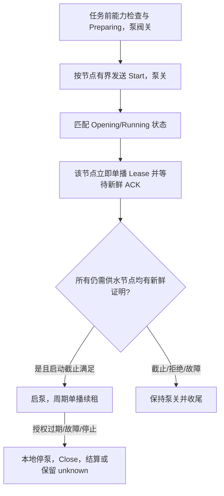

# 最多 5 路定量抽水：十轮工程复核与实施方案

日期：2026-10-19。主机基线 `ad43f28`，从机 `56821a3`，APP `4c8ea4a`。

设计阶段状态：本文形成时完成源码复核、方案设计和离线复算，尚未实施控制代码或进行 5 台实测。随后已实施软件改造并完成自动测试，最新结果见[实施与验收交接](MESH_IMPLEMENTATION_ACCEPTANCE_20261019.md)；硬件验收仍待完成，生产 `MaxConcurrent=1`。本文保留设计阶段依据，作为上述基线下的 **5 路实施入口**；与早期通用方案的选择、顺序不同处，以本文为准。

## 1. 推荐决策

采用一套完整改造：**沿用现有任务报文，续租改为本批逐节点单播；双端统一合并、退避和发送窗口；SDK 提供带票据的真实分段终态；Opening 建立新鲜授权后才启泵。**

先做 SDK 桥接原型并固定构建输入，验证能取得真实终态，再实施业务调度。单路通过后递进验证 2 路、5 路。正式开放 5 路须通过通信、保护和量杯验收，不能只修改并发常数。

这一选择针对最多 5 路，避免立即重做实时协议。它可以约束业务分段占位、消除重复命令的负载放大，并在链路不满足时限时停止；不能使任意射频故障下的任务都成功，也不能直接证明 500 mL 的物理精度。

## 2. 十轮复核：证据、修正和出口

“十轮”在这里指十项可检查的工程审查。以下列出审查结论与反例，不将假设写成实测。

| 轮次 | 复核问题与证据 | 本轮确定的修正 | 验收出口 |
|---|---|---|---|
| 1：现场归因 | 单从机已出现 TX 上下文耗尽和 LEASE。完整复现任务 `116:27` 目标为 200 mL；500 mL 历史 `116:26` 有 LEASE 终态。现场固件与当前源码身份未对齐 | 先定位确认/租约链；不把所有历史失败归为同一原因，不把设备 0 脉冲等同量杯 0 mL | 每台有构建身份，日志能关联 job、节点、阶段和停止原因 |
| 2：资源单位 | TX=8 是每设备分段消息上下文数；Status 的 3 段通常共用 1 个消息上下文 | 每目的地址至多 1 条在途分段；主机全局业务窗口 2，从机实际窗口 1 | 记录实际提交和终态，占位有界；不能以 5<8 作为容量证明 |
| 3：SDK 终态 | API 为异步 BTC 投递；现有 send-comp 在核心发送函数返回后触发，尚未等 SAR 结束；reset 有不触发 end 的路径 | 新增 tracked-send 桥接；正常终态和提交失败分开处理；缺失回调冻结窗口并停机，不能定时假释放 | 立即失败、异步失败、end 先到、重复/缺失终态、reset 均通过故障注入 |
| 4：正常组播成本 | 本地 IDF 5.4 Mesh v1.0 组播分段固定初发+4次重复；间隔 50 ms，寿命还包含广告和排队 | 原 24 PDU/s 仅为排除全部 SAR 重复的基础值；5 台计入固定组播重复为 32 PDU/s | 预算区分基础、固定重复、网络重复，额外单播重传另测 |
| 5：续租方式 | 所有订阅组节点都会回复 Lease，包括闲置节点的 STALE；5 台组播 Lease 的固定重复抵消其一发多收的数据优势 | 逐节点单播 Lease，每运行节点约 1 Hz；只给本批已确认开阀、仍需供水者授权 | 闲置节点不被续租唤醒；每路授权和拒绝可单独关联 |
| 6：重试恢复 | 剩 1 台慢节点时，现有全局轮转退化成每 150 ms；重复 Prepare/Start 强制 Status | 按节点退避；合并待发意图；新 revision 和显式 StatusGet 仍能恢复状态 | 首轮公平；慢节点不会生成无界 Status/EventAck；已确认 Prepared 不压掉新的 Opening |
| 7：时限与不可抢占 | 已发送的遥测 SAR 无法被 LeaseAck 抢占；固定等 300 ms 也不能证明旧会话结束 | 用真实窗口限制；授权按截止优先；普通分段发出前检查余量；延迟超预算即安全退出 | 阻塞遥测、丢 SAR ACK 时不放宽保护、不假造窗口释放 |
| 8：启动和授权年龄 | 从机 Start 开启 3 秒租约，当前 Opening 可等 4 秒；NoFlow 5 秒也从 Start 而非启泵计时 | Opening 对已开阀节点立即单播续租；启泵需全部必需节点新鲜证明；证明从本地提交前时刻计，不从 ACK 到达时计 | 未获证明泵始终关；首脉冲预算纳入启动；旧/重复 ACK 不续命 |
| 9：停止、重启、混用 | 停止标志检查与 API 调用存在竞态；已进入 SDK 的报文不能可靠取消；旧端不会自动具备新调度能力 | 定义发送提交点及停止屏障；本地先停泵；保留 fence；任务前能力/构建检查，不支持则拒绝 | 屏障确认后不再 commit 旧授权；迟到包不能复活关闭任务；重启不自动重跑 |
| 10：可验收性 | 名义 PDU 和正常平均占用不代表最坏延迟；通信正常也不证明水压与 K | 分 SDK、调度、时序、故障、实水五类门槛，按 1→2→5 路验证 | 日志、构建产物、量杯数据齐全后才调整生产并发 |

## 3. 为什么选逐节点单播续租

保持 Lease 的 12 字节、LeaseAck 的 13 字节及完整 JobKey/seq 不变，只改变主机发送目的地址和调度。仍需要双端升级，因为发送结果、合并及授权证明行为也会变化。

### 3.1 预算修正与比较

令 A 为本批稳定运行且阀打开的台数，R 为定期 Hello 的登记节点数，G 为在线收到组播并回复的台数。以下假设 R=G，广告承载、network count=1，无额外单播 SAR 重传、阶段事件、管理流量、代理转发或中继。

```text
当前基础数据量，排除全部 SAR 重复：2 + 2G + 1.5A + 0.9R
当前计入组播 Lease 固定 5 轮：     10 + 2G + 1.5A + 0.9R
推荐方案，单播+常规 Hello 不补查：  5.5A + 0.3R
单位均为 lower-transport 数据 PDU/s，未计 SAR ACK 和 beacon。
```

| 场景 | 原基础值 | 原实现含固定组播 SAR 重复 | 推荐方案 | network count=1 后，原实现→推荐 |
|---|---:|---:|---:|---:|
| 5 台在线、1 路运行 | 18.0 | 26.0 | 7.0 | 52.0→14.0 |
| 5 台在线、5 路运行 | 24.0 | **32.0** | **29.0** | 64.0→58.0 |
| 32 台在线、5 路运行 | 102.3 | **110.3** | **37.1** | 220.6→74.2 |

5 台全运行时，组播 Lease 为 `2段×5轮=10`，5 条单播 Lease 也为 `2段×5=10`；LeaseAck 都为 10。因此单播的理由主要是**目的明确、消除闲置应答、避免 Lease 与组播 Close 共用同一目的地址的分段窗口**。主要稳定减流来自正常 Hello 不再每次触发完整 Status 查询。不能将本方案宣传成 5 路时流量下降数倍。

Hello 维持 10 秒周期，常规链从 9 PDU 降为 Hello(2)+HelloReply(1)=3 PDU。首次发现、unknown、必要恢复和任务前能力检查仍有额外流量；它们不包含在上述稳定预算里。32 台一行仅作部署差异评估，不能作为已支持 32 台后台的证明。

组播 4 次重传的等待合计至少涉及四个 50 ms 定时，但排队和实际广告耗时还要累加；**200 ms 不是组播 SAR 寿命上限**。单播 TTL=3 的重传定时为 550 ms，ACK 丢失会迅速消耗时限；单播方案也必须实测。

### 3.2 发送窗口有没有吞吐余量

稳定 5 路时，主机至少每秒提交 5 条分段 Lease，每台运行从机每秒约提交 `1 LeaseAck + 0.5 Summary + 0.1 Hello = 1.6` 条分段消息，不含阶段突发。

以 S 为示例平均 SAR 会话寿命，主机窗口 2 的必要条件为 `5S < 2`；从机同目的窗口 1 的必要条件为 `1.6S < 1`。

| 示例平均寿命 S | 主机窗口 2 的必要利用率 | 从机窗口 1 的必要利用率 |
|---:|---:|---:|
| 100 ms | 25% | 16% |
| 200 ms | 50% | 32% |
| 300 ms | 75% | 48% |
| 400 ms | 100%，无稳定余量 | 64% |
| 550 ms | 137.5%，无法持续承载 | 88% |
| 1000 ms | 250% | 160% |

这是必要平均负载检查，不是排队仿真、空口容量或最坏时延证明。正常台架可先以 **SAR p99≤200 ms、Lease 从提交到应用 ACK p99≤800 ms** 为性能目标，同时记录 max 和每次安全截止是否满足；这些是待验证门槛，不是已测结论。连续超预算时缩小 batch 或退出任务，不能自动增加窗口来维持出水。

## 4. 第一个落地项：SDK 桥接原型

### 4.1 固定输入和补丁范围

本机为 `espressif32@6.10.0`、framework 包 `3.50400.0`、IDF `5.4.0`，主从均未开启 Mesh v1.1。保存了[本地 SDK 与配置哈希清单](D:/pump/pump-muti/docs/MESH_SDK_BASELINE_20261019.json)。它是分析输入，不代表现场设备或补丁后固件。

后续补丁放入版本库，在项目专用的 SDK 包副本中应用；构建脚本核对输入哈希和补丁版本，不匹配就失败。禁止以手工改全局 PlatformIO 缓存作为可交付构建方式。

| SDK 文件 | 最小改动 |
|---|---|
| `api/core/esp_ble_mesh_networking_api.c` 及对应 API 头 | 增加 `...server_model_send_msg_tracked(..., uint32_t ticket)`；保留旧 API，明确新 API 的接受/拒绝契约 |
| `btc/include/btc_ble_mesh_prov.h` | model-send 参数带 ticket/是否跟踪标记，普通发送初始化为不跟踪 |
| `btc/btc_ble_mesh_prov.c` | ticket 随 BTC 复制；检查 deep-copy 的 ctx/data 分配失败；把稳定 send-callback 和 ticket 传入核心发送；转发提交结果和真实 end |
| `core/transport.c` | 首版优先复用现有 `seg_tx_complete → cb->end`；审计每个 reset/直接错误返回路径，不把 reset 等同于收到 end |

不在首版加入主动取消 SAR、改变底层重传次数或重写 transport 的功能。若桥接原型无法通过下述边界验证，暂停业务整合，保持单路配置。

### 4.2 事件契约与生命周期

建议公开三类结果：`StackAccepted(ticket)`、`StackRejected(ticket,error)`、`SarEnded(ticket,error)`。API 同步拒绝另记 `ApiRejected`。未分段 Start 等只占 BTC 提交额度，不占 SAR 窗口；其 StackAccepted 也不代表对端已执行。

1. transport 所有者在 API 调用前登记 ticket、目的地址、generation、是否分段和 issuedAt，再占用相应额度；API 同步失败恰好回收一次。
2. API 返回成功后，等待内部结果。核心明确拒绝时回收；分段 StackAccepted 不能释放 SAR 窗口，必须等真正 SarEnded。
3. 使用进程内不复用的非零 32 位 ticket，通过稳定 callback 和 `uintptr_t` 传递；禁止把栈变量、BTC 临时 ctx 或可复用 cookie 地址当异步关联身份。回绕前停止接收新任务并安排安全重启。
4. SarEnded 或应用 ACK 可能早于 StackAccepted 被业务消费。每 ticket 保存独立结果位并统一收敛，只释放一次；旧 ticket 的迟到事件不能释放新 ticket。
5. 回调只写固定结果槽和唤醒标志，不执行 Flash、不等待业务队列。每个在途 ticket 的提交结果和终态分别保存，唤醒允许合并，终态不可因队列满丢失。
6. 核心返回错误前可能已处理部分段；StackRejected 只代表本地无该有效会话，不能反推出空口绝无残片。活动任务出现意外 EBUSY/分配失败时记录异常并停止，不立即对同目的地址高频重投。
7. `bt_mesh_tx_reset`、`bt_mesh_tx_reset_single` 存在直接 reset 且不回调的路径。运行期间拒绝配网、删除节点、密钥重配和本地 Mesh reset；若发生意外 reset/缺失回调，停泵、从机本地保护关阀、冻结相关窗口，进入故障态。只在确认堆栈整体静默或重启后重建窗口，普通超时不能作资源已释放的证明。

必须先在主机 ESP32、从机 ESP32-C3 两个构建目标通过干净构建，再做无水故障注入：API 失败、BTC copy/alloc 失败、核心拒绝、正常 end、重传耗尽、end 先到、重复 end、reset 无 end。只证明正常路径能回调不足以合入。

## 5. 业务发送器：合并、有界、公平

### 5.1 单一所有者与额度

双端 `mesh_transport.h/.cpp` 统一接管所有业务发送入口；控制循环仅提交意图、读取结果，不等待无线。所有者维护待发、票据、目的地址窗口和停止屏障。SDK 管理流量不自动受业务窗口约束，活动任务期间必须互斥管理操作。

| 项目 | 首版设计值/规则 | 限制 |
|---|---|---|
| 同一实际目的地址的应用分段 | ≤1 | 按发送源/实际 dst，不按 opcode；从机上报共用主机地址窗口 |
| 主机全局应用分段 | ≤2，普通分段至多 1 | 留控制机会；不是对 SDK 所有流量的总占位保证 |
| 从机应用分段 | 实际≤1 | Status、Summary、Hello、LeaseAck 不能并行占不同窗口 |
| 未分段 BTC 在途提交 | ≤4 | 内部提交结果后回收；仍需限频与 deadline |
| 待发记录 | 候选 64，至少 16 槽仅供关键意图 | 普通满时合并/丢旧遥测；关键无法接收须上报并停止，不能静默丢 |
| 在途结果记录 | 候选 8 槽，覆盖 2 个 SAR+4 个未分段提交 | 票据持有到所需结果被消费；不能用会丢事件的普通 FIFO 代替 |
| 授权账本 | 每活动节点最近 3 条，5 台共 15 条 | 未提交意图不算证明；满时禁止无限新增 |

这些记录数为实现起点，RAM 占用须由 `sizeof`、link map、运行堆/任务栈峰值确认。本轮没有声称已测得某个 RAM 数值。

优先顺序为：Close → 临近截止的 Lease/LeaseAck → 终态/阶段 Status 与 EventAck → Prepare/Start → Summary/Hello。结合最早截止和节点公平性选择。已提交的低优先 SAR 不能抢占；主机留一槽也不能解开从机已经堵住的单一窗口。

正常稳态为各节点错开续租到期时刻，避免每秒一次性堆积 5 条；首次授权在收到该节点开阀状态后立即申请。单播 LeaseAck 取消地址模 32 的额外等待，改为尽早按窗口发送；重复同 seq 不推迟最早应答时间。此变更仍须覆盖 5 台同时回 ACK 的台架场景。

### 5.2 各消息的具体处理

| 消息 | 实施规则 |
|---|---|
| Prepare / Start | 每节点/任务/op 至多一个待发；候选重试 300→600→1000 ms，首次分发优先；计时从实际提交起；不能在队列等待时继续生成副本 |
| Status | 同 job/revision 合并尚未发送的快照；新 revision 必须可发送；已 ACK revision 不因重复命令无条件重发。显式 StatusGet 可请求重发当前快照 |
| 终态 Status | 保留现有阀关后持久化及有界主动重试；之后可查询，不能像普通摘要一样丢失结果 |
| EventAck | 同目的/job/revision 合并；重复 Status 可再次触发确认，但只能按窗口发送；没有 ACK-of-ACK，不等待不存在的应用确认 |
| Summary | 只留最新，拥堵时丢旧快照；不推进阶段、不作为租约证明；已发送的 payload 不原地改写 |
| Lease | 仅本批已确认开阀、尚未正常关闭的节点；每节点约 1 Hz。新序号只在实际提交时分配/记账，未提交过期意图不得增加证明 |
| LeaseAck | 保留不可变的 seq/result，入队不算交付；更新证明可合并旧未发 OK，但本批有效拒绝不能被静默覆盖。传输失败仍在自身截止内有界处理 |
| Hello / StatusGet | 常规 Hello 只更新在线并回 HelloReply；首次发现、unknown、失步恢复才完整补查。运行中必要补查走相同窗口和授权期限 |
| Close | 本地先停泵；停止意图独立保留，优先于普通发送。组播 Close 保留并合并重试，真实分段未结束前不再提交同组地址分段 |

同一 revision 不是同一脉冲快照，不能为每次流量更新制造新事件序号。重复 Start 对应的当前 Opening revision 若尚未确认，即使之前 Prepared 已确认，也必须能够发送。正常终态/故障更新优先于旧授权。

## 6. Opening、启泵与保守授权证明

### 6.1 启动流程



首条 Start 有效提交后启动固定 bootstrap 截止，建议首版为 2400 ms；重试不移动截止。每个已收到匹配开阀输出状态的节点立即续租，不能等待最后一个节点。未收到状态的节点不能仅凭 Start 入队成功就无限续命。

进入 Supplying 必须同时满足：所有仍需供水节点有匹配 job 的 Opening/Running 状态、没有更新关闭/故障事件、每节点有在开阀状态之后签发的新鲜 OK 证明、证明年龄≤1000 ms，且 bootstrap 未超时。已正常 Target 关闭者移出所需集合；若全部已正常结束，不启动泵。

Opening/Running 只是已执行开阀输出命令，当前没有物理阀位传感器。若等待中发生有效非 OK 授权回执，先本地停泵并收尾/核实；保留拒绝和最终阀状态。若它实际与 Target 终态乱序，也不能轻率清除 abort 把整个任务改写为成功，结果语义需单独覆盖测试。

### 6.2 ACK 新鲜度规则

每条授权记录 `source、job、generation、seq、issuedAt、提交结果、可选先到ACK`；issuedAt 在调用 tracked API **之前**由本地单调时钟记录。泵授权证明采用该起点，不能采用 ACK 接收时刻。

- 只接受账本存在、来源正确、job/generation 匹配且提交结果有效的回执。ACK 早于提交结果时暂存，关联后再决策；提交拒绝则不能建立证明。
- 该 seq 必须比该节点已接受证明新，重复 ACK 不更新时钟；跨轮晚到但仍在有限账本和时限内可接受，不要求等于全局最新 seq。
- 正常续租周期保留 1000 ms、从机 Lease 保留 3000 ms；主机以 `now-issuedAt < 2400 ms` 判定证明有效，达到边界即先停止本地泵。
- 未提交/队列过期、旧 generation、未知序号、过老 ACK 均不能续命。32 位计时使用无符号差值，序号按串行比较；跨重启不复用账本。

反例：授权本机 t=0 发出，从机 t=100 ms 接受，ACK 到主机 t=1800 ms。若主机按接收时刻再给 2400 ms，将到 t=4200 ms 才停止，比从机 t=3100 ms 的租约失效还晚 1100 ms。按 issuedAt 记证明，主机截止仍为 t=2400 ms。离线预算保存了 900/1100/1800/2500 ms 的对应算例；它们不是设备实测。

2400 与 3000 的差值仍要容纳本地控制调度抖动。保护状态检查必须先于 `pump.renew`/启泵决策；每次本地 renew 都以当前证明有效为条件。不能在证明已过期时先给本地泵续命，再依赖下次 tick 停机。

### 6.3 NoFlow 与水路启动预算

从机 `startWaitMs=5000` 从 Start 开阀开始计，`maxRunMs` 同样从开阀计。主机 Opening 内续租不能重置这两个起点。

对每一路必须满足：

```text
实际 Start 接受至启泵时间 + 启泵至首个有效流量脉冲时间 + 调度余量 < 5000 ms
```

首版可将“最早 Start 至启泵≤2500 ms”作为台架启动目标，为建压与首脉冲留出约 2500 ms；它不是已验证水路能力。若余压已产生脉冲，还须避免在等待其他节点期间超过 `noFlowMs=1500` 的无新增脉冲间隔；收到 Running 不能被视为可以无限等泵。

实际水路无法满足时先降低 batch、检查供压/余压和启泵安排，不能直接拉长 NoFlow/Lease。控制循环保持非阻塞，本地泵 1000 ms authorization、250 ms renew 和 5 ms tick 的既有保护继续保留并观测最大调度间隔。

## 7. 停止、兼容与恢复

### 7.1 停止屏障的精确定义

停止先同步执行本地 `pump.stop()`，然后提交关闭授权 generation 的屏障。transport 所有者在每次 dispatch 的 commit 点决定票据属于哪一 generation；处理屏障并 ACK 后，不再 commit 旧 generation 的 Prepare/Start/Lease。

“检查 generation”与“调用 SDK”不能靠两个无同步步骤假定原子。屏障请求到达前已 commit 的一次调用可能仍在执行或稍后进入 BTC，属于已提交集合，须继续跟踪直到终态。测试按这个明确的先后关系断言，不能承诺用户按停止键后绝无一次迟发。

保留 Close 抢在 Prepare 前到达时持久化取消 fence、重启默认输出关、关闭/过期任务不能被旧 Start/Lease 复活的现有语义。远端关阀 3000 ms 是从最后有效新租约被接受计，不是从用户点击停止计；已提交的合法新序号迟到仍可能推迟该起点。

若产品要求“点击停止后固定 T 内所有阀物理关闭”，现协议和无阀位反馈不能提供此保证，需要另行设计带可验证截止的授权及物理反馈。当前交付先确保本地停泵不依赖无线，并实测阀输出及尾流。

### 7.2 版本门槛

现有 Hello 严格长度校验，不能直接追加字段。建议新增空闲/任务前单播能力查询：`CapabilitiesGet=0xD0`（nonce:u32，4 字节），`Capabilities=0xD1`（nonce:u32、protocolRev:u16、featureBits:u16、buildId:u32，12 字节，2 段），小端编码。

主从须同时更新 Op、operations 表、opcode 范围检查和接收白名单。能力包括有界发送、重复命令合并、单播续租/拒绝反馈及约定授权语义。每次新任务前确认所选节点响应当前 nonce，构建 ID 位于部署清单；未知/不支持不允许进入新调度，不自动降级省略保护。探测及首次结果恢复在 Start 前完成，避免占用 5 秒无流预算。

32 位 buildId 只是完整构建 manifest 的索引，不是密码学身份或固件内容的远程证明；受控台架仍要将串口身份、固件 SHA-256 和刷写记录对应。旧固件无响应应报版本不兼容。APP 不必理解这些 Mesh opcode，随后兼容增加 reason 展示与原任务查询。

### 7.3 故障后的处置

| 故障 | 确定行为 |
|---|---|
| 一个节点始终无状态或无新鲜 ACK | 固定阶段/证明截止到达即停止，不让其重试拖住其他节点或滑动截止 |
| SAR 超时但有明确 end | 回收对应票据；按消息自身剩余截止有界处理；不能因为回收成功就认为业务成功 |
| 意外 EBUSY、关键队列/结果溢出 | 记录首个失败原因并本地停泵；从机执行本地安全关闭，不无限重新提交 |
| 缺失回调、非预期 Mesh reset | 冻结窗口，禁止新任务；保护关闭后进入诊断/确认静默或重启流程 |
| ACK 与 Target/故障状态乱序 | 更新状态版本优先，保留主机停止原因及从机实际原因；不自动补抽、不猜测成功 |
| 主/从重启或手机断连 | fence/结果保留；只查询原任务，结果无法确认则保留 unknown，禁止自动恢复出水 |

## 8. 实施顺序、改动位置和成本

| 顺序 | 修改位置/交付 | 必须先通过的门槛 |
|---|---|---|
| S0：固定输入、SDK 原型 | 仓库内补丁/应用脚本、双端构建身份、tracked API 与固定结果槽 | 双芯片干净构建；完整终态/错误/reset 矩阵；输入哈希不符则拒绝构建 |
| S1：发送治理 | 双端 `mesh_transport.h/.cpp`、应用发送入口 | 同目的分段≤1、主机全局≤2；去重、截止、背压；管理与活动任务互斥；无水压测不累积票据 |
| S2：任务时序 | 主机 `master_scheduler.h/.cpp`；从机 `application.h/.cpp` | 逐节点重试/单播续租、3条账本、Opening 证明、保护先于 renew、停止屏障与否定回执测试 |
| S3：身份和结果 | 双端 `protocol.h`/transport/应用；主机 FLOW/历史，APP 解析/历史/界面 | 任务前能力检查；失败、unknown、Target 分别展示；重连只查询原任务 |
| S4：递进验收 | host tests、故障注入、1/2/5 台通信与量杯记录 | 达到下面的发布门槛后才把生产 `MaxConcurrent` 设为 5 |

先用无水模拟 IO 验证状态机和发送治理，再上受控水路。规划上，熟悉该项目和 ESP-IDF 的一名工程师、有 5 台设备及故障注入条件时，可按 **约 7～12 个工作日**安排：SDK 原型 1～2 天，发送治理 1～2 天，时序/版本/结果 2～4 天，联合验收 3～4 天；总区间为估算，具体工作可交叠，水路整改及外部等待另计。S0 若暴露桥接语义问题，先重新评估工期，不承诺用固定延时跳过它。

## 9. 发布验收：条件不满足就保持较小并发

下列均为后续实施必须执行的计划，不能引用本轮离线复算当作已通过。

| 层次 | 场景/样本 | 通过条件 |
|---|---|---|
| 构建 | 干净环境主从构建、补丁输入被改动、旧节点/不匹配 capability | 哈希/补丁/构建 ID 可追溯；不兼容拒绝任务，不能静默绕过 |
| 终态 | API、BTC copy/alloc、核心错误、end 乱序/重复/缺失、reset | 正常票据恰好回收一次；缺失时冻结；无错误复用目的窗口 |
| 调度 | 模拟 IO 至少 1000 轮；重复 Prepare/Start；丢 EventAck；重试只剩慢节点 | 队列/票据不累积；待发有界；应用同目的占位≤1、全局≤2；阶段截止不滑动 |
| 正常通信 | 1→2→5 台，每级覆盖启动、稳态、终态；同步 Hello/Summary | 不出现业务自激上下文耗尽；记录 SAR 与应用 ACK p50/p95/p99/max；满足每笔任务的证明/首脉冲时限 |
| 故障通信 | 4 台正常+1台慢；丢数据或 SAR ACK；将遥测 SAR 阻塞至超过授权预算 | 不伪造抢占/完成；资源不无界增长；有界恢复或本地停泵/远端保护关闭 |
| 授权 | ACK 延迟 900/1100/1800/2500 ms、跨轮、重复、错源/错 job、Target 乱序 | 从 issuedAt 计证明；旧/重复不续命；过期或有效拒绝先停止；不凭 SAR end 启泵 |
| 停止/重启 | 队列满时停止、Close 丢失、停止与 dispatch 同时发生、各持久化点断电 | 本地关泵不等无线；屏障 ACK 后无新旧授权 commit；fence 生效；重启无自动重跑 |
| 实水 | 单路先做 20 次 500 mL；再 2 路、5 路各做 20 批，记录每一路 | 正常 Target/quiet Done；设定、脉冲、量杯/称重、尾流及原因可追溯；误差符合事先约定的容差 |
| 长稳/部署范围 | 5 台台架建议覆盖 8 小时的模拟 IO 循环及通信空闲切换；在线超过5台则另测实际R/G | 无资源累积；后台恢复不形成风暴；对未测部署不外推容量 |

20 批或 8 小时是初步工程样本，不是零故障可靠性证明。建议性能目标 SAR p99≤200 ms、Lease ACK p99≤800 ms 需同时评估实测最大值；哪怕 p99 达标，只要某笔授权过期，就必须按保护停止。

每台记录：单调时间、role/build、job/addr、ticket/op/generation、seq/revision、API/stack/SAR结果、队列等待、会话寿命、占位峰值、合并/过期次数、证明年龄、控制循环最大间隔、启停输出时刻。主机停止原因和从机实际关闭原因分别保留。

500 mL、K=5880 pulses/L 对应目标 2940 脉冲。验收同时记录关阀脉冲、尾流脉冲和最终值，不要求最终恰好 2940。体积容差尚未由业务确定；在它明确前可以完成通信验收，但不能宣布计量精度合格。只有正常 Target/quiet Done 后仍稳定偏差，才进入 K 标定/尾流补偿实验。

若 S0 无法稳定提供真实终态，或完成本方案后 5 路仍持续不满足授权/启动预算，保持已通过的较小 batch。之后再单独立项 8 字节实时协议：完整 JobKey 映射、防重放、token/seq 回绕、重启失效及协商先评审，不能直接截断身份字段。此项不作为首版必做。

## 10. 本轮证据与复算

- [现场诊断](D:/pump/pump-muti/docs/VOLUME_DIAGNOSIS_20261019.md)、[原 5 路评估及条件反例](D:/pump/pump-muti/docs/MESH_FIVE_CHANNEL_ASSESSMENT_20261019.md)、[通用优化背景](D:/pump/pump-muti/docs/MESH_VOLUME_OPTIMIZATION_20261019.md)。
- [离线预算脚本](D:/pump/pump-muti/docs/analysis/mesh_volume_budget_20261019.py)、[预算 JSON](D:/pump/pump-muti/docs/MESH_VOLUME_BUDGET_20261019.json)：增加组播固定重复、推荐单播负载、必要平均利用率、ACK 年龄反例；不连接设备。
- [SDK/配置哈希输入](D:/pump/pump-muti/docs/MESH_SDK_BASELINE_20261019.json)：本机输入身份，未声称为现场身份或可发布补丁。
- [本轮离线检查报告](D:/pump/pump-muti/docs/MESH_FIVE_CHANNEL_REVIEW_VERIFICATION_20261019.json)：预算重算、17 项输入哈希、文档链接及十项审查结构检查通过；不包含固件构建、射频或实水验证。
- [主机当前调度](D:/pump/pump-muti/src/master_scheduler.cpp:145)、[主机当前发送器](D:/pump/pump-muti/src/mesh_transport.cpp:133)、[主机 Hello 补查](D:/pump/pump-muti/src/application.cpp:169)。
- [从机重复命令及租约回复](D:/pump/pump-muti-slave/src/application.cpp:78)、[从机初始租约](D:/pump/pump-muti-slave/src/flow_job_controller.cpp:57)、[从机 NoFlow 检查](D:/pump/pump-muti-slave/src/flow_job_controller.cpp:106)、[保护参数](D:/pump/pump-muti-slave/include/flow_job_controller.h:5)。
- [SDK 固定重发与终态](C:/Users/79622/.platformio/packages/framework-espidf/components/bt/esp_ble_mesh/core/transport.c:367)、[组播/单播定时](C:/Users/79622/.platformio/packages/framework-espidf/components/bt/esp_ble_mesh/core/transport.c:59)、[reset 不回调路径](C:/Users/79622/.platformio/packages/framework-espidf/components/bt/esp_ble_mesh/core/transport.c:1720)、[BTC 当前发送路径](C:/Users/79622/.platformio/packages/framework-espidf/components/bt/esp_ble_mesh/btc/btc_ble_mesh_prov.c:2908)。

本轮只更新方案、证据和离线预算；控制源码、并发配置、K/NVS 和设备状态未改动。最终能否开放 5 路，以补丁实施和上述验收记录为准。
