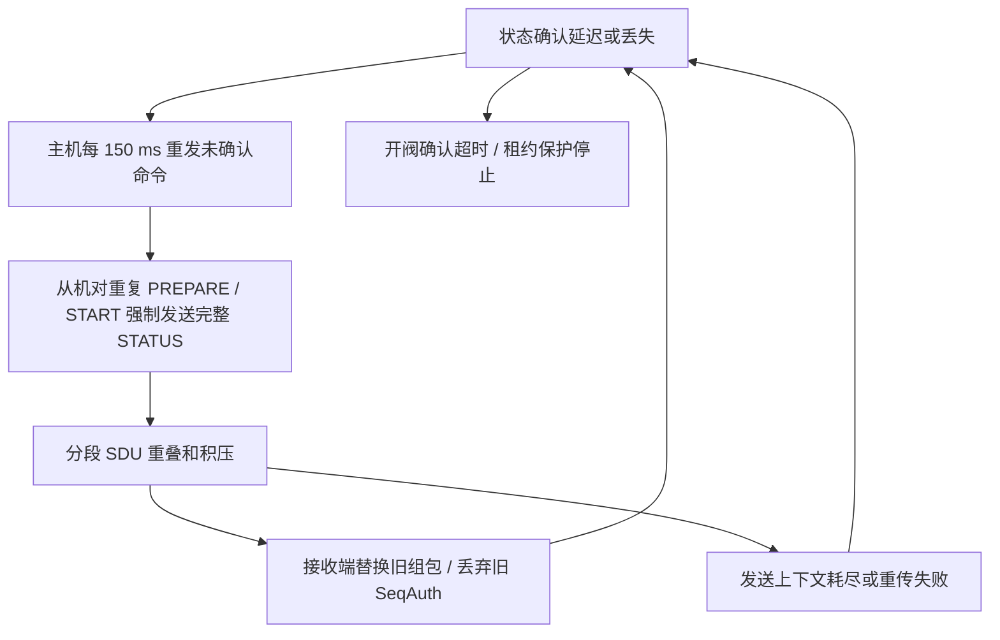
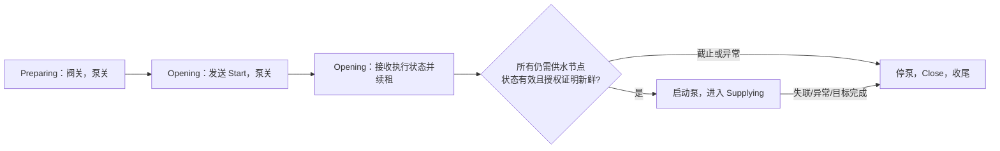

# 定量抽水不足：深入分析与优化实施方案

日期：2026-10-19（Asia/Shanghai）  
状态：方案与离线预算已完成，控制代码尚未修改，尚未刷机或进行修复后出水验证。  
对象：ESP32 主机、ESP32-C3 从机、Android APP。

**最多 5 路的实施入口已更新为 [十轮工程复核与实施方案](D:/pump/pump-muti/docs/MESH_FIVE_CHANNEL_IMPLEMENTATION_PLAN_20261019.md)。** 本文保留通用背景，5 路选择逐节点单播续租，先做 SDK 终态桥接原型，再整合业务治理与启动授权；以下预算也补齐本地组播固定重复。

## 1. 建议决策

**先解决 Mesh 确认链拥堵和开阀阶段的租约配合，再复测 500 mL。现阶段没有依据通过修改 K、提高泵速或取消租约保护解决问题。**

推荐正式目标为 **业务减流 + 正确的开阀续租时序 + SDK 真实分段终态窗口**。十轮复核后调整实施顺序：先做 SDK 桥接原型，确认最不确定的终态/错误路径可维护，再整合业务调度。5 路使用现有报文逐节点单播续租。第一阶段保持当前 `MaxConcurrent=1`，更高并发须另行通过通信和水路联合验证。

| 优先级 | 工作 | 预期效果 | 发布条件 |
|---|---|---|---|
| P0 | 固件身份、阶段与发送结果日志 | 能确定实际运行版本及首次失败环节 | 主从日志可关联 job、地址、序号、修订号 |
| P0 | 状态合并、每节点重试退避、抑制重复 Hello 补查 | 去掉业务层造成的分段放大 | 重复命令不再无限生成新状态传输 |
| P0 | Opening 阶段续租与启泵前确认 | 避免从机在主机仍等待确认时先触发 LEASE | 所有参与节点有新鲜授权证明后才允许启泵 |
| P0 | 队列期限、停止屏障、异步错误回传 | 清理未提交旧命令并定义提交竞态边界 | 屏障 ACK 后无新旧授权 commit；已提交集合继续跟踪；迟到包不能复活关闭任务 |
| P0 | 固定版本 SDK 补丁，暴露真实 SAR 终态 | 同一源/目的地址不再重叠提交分段 | 正常终态恰好回收；reset/缺失回调冻结并停止，不能假释放 |
| P1 | 任务失败原因端到端展示及结果补查 | APP 能区分失败、未知、达到目标 | 重连查询不会自动重新出水 |
| P2 | 扩容预算、必要时单包实时协议 v2 | 降低多节点控制的分段依赖 | 按实测决定，并完成版本协商与防重放验证 |

“适合的修复”不是把所有超时调大。当前默认单路，先消除本次已有证据支持的自激拥堵路径，并使超时与授权状态一致，改动范围更容易验证。兼容方案能缓解流量，但若没有真实 SAR 终态，不能声称实现了严格的分段互斥。

## 2. 分析基线与可信边界

| 项目 | 本次分析基线 | 限制 |
|---|---|---|
| 主机仓库 | `D:\pump\pump-muti`，`ad43f28bcef9ac4477d2c8428f000195e77d383c` | 当前 HEAD，不代表现场固件 |
| 从机仓库 | `D:\pump\pump-muti-slave`，`56821a3fd071347f505d532620e7e4f628ebdbdf` | 保留本地 COM6 配置 |
| APP 仓库 | `D:\pump\pumpmutiapp`，`4c8ea4a4169dc9805bd27d141e95c96b9c15d16f` | 手机为 1.2.0/code 8，不能由版本号推导全部构建内容 |
| 本机 SDK | PlatformIO `espressif32@6.10.0`；已安装 `framework-espidf` 包 `3.50400.0`，`version.txt=5.4.0` | 只用于解释本地实现；现场 SDK 版本尚未锁定 |
| 并发 | `include/board_profile.h` 的 `MaxConcurrent=1` | 支持登记 32 节点不等于同时运行 32 路 |
| 安全常数 | 从机 Lease 3000 ms；主机 LeaseAck 2400 ms；Opening 4000 ms | 按当前源码分析，不反推现场确切固件行为 |

现场主机 HELLO 缺少当前源码的 `individual=1`，提示固件与工作区存在差异。Git 更新没有更新设备固件。此前旧主机提交的 Opening 续租行为与当前 HEAD 不同，因此下文明确区分“现场事实”“源码确定行为”和“待验证假设”。

### 2.1 现场已经确认

- 用户设定的 500 mL 历史任务 `116:26`，从机最终为 `FAULT / LEASE`，设备计量 0 脉冲、0 mL。
- 完整捕获的下一笔 `116:27`，APP 保存的目标实际为 **200 mL**，不能写成 500 mL 复现。
- `116:27` 主从均出现 `No multi-segment message contexts available`；伴随旧 SeqAuth 丢弃、Duplicate SDU、重传耗尽。
- 主机记录到 Preparing → Opening → Draining → Failed，没有记录到 Supplying；从机最终同样为 LEASE、0 脉冲。
- 采样中主机泵输出关闭、`fault=NONE`；从机外部联锁为旁路状态 `enabled=0 ready=1`。
- 这些证据足以优先处理确认/续租链路，尚不足以确定最初触发因素是射频丢包、发送重叠、现场旧版本行为中的哪一项。

### 2.2 不应扩大的结论

- `116:22`～`116:25` 虽然也是 500 mL 失败，但没有逐笔停止原因，不能全部认定为 LEASE。
- 上报 0 mL 是设备计量结果，缺少量杯实测，不能声称物理出水必定为零。
- 阀的 Opening 状态代表从机已执行开阀输出命令；当前没有阀位反馈传感器，不代表物理阀门已确认打开。
- 本次分析没有证明流量传感器、泵驱动或水路一定正常。这些项目应在通信恢复后按停止原因继续排查。

现场时序与原始证据详见 [现场诊断](D:/pump/pump-muti/docs/VOLUME_DIAGNOSIS_20261019.md)。整个采集窗口的统计如下，**不是单笔任务统计**：

| 指标 | 主机 | 从机 |
|---|---:|---:|
| 日志行数 | 346 | 220 |
| TX 分段上下文耗尽 | 5 | 41 |
| 重传耗尽 | 7 | 16 |
| 丢弃旧 SeqAuth | 119 | 80 |

日志为 PC 接收时间。主机末尾有乱码行，不用它推导精确动作时间。主机窗口为 19:20:35.180～19:23:04.702，从机到 19:22:50.323。

## 3. 故障怎样被放大

### 3.1 主链路



图中每条放大路径都有源码依据；现场也出现了对应的底层错误。但日志没有逐包的提交、分段终态和应用 ACK 关联，不能认定每一个环节都已在本笔任务中逐包证明。

主机只要还没看到状态确认，就继续重试。重复命令在控制器内部保持幂等，不会重置目标脉冲、开阀时间或租约；但应用层每次都 `status(true)`，仍会创建新的分段 SDU。**动作幂等不等于通信负载幂等。**

完整 Status 是 3 个分段；主机每收一条 Status 又发送 2 个分段的 EventAck。以“每次 150 ms 重试都产生并成功交付一轮响应”为计算假设，仅这两类报文就有约 `5 / 0.15 = 33.3` 个数据分段/秒，计入 Start 为 40 个数据 PDU/秒。再叠加网络重复、SAR ACK、底层重传、周期状态与摘要。这里描述的是潜在放大强度，不是现场实测吞吐。

### 3.2 为什么增加 RX 缓存不能直接解决

本地 SDK `transport.c::send_seg()` 遍历 `seg_tx[]`，没有空闲项时返回 `-EBUSY`，同时打印现场错误。因此这是 **TX 分段会话资源耗尽**，不是普通堆内存不足，也不是 RX 分段数量不够。

更关键的是接收实现 `seg_rx_find()`：

1. 按源地址、目的地址匹配已有组包上下文。
2. 新 SeqAuth 到来时，如果旧 SDU 仍在组包，会输出 `Duplicate SDU` 并重置旧上下文。
3. 在启用 `CONFIG_BLE_MESH_DISCARD_OLD_SEQ_AUTH` 的本地构建中，随后到达的旧 SeqAuth 会被丢弃。

因此，同一个从机发往主机的 Status、LeaseAck、Summary、Hello 即使业务类型不同，也不能靠“每类各留一个窗口”避免该问题。需要按实际源/目的地址约束分段提交。同样，主机发向同一组地址的 Lease 与 Close 也共享这一风险。

本地配置为 TX=8、RX=16、ADV=40。单纯把 TX 调大，可以容纳更多重叠会话，但不能修复旧组包不断被新 SDU 替换的行为。现有 `CONFIG_BT_ALARM_MAX_NUM=128` 用于另一项共享定时器资源修复，应保留，不能当作本次全部问题的解法。

### 3.3 四种“发送成功”必须区分

| 层级 | 能证明什么 | 不能证明什么 |
|---|---|---|
| `mesh.send()` 返回 true | 进入本地业务队列 | SDK 接受、无线发送、对端接收 |
| `esp_ble_mesh_server_model_send_msg()` 返回 ESP_OK | API 请求被接纳 | 内部 `send_seg()` 成功、SAR 完成 |
| `ESP_BLE_MESH_MODEL_SEND_COMP_EVT` 无错误 | 本机 BTC 路径调用 `bt_mesh_model_send()` 返回成功 | 分段已经传完、对端控制器已执行 |
| 真实 SAR 终态 / 应用确认 | SAR 终态表示该底层发送会话结束；有效 Status/LeaseAck 表示特定应用行为 | 单播 SAR ACK 不等于应用接受；组播 SAR 结束更不等于所有接收方收到 |

本机 `btc_ble_mesh_prov.c` 的 server send 分支以 `bt_mesh_model_send(..., NULL, NULL)` 提交，随后立即产生 send-comp 回调。这里没有传入下层 `bt_mesh_send_cb`，所以**仅添加 send-comp 处理，然后在该事件到来时释放分段窗口，仍会过早放行下一条 SDU**。

send-comp 仍值得接入：它能暴露内部 `-EBUSY` 等异步提交错误。真正的会话结束在 `transport.c::seg_tx_complete()`：先释放上下文，再调用 `cb->end()`。单播成功通常依赖分段 Block ACK；组播成功只是本地规定的发送轮次结束，必须继续依赖各节点的应用确认。

本地 Mesh v1.0 路径的单播重传定时为 `400 + 50 × TTL`，TTL=3 时为 550 ms，重传次数常数为 4。广告排队和实际重传还占用时间，不能把 `4 × 550 ms` 当作所有发送路径严格的最坏寿命。

同版本组播分段使用 **50 ms** 重传定时，正常初发后仍固定重复 4 轮，无需发生丢包；必须将其计入稳定预算。四次定时等待也不是会话寿命的 200 ms 上界。另有 `bt_mesh_tx_reset[_single]` 直接 reset 不触发 end，桥接设计须明确这一例外。

## 4. 报文和容量预算

### 4.1 当前协议的分段成本

vendor opcode 为 3 字节。当前发送路径采用 4 字节短 TransMIC，未强制 segmented 时，Access 长度不超过 11 字节可走单包，因此业务载荷最多 8 字节。分段后的数据区每段 12 字节。

```text
payload <= 8：1 个未分段数据 PDU
payload > 8：ceil((payload + 3 字节 opcode + 4 字节 MIC) / 12)
```

| 报文 | 业务载荷字节 | 数据 PDU 数 | 影响 |
|---|---:|---:|---|
| Prepare | 28 | 3 | 任务参数低频发送，适合可靠分段 |
| Start | 8 | 1 | 自身单包，响应 Status 为分段 |
| Lease | 12 | 2 | 当前实时授权仍依赖分段 |
| LeaseAck | 13 | 2 | 从机保活证明仍依赖分段 |
| Close | 9 | 2 | 紧急关阀命令也会占用分段资源 |
| StatusGet | 8 | 1 | 自身很小，但触发完整 Status |
| Status | 27 | 3 | 主要事件响应负载 |
| EventAck | 12 | 2 | 需要纳入分段调度，不能无限插队 |
| Summary | 18 | 3 | “摘要”仍是 3 段，应降频/合并 |
| Hello | 9 | 2 | 周期维护流量 |
| HelloReply | 6 | 1 | 当前单包 |
| CommandReply | 10 | 2 | 拒绝风暴也可能放大拥堵 |
| Mesh Request：统一水量 / 分路水量 | 37 / 61 | 4 / 6 | 仅发生 Mesh 转发时，手机直连主机走另一条链路 |
| Mesh Response | 46 | 5 | 同上，不能把每次手机查询都计为 Mesh 5 段 |

手机 GATT MTU=185 影响手机和主机的链路，不能扩大 Mesh 未分段载荷的 8 字节预算。分路请求是 29 字节基础字段加 32 字节水量表，共 61 字节，在当前 Packet 的 64 字节范围内。

### 4.2 全局 150 ms 与多路时限的冲突

当前 Preparing、Opening 共用“每 150 ms 只发送一个未确认节点”的全局节拍。下表假设每路首次发送成功、无排队、无丢包、无需重试；以第一条 Start 提交为 0 时刻。真实系统还要加控制循环、SDK 排队、传输和响应时间，表中是理想预算。

| 每批路数 | 最后一条 Start 首次提交 ms | 距 4 秒 Opening 截止余量 ms | 距首路 3 秒初始租约余量 ms |
|---:|---:|---:|---:|
| 1 | 0 | 4000 | 3000 |
| 4 | 450 | 3550 | 2550 |
| 5 | 600 | 3400 | 2400 |
| 8 | 1050 | 2950 | 1950 |
| 16 | 2250 | 1750 | 750 |
| 24 | 3450 | 550 | -450 |
| 27 | 3900 | 100 | -900 |
| 28 | 4050 | -50 | -1050 |
| 32 | 4650 | -650 | -1650 |

当前 HEAD 只在 Supplying 发送 Lease。如果某节点 Start 很早成功，而整个 Opening 超过 3 秒，它会先失去租约。28 路及以上甚至无法在 4 秒内完成理想首次提交。不能简单把全局 150 ms 改成 300 ms，否则扩容预算更差。

**这不是本次单路故障的现场原因结论。** 当前默认每批 1 路；这张表说明未来不能直接提高 `MaxConcurrent`。

### 4.3 即使只运行一路，也要计入所有已登记节点

当前每次从机 Hello 会引发：Hello 2 段 + HelloReply 1 包 + StatusGet 1 包 + Status 3 段 + EventAck 2 段，共 9 个数据 PDU；每节点约 10 秒一轮。

定义定期 Hello 的登记节点数 R、实际收到并正常回复组播 Lease 的在线节点数 G、稳定运行且阀输出打开的节点数 A。当前所有配网从机订阅 `0xC001`；从机对有效格式 Lease 都安排 LeaseAck，任务不匹配或阀已关时也回复 STALE。主机业务层忽略非本批回复，不能省掉已发生的发送成本。下表假设登记节点全部在线且接收组播，即 G=R；忽略重试和阶段变化，报文均正常送达：

```text
续租：2 PDU/s
续租确认：2 × G PDU/s（包括闲置从机的 STALE 回复）
摘要：3 × A / 2 PDU/s
Hello 及其状态补查：9 × R / 10 PDU/s
基础总计（排除所有 SAR 重复）：2 + 2 × G + 1.5 × A + 0.9 × R PDU/s
含本地组播固定重复：10 + 2 × G + 1.5 × A + 0.9 × R PDU/s
```

| 登记且在线节点 R=G | 运行节点 A | 基础数据 PDU/s（排除全部 SAR 重复） | 网络 count=1 对基础数据的名义发送次数/s |
|---:|---:|---:|---:|
| 1 | 1 | 6.4 | 12.8 |
| 5 | 1 | 18.0 | 36.0 |
| 8 | 1 | 26.7 | 53.4 |
| 16 | 1 | 49.9 | 99.8 |
| 32 | 1 | 96.3 | 192.6 |
| 4 | 4 | 19.6 | 39.2 |
| 5 | 5 | 24.0 | 48.0 |
| 8 | 8 | 37.2 | 74.4 |
| 16 | 16 | 72.4 | 144.8 |
| 32 | 5 | 102.3 | 204.6 |
| 32 | 32 | 142.8 | 285.6 |

复核修正：早期预算将 LeaseAck 按 A 计算，低估了部分节点运行时的负载；只有 G=A 时该简式成立。以上按当前从机的实际回复条件修正。减少无关 ACK 应基于任务参与资格，不能静默丢弃本批已 Start 节点的真实租约拒绝。

上表为排除所有 SAR 重复的基础值。计入本地组播 Lease 的固定重复，每行应再加 8 PDU/s：5 台全运行为32，32台在线5路运行为110.3。`ESP_BLE_MESH_TRANSMIT(1,20)` 的 count=1 使相应数据网络发送名义翻倍，分别为64和220.6次/s。原表右列只对基础值翻倍，不能当完整正常负载；均不包含额外单播 SAR 重传、SAR ACK、beacon、配置、中继/代理流量，也不是广告三个信道上的实际射频包计数。

5 路推荐单播续租、常规 Hello 不完整补查后，稳定预算为 `5.5×A+0.3×R`：5台全运行为29 PDU/s、32台在线5路运行为37.1。单播仍有丢 ACK 重传风险，详见[十轮复核预算与平均容量限制](D:/pump/pump-muti/docs/MESH_FIVE_CHANNEL_IMPLEMENTATION_PLAN_20261019.md)。

APP 每 2 秒 Query 通常只读取主机内存/持久化结果并重放 FLOW；只有 unknown 补查等路径才会发送 StatusGet。不能把 APP 正常轮询误算为每 2 秒广播查询全部从机。优化 APP 轮询有利于网关负载，但不是当前最有证据的 Mesh 根因修复。

## 5. 可选架构与推荐范围

| 选择 | 具体内容 | 优点 | 剩余限制 | 建议 |
|---|---|---|---|---|
| A：兼容现协议 | 合并、期限、每节点退避、Opening 续租、异步提交错误、有限速发送 | 应用改动可分步验证；保持字段兼容 | 无真实 SAR 结束信号时，只能保守控制，不能严格证明零分段重叠 | 可单独评审；不是正式 5 路修复交付 |
| B：A + SDK 小范围补丁 | 给 vendor send 增加关联票据与真实下层终态，按目的地址约束分段窗口 | 直接解决同一目的地址重叠；失败可回传业务层 | 需固定 SDK 并维护补丁；低优先 SDU 已提交后仍会阻挡同目的急件 | 推荐作为正式修复目标 |
| C：实时协议 v2 | 高频控制尽量限制到 8 字节内；配置/详细结果仍低频分段 | 减少实时控制对 SAR 的依赖，利于扩容 | 新 opcode、会话映射、协商、计数回绕、防重放和迁移复杂 | 有更高并发目标或 B 的实测余量不足时立项 |

不建议把应用直接绑到 SDK 私有头、随意修改全局已安装包后手工刷机，也不建议在没有射频证据前重做整套通信。先建立可重复构建的补丁与验证记录。B 解决自激重叠，不保证在任意射频丢包下继续运行；持续失联时应当按保护逻辑停止。

## 6. 业务消息治理设计

### 6.1 统一待发记录与单一所有者

双端传输层新增待发记录，至少包含：

```text
ticket、dst、op、jobKey、revision/leaseSeq、generation
priority、createdAt、notBefore、deadline、attempt、payload
```

传输工作线程独占合并表和待发队列。控制任务只提交意图和停止屏障；SDK 回调只投递结果事件。禁止一边发送、一边由其他任务清空或遍历重写同一 FreeRTOS 队列。回调中不做 Flash、阻塞发送或复杂控制决策。

原来的 bool `send()` 可保留适配，但新路径要区分 `Accepted / Coalesced / Backpressure / Expired / NotReady`。结果通道要区分 `ApiRejected / StackRejected / SarFinished / ApplicationAcked`，由控制任务消费。把正常背压当作可调度状态；关键消息在截止内无法处理时仍触发安全停止。

### 6.2 各类消息如何合并和重试

| 报文 | 合并键/保留规则 | 完成与重试规则 |
|---|---|---|
| Status | `dst+job+revision` 至多一条待发；同修订号更新脉冲快照；新阶段替代尚未发送的旧中间阶段 | EventAck 确认状态事件；重复 Start/Prepare 仅唤醒已有待发意图；已确认事件不因重复命令立即重发 |
| 终态 Status | Done/Fault 保留最新完整结果，并先完成既有持久化流程 | 有界主动重试后停止广播，结果保留供 StatusGet 补查；不可当普通遥测丢弃 |
| Summary | `dst+job` 只保留最新遥测；拥堵时跳过旧摘要 | 不等待应用 ACK，不以摘要推进控制状态 |
| Lease | 5 路方案按 `dst+job` 至多一条未提交授权；序号在实际提交时分配/记账 | 逐节点单播并保留发送账本；重发同序号不延长主从看门狗，不以无限新序号作重试 |
| LeaseAck | `dst+job` 有界保存当前有效回执，明确该 seq 的最早应答时刻 | 入业务队列不等于交付；失败可按截止重试；更旧 ACK 不覆盖更新证明 |
| EventAck | `dst+job+revision` 去重，保留较新确认；终态优先 | 没有 ACK-of-ACK，按传输终态或期限结束；对端重复 Status 可再次触发 |
| Prepare/Start | `dst+job+op` 每节点最多一个待发意图 | 有界退避；阶段推进或任务停止后过期；重试不重置总阶段截止 |
| Close | 当前 job 的停止意图可重复合并 | 最高优先；先停本地泵；按截止重发并补查终态，不能等待无线才停泵 |
| Hello / HelloReply / StatusGet | 每地址合并维护请求 | Hello 保留在线性；首次发现、重启、unknown、必要恢复才补查完整状态 |
| CommandReply | 同 job、命令、拒绝码合并和限流 | 拒绝应能快速结束等待，但重复 STALE 不得形成无限高优先报文风暴 |

关键细节：

1. “同修订号”只标识状态事件，不标识每一个流量采样；不能为了每个脉冲递增事件修订号。
2. 如果主机确实丢失已确认状态，应通过显式 StatusGet 恢复；对该请求允许重发完整快照，但仍走统一合并和窗口。
3. 当前 StatusGet 忽略请求 key 并返回当前快照。主机必须继续按 key/revision 验证，不能把任何响应都当作本轮任务确认。
4. 终态重试次数在链路提交失败时不能悄悄耗尽；但总期限仍需封顶，防止无限占用链路。重试结束后依靠持久结果补查，不自动重新运行任务。
5. 各类应用确认语义不同。不能对所有消息统一“等应用 ACK 后再发”，否则 EventAck 等无对端应用回执的消息会永久占位。

### 6.3 每节点退避与首次发送公平性

候选重试间隔为 **300 → 600 → 1000 ms**，加入小幅有界抖动；这是待测起点，不是最终配置承诺。

- 每节点有独立 `attempt/nextDue`。新节点的首次发送优先于同批节点的第二次重试，避免慢节点独占首次分发。
- 重试间隔从实际提交或明确失败结果计算，不能在报文还躺在本地队列时再生成一份。
- 单节点阶段始终只有一个待发 Prepare 或 Start 意图；收到有效状态后取消对应重试。
- 全局速率由发送窗口和预算控制，不再只依赖一个固定 150 ms 全局计时器。
- Preparing 10 秒、Opening 4 秒是当前源码基线；5 路实施增加首个 Start 有效提交后固定 bootstrap 截止，候选2400 ms。NoFlow 5秒从从机 Start 计时，必须给建压/首脉冲留余量；不得因重试滑动延长截止。

### 6.4 停止屏障和过期规则

任务停止时，先调用现有本地 `pump.stop()`，再提升该任务的 generation，并向传输所有者提交停止屏障：

1. 在下一次提交 SDK 前丢弃该 job 尚未提交的 Prepare、Start、Lease 和旧遥测。
2. 保留 Close、终态、终态确认及必要补查；Close 本身不得被普通合并删除。
3. 已经提交给 SDK 的消息不能宣称已撤销。没有公开可靠取消接口时，依靠接收端 fence、状态检查和租约作为最终保护。
4. 保留“Close 抢在 Prepare 前到达时先持久化取消 fence”的现有行为，以及重启不自动重新出水的行为。
5. 迟到的同序号 Lease 不能二次延长授权；已关闭/已过期的任务不能被迟到 Start 或 Lease 复活。

远端关阀的 3000 ms 是从**最后一次有效新租约被从机接受**开始计时，不是从主机点击停止开始计时。队列和空口中已有合法报文可能迟到，因此不能把“主机停止后一定 3 秒内关阀”写成现协议已保证的硬界限。应分别测量本地停泵延迟、最后授权接受时间、阀输出关闭时间和尾流；需要更强端到端截止时，须额外设计可验证的授权有效期语义。

## 7. 严格 SAR 发送窗口设计（方案 B）

### 7.1 必要接口

固定 SDK 版本，给当前 vendor server send 路径增加可审计的扩展，在内部传入 `bt_mesh_send_cb` 和稳定 ticket，转发真正的 start/end 结果。应用只依赖该扩展的公开包装接口，不直接调用 SDK 私有核心函数。

- ticket 对应的记录活到真正终态，不能引用栈上 `ctx`、临时 buffer 或已经释放的 BTC 参数。
- API/内部立即失败与后续 `end()` 可能走不同路径，需要保证应用只释放一次窗口；覆盖同步回调及乱序回调。
- 回调携带 ticket、目的地址、底层错误和分段标记，payload 无需长期复制到日志。
- 提交失败、重传耗尽、远端取消、正常完成都回传；SDK/设备重启时不能误把旧票据当作新任务完成。
- 对异常缺失回调设置健康检测。健康检测到期不等于 SDK 上下文已释放，不可仅靠软件计时直接继续复用同一窗口；应停止相关授权并进入诊断/安全恢复路径。
- 补丁脚本校验 SDK 文件版本/哈希，验证不匹配时构建失败；主从均记录补丁版本和构建身份。

### 7.2 窗口和优先级

**每一发送节点，对实际目的地址同时最多 1 条分段 SDU。** 不按 opcode 分开占位。不同目的地址可以有界并行；单包消息不占 SAR 窗口，但仍应限流，不能无界提交给 BTC。

候选全局应用分段窗口从 2 开始，预留紧急容量并统计实际占用。若验证后升至 4，必须确认 SDK 配置流量和剩余上下文余量。TX=8 是共享上限，业务层“预留”不能自动约束未纳入该调度器的 SDK 管理流量；任务期间应避免并行配网/重配置。

待发顺序建议：Close → 即将到期的 Lease/LeaseAck → 阶段/终态及 EventAck → Prepare/Start → 遥测/Hello。优先级与最早截止结合，普通消息保留有限进展机会。

**优先级不能抢占已发出的同目的分段。** 一个已经开始重传的 Status 仍可能阻挡 LeaseAck；主机发向组地址的 Lease 也可能阻挡 Close。应在提交低优先分段前检查最近安全报文的预算，并在运行期间减少非必要大包。若链路持续达不到租约预算，应停止，不应为了保证“完成率”放松保护。

### 7.3 不把 SAR 成功等同于任务成功

SAR end 只用于释放底层占位；Start 仍须匹配的 Status，Lease 仍须有效 LeaseAck，结果仍须完整终态。应用 ACK 若先于本机 SAR end 到达，可以更新业务状态，但不能在真正 end 前错误释放分段资源。

## 8. Opening、租约和启泵屏障

### 8.1 当前源码的确定风险

从机在 Start 真正执行时开启 3000 ms 初始租约；主机只在 Supplying 发 Lease。Opening 允许等待 4000 ms，所以主从存在明确的授权空窗。即使单路，若开阀状态延迟超过 3 秒，也可能在主机等待期间先失效。

当前主机 LeaseAck 还要求 `ack.seq == 当前 leaseSeq_`。主机每 1000 ms 发新序号后，上一轮晚到的 ACK 即使仍有一定新鲜度也会被忽略。这会放大排队带来的误停风险；但直接接受任何旧 ACK 并用收到时刻续命，会引入更严重的过期授权问题。

### 8.2 推荐状态配合

不必对外增加新的阶段编号。可在 Opening 内部加入授权子状态：



实施约束：

1. 5 路方案在收到该节点匹配 job 的 Opening/Running 执行状态后，立即向它单播 Lease，不能等全部节点确认才开始续租。第一条 Start 有效提交后开启固定 bootstrap 截止，候选2400 ms，重试不延长。
2. 只向“本批已获得有效开阀执行状态、仍需供水”的节点授权，避免闲置/未 Start 节点回复 STALE。未收到状态的节点不能仅凭命令入队成功就无限续命。
3. 从收到开阀执行状态后发出的新授权建立证明；启泵前所有仍需供水节点均须有该证明，且未出现更新的关闭/故障状态。已正常达到 Target 的节点不再要求续租确认。
4. 确认只代表输出命令和租约已被从机接受，不能命名成物理阀位检测。
5. 所有节点已正常结束时不启动泵。Opening、租约或传输任一条件失败时，保持泵关并按既有安全路径收尾。
6. 若在 Opening 期间续租成功，也不能无限等待开阀确认。NoFlow、maxRun、联锁、独立租约保护继续有效；部分水路若存在余压流量，仍须计入该任务。

### 8.3 用有限发送账本判断 ACK 新鲜度

每次授权记录 `job、seq、generation、issuedAt、stackAccept/submit状态`，保留有限历史（候选最近 3 轮，覆盖正常乱序，不无限增长）。主机按以下条件接受：

- 来源是本批必需节点，job/generation 匹配，序号确由本机发出，结果为 OK。
- 序号比该节点已接受的证明新；重复 ACK 不更新任何授权时钟。
- 该授权从本机有效提交起的年龄小于预设证明窗口；跨一轮到达不自动作废，但过老 ACK 不延长授权。
- 用授权的本地提交时刻作为保守证明时间，或只授予它尚余的预算；不能一律 `ackAt=now`。
- 如果提交结果与 ACK 回调到达顺序相反，暂存并关联，不能把真实 ACK 判为未发出，也不能接受没有匹配账本的伪旧记录。
- seq 回绕使用现有串行比较规则，跨 job/重启不可混用；不得复用同一有效会话的序号空间。

非 OK 回执也要关联发送时的节点资格。5 路单播方案只在开阀状态确认后授权；若必需授权收到匹配的非 OK 回执，先本地停泵并收尾/核实，不能静默丢弃。它可能与 Target 终态乱序，不能为改善完成率轻率清除 abort 或把结算改为成功。

候选预算：新授权周期仍 1000 ms，从机 Lease 仍 3000 ms，主机证明超时仍以 2400 ms 为基线；启泵时最新证明年龄先以不超过 1000 ms 做台架起点。最终须根据 `队列等待 + SAR + 从机错峰 + ACK发送 + 控制调度` 的实测分布留余量。2400 与 3000 的 600 ms 差值并不是已验证的最坏时间保证。

### 8.4 LeaseAck 调度不能丢失交付状态

当前从机只有一个待回执槽，并在入业务队列成功后就清除 pending；若随后 SDK `-EBUSY`，控制层看不到失败。改造后应保留到明确传输结果或有效截止，并合并新回执。

当前错峰为 `(addr % 32) × 13 ms`，范围 0～403 ms，只是延迟策略，不是独占无线时隙。5 路单播方案将各节点续租分散安排，从机 ACK 尽早按窗口发送，取消额外地址错峰；重复同 seq 不向后推迟 due。仍须测试5台同时回复的场景。

## 9. 可观测性和 APP 优化

### 9.1 主从诊断字段

启动/只读版本查询输出：`role、app_git、dirty、build_id、idf_version、mesh_patch、protocol、capabilities、MaxConcurrent、Lease/Opening常数`。Git 字符串仅表示构建输入；dirty 和固件产物哈希也要保留。

关键事件输出设备单调时钟和以下字段：

```text
job=epoch:id addr=... phase=... reason=...
ticket=... op=... revision/leaseSeq=... generation=...
queue_age_ms=... result=... sar_duration_ms=...
ack_age_ms=... retry=... stop_origin=...
```

区分 `phase_timeout、queue_deadline、stack_busy、sar_timeout、lease_ack_expired、slave_lease_expired、storage_fault`，不要都只显示为 Transport。FLOW 增加可选 `reason`，并在终态保存中保留原因；本次主机 `publishFlow()` 虽然接收 reason 参数，输出行却未包含它。

计数器至少包括：

- 各消息类生成、合并、提交、到期、丢弃、重试次数；队列长度峰值及最大等待时间。
- 分段窗口占用、异步 EBUSY、SAR 完成/失败、每目的地址重叠违规次数。
- 各节点 Prepare/Opening 确认延迟，LeaseAck 的 p50/p95/p99/max 及最老有效证明年龄。
- 控制循环间隔最大值、Flash 写入耗时、关键 RX/TX overflow。
- 主动停止原因和从机实际停止原因分别记录，避免主从不同保护先触发时互相覆盖。

关键状态变化立即记一条，重复错误按窗口汇总；完整逐包日志只在有界诊断模式启用。串口/GATT 大量打印本身也会改变调度，不应为诊断制造新拥堵。

### 9.2 网关与结果可恢复

主机网关存在有界输出队列及 BLE 分块失败路径。它是次要可靠性改进项，现有证据不足以认定它是本次 Mesh 故障根因。

- 终态/错误保留可重查；普通 FLOW 只保留较新的快照，避免慢手机挤占全部输出。
- APP 按阶段区分“达到目标”“失败”“结果待核实”；`FINISHED` 只说明任务已终结，不能直接显示成功。
- 断连后用原 client/sequence/job 查询和对账；不得生成新请求或自动补抽剩余量。
- 新增 reason 字段保持向后兼容，旧固件无字段时显示“原因未上报”，不能猜测 LEASE。
- inventory、mesh-state 当前多为主机本地信息；仅在实测网关拥堵时调整轮询，避免误砍恢复能力。

### 9.3 控制任务中的 Flash 与定量误差

当前从机 tick 为 5 ms，但应用处理、Flash、SDK 回调调度都可能引入抖动。NVS fence 在阀关时、接受新任务前持久化，终态在阀关后保存，这是必须保留的恢复语义。不要为提速把 fence 改成开阀后的异步写入，也不要每个脉冲写 Flash。

先统计最大 tick 间隔和存储耗时，再决定是否把非安全日志、结果发布移出控制任务。若发现中断计数或输出关断延迟，需要独立测量，不用本次 LEASE 失败推导传感器精度。

## 10. 实时协议 v2 的后续边界

若更高并发实测仍被实时分段拖累，可把频繁 Lease/LeaseAck/Close/运行摘要设计为尽量单包，详细配置和终态仍使用低频分段。

当前完整 JobKey 已占 8 字节，无法再塞入 32 位 seq 和结果码而保持单包。**不能简单截断 epoch/id 或删掉序号。** 需要单独设计会话映射：

- 用低频可靠握手把短 token 映射到完整 JobKey、参与节点/批次和防重放 fence。
- token 必须在所有可能迟到包的有效范围内不复用；主从重启使旧映射失效，重新建立前禁止出水。
- 单播与组播的 token 作用域、ACK 来源、序号宽度和回绕前重协商必须写入协议；截断后的计数空间不可默认足够。
- 为紧急关闭保留匹配身份和拒绝旧包的能力；不因追求 8 字节取消授权检查。
- 新 opcode 和显式 capability 协商。旧节点不会“自动理解”；不支持需要的安全能力时拒绝开任务。
- 如果现有 Mesh 安全上下文和会话生命周期无法提供上述约束，应允许保持分段，先完成协议评审。

这是一项后续架构选择，不是本次短修的前提。主从成对升级不等于允许删除兼容检查。

## 11. 实施拆分与验收交付

| 批次 | 修改位置 | 交付内容 | 验收出口 |
|---|---|---|---|
| M0：可定位 | 双端 `application.cpp`、构建脚本、主机 `master_scheduler.cpp` | 固件身份、关键状态/传输计数、首次失败原因 | 不开启出水即可确认版本与报文链路；日志不泄漏 PIN/密钥 |
| M3：先验证严格窗口 | 可重复应用的固定 SDK 补丁、双端 transport | SAR end 事件与 ticket、固定结果槽、reset/缺失回调策略 | 双芯片干净构建及终态故障注入；同目的占位有界，缺失时冻结 |
| M1：业务减流 | 双端 `application.cpp`、`mesh_transport.h/.cpp`、主机 scheduler | 合并、每节点退避、维护补查抑制、deadline、停止屏障、send-comp 错误回传 | 丢 ACK/重复命令不会无界放大；任何错误仍按原保护停止 |
| M2：授权一致 | 主机 scheduler/运行状态、从机 ACK 调度 | 逐节点单播、Opening 续租、启泵屏障、有限 ACK 账本、NoFlow 启动预算 | 所有相关节点新鲜证明前泵不启动；重复/旧 ACK 不续命 |
| M4：端到端结果 | 主机 FLOW/历史、APP `MasterProtocol.kt`、`MasterHistory.kt`、界面 | 兼容 reason、明确失败/未知、断连查询恢复 | 终态丢通知后可补查；不会自动重跑 |
| M5：容量验证 | 配置、台架记录、必要时协议 v2 设计 | 逐级通信/水路验收、并发上限 | 没有通过的并发不得写入生产配置 |

表中保留原编号以便追溯，实施顺序已改为 M0→M3原型→M1/M2整合→M4→M5，对应新实施方案 S0～S4。M1/M2 可分提交评审，但正式交付须包括 M3 和硬件复测。无法维护 SDK 补丁时，不用固定守候时间冒充真实 SAR 完成。

相关源码入口：

- 主机：[调度器](D:/pump/pump-muti/src/master_scheduler.cpp)、[运行状态](D:/pump/pump-muti/include/master_scheduler.h)、[应用入口](D:/pump/pump-muti/src/application.cpp)、[传输层](D:/pump/pump-muti/src/mesh_transport.cpp)、[并发配置](D:/pump/pump-muti/include/board_profile.h)。
- 从机：[应用/ACK](D:/pump/pump-muti-slave/src/application.cpp)、[阀控制器](D:/pump/pump-muti-slave/src/flow_job_controller.cpp)、[保护参数](D:/pump/pump-muti-slave/include/flow_job_controller.h)、[传输层](D:/pump/pump-muti-slave/src/mesh_transport.cpp)。
- APP：[轮询与任务](D:/pump/pumpmutiapp/app/src/main/java/com/cczb/app/MasterControlViewModel.kt)、[解析与状态合并](D:/pump/pumpmutiapp/app/src/main/java/com/cczb/app/MasterProtocol.kt)、[历史记录](D:/pump/pumpmutiapp/app/src/main/java/com/cczb/app/MasterHistory.kt)。

## 12. 验证矩阵

以下是实施后的必做验证，不表示本次已执行。先使用模拟 IO 和故障注入，再安排有受控水路的真实出水。现有主从 host tests 应随控制器改动运行，SDK 构建/硬件日志用于补足 host tests 无法覆盖的异步行为。

| 场景 | 注入或操作 | 必须满足的断言 |
|---|---|---|
| 单路正常任务 | 200 mL、500 mL、不同泵档位 | Preparing → Opening → Supplying → Target → quiet Done；记录 closePulses/最终脉冲/实测量 |
| 重复 Prepare/Start | 高频重复相同 job；ACK 丢失 | 动作幂等；目标/计时不重置；待发意图有界；状态传输遵守窗口 |
| 状态/EventAck 丢失 | 丢首包、连续丢数包、乱序 | 可恢复或明确超时失败；不产生无限重试；不会把 Summary 当阶段确认 |
| 异步 SDK EBUSY | API 先返回成功，send-comp 再失败 | 业务能看到失败；未交付 ACK 不被永久当作已发送；重试有截止 |
| SAR 终态异常 | 超时、取消、回调早于提交返回、重复/缺失回调 | 恰好一次回收；无同目的重叠；缺失时安全停止，不盲目重开窗口 |
| ACK 跨轮到达 | 900/1100/1800/2500 ms 延迟及乱序 | 按有效提交年龄判断；有限历史内新证明可接收；过期/重复证明不续命 |
| Opening 慢响应 | 在 3000 ms 前后延迟；最后节点不响应 | 有效续租覆盖等待；总截止不延长；未满足全部证明时泵始终 OFF |
| 单播授权边界 | 未 Start/闲置节点不发 Lease；提前 Target 与拒绝乱序 | 授权对象准确；仍需供水节点的拒绝或过期先安全停止，结果原因保留 |
| 中途失联 | 主机关机、从机关机、屏蔽双向无线 | 主机本地泵按授权保护关闭；从机在最后有效租约后 3000 ms 加已测调度抖动内关闭输出 |
| 人工停止遇拥堵 | 堵满普通待发；Close 丢失/晚到 | 本地先停泵；停止屏障后不再新提交旧 START/LEASE；从机最终关闭，迟到包不复活 |
| Close 超越 Prepare | 乱序并在各持久化点断电重启 | fence 生效，任何旧任务不得在重启后自行开阀 |
| 终态/通知丢失 | 丢所有主动终态，随后 Query/StatusGet | unknown 正确保留并能补齐；历史恢复正确；从不自动补抽 |
| Flash 失败或慢写 | fence 写失败、终态写失败、注入延迟 | 接受新任务前持久化失败即拒绝；保护循环延迟被记录，不能掩盖结果不可靠 |
| 维护流量并存 | 登记 1/8/16/32 台，仅运行 1 台 | 周期 Hello 不引起补查风暴；事件 ACK 与 LeaseAck 均有预算 |
| 多路扩容 | 当前目标按 A=1→2→5 验收 | 通信和水压/流量分别验收；未通过时仍使用较小 batch |
| 计数与异常原因 | 脉冲输入正常/为零/中断；尾流 | Target、NoFlow、Runtime、Lease、TailFlow 能明确区分；不修改 K 掩盖异常 |
| 长时间运行 | 模拟 IO 1000 轮以上及现场约定时长 | 队列/票据/SDK 上下文不累积；正常条件无自激 EBUSY 风暴 |

### 12.1 建议发布门槛

1. 主从真实固件 build ID、SDK 补丁及配置可确认，构建产物与部署记录一致。
2. 每目的地址分段并发不超过 1；压力与故障测试后占位回归零，无失控队列增长。
3. 正常单路测试不再出现重复 SDU 导致的持续旧 SeqAuth/EBUSY 风暴。故意射频丢包时允许出现底层失败，但必须有界恢复或安全停止。
4. Opening 启泵屏障、有限 ACK 新鲜度、停止屏障、防重放和重启恢复全部通过；正常完成率不能代替这些安全断言。
5. 建议先完成 20 次现场 500 mL 连续正常出水作为初步验收样本，同时保存失败样本；20 次通过不等于长期可靠性证明。多节点和长稳另行验证。
6. 每次记录目标 mL、K/版本、目标脉冲、关阀脉冲、尾流脉冲、最终脉冲、上报 mL、量杯/称重实测、停止原因和持续时间。
7. 业务允许的体积误差尚未给出，实施前确认绝对/相对容差及测量方法。不得先承诺 ±1% 等未经验证的精度。

K=5880 pulses/L 时，500 mL 目标为 2940 脉冲，名义每脉冲约 0.170068 mL。当前 `preclose=0` 默认下应观察达到目标后关阀及其尾流；最终值不应简单要求恰好等于 2940。只有正常 Target/quiet Done、量杯偏差仍稳定时，再做 K 标定或尾流补偿实验。

## 13. 部署与回滚原则

- 先冻结三个仓库版本与本地配置，保存主从 NVS/配网信息的可恢复记录；不把擦 NVS 当作通信优化步骤。
- 第一轮按当前默认单路完成修复验证；部署时记录应用、SDK 补丁、配置和固件哈希，不只写“已更新 Git”。
- 新主机需要 LeaseAck 等能力时，先确认所有参与节点支持；混用旧版本必须明确拒绝或进入经过验证的兼容模式，不能静默丢掉保护。
- 如新增能力查询，优先使用新 opcode 或明确版本字段；当前 Hello 严格校验长度，不能直接追加字段并假设老端仍能解析。
- 任何升级/回滚均在泵阀输出关闭、任务已结算或保留 unknown 的状态执行。不自动恢复旧任务，不因恢复日志而重新发 Start。
- SDK 补丁随仓库保存并在干净环境重建；回滚同时考虑主从协议与存储兼容，保持现有任务 ledger/fence。

## 14. 本次交付、复算与下一步

本次完成现场证据复核、主从及 APP 代码追踪、ESP-IDF 底层语义核对、报文/时序预算和实施/验收设计。**没有改动运行控制源码，没有刷机、重启、修改 NVS/K，也没有再次发出出水命令。**

复算工具只使用 Python 标准库，不连接任何设备：

```powershell
Set-Location D:\pump\pump-muti
& 'C:\Users\79622\.platformio\penv\Scripts\python.exe' `
  docs/analysis/mesh_volume_budget_20261019.py `
  --output docs/MESH_VOLUME_BUDGET_20261019.json
```

- [离线预算 JSON](D:/pump/pump-muti/docs/MESH_VOLUME_BUDGET_20261019.json)
- [预算计算脚本](D:/pump/pump-muti/docs/analysis/mesh_volume_budget_20261019.py)
- [最多 5 路专项评估](D:/pump/pump-muti/docs/MESH_FIVE_CHANNEL_ASSESSMENT_20261019.md)
- [现场诊断及证据说明](D:/pump/pump-muti/docs/VOLUME_DIAGNOSIS_20261019.md)
- [现有交接文档](D:/pump/pump-muti/HANDOVER.md)

下一实施入口为[5 路十轮复核方案](D:/pump/pump-muti/docs/MESH_FIVE_CHANNEL_IMPLEMENTATION_PLAN_20261019.md)的 S0：固定输入并验证 SDK 桥接，再整合业务与授权，按1→2→5路复测。当前不能视为已修复或已验证达到设定水量。

### 本地 SDK 核对入口

- [分段发送、接收与终结](C:/Users/79622/.platformio/packages/framework-espidf/components/bt/esp_ble_mesh/core/transport.c)：`send_seg`、`seg_rx_find`、`seg_tx_complete`。
- [API 内部提交与 send-comp](C:/Users/79622/.platformio/packages/framework-espidf/components/bt/esp_ble_mesh/btc/btc_ble_mesh_prov.c)：`BTC_BLE_MESH_ACT_SERVER_MODEL_SEND` 分支。
- [未分段长度定义](C:/Users/79622/.platformio/packages/framework-espidf/components/bt/esp_ble_mesh/core/transport.h)：`BLE_MESH_SDU_UNSEG_MAX=11`。

本方案的计算是源码假设下的离线算术，不是空口仿真；支持的并发数、无线最坏延迟和最终体积误差仍以实施后的台架与现场记录为准。
