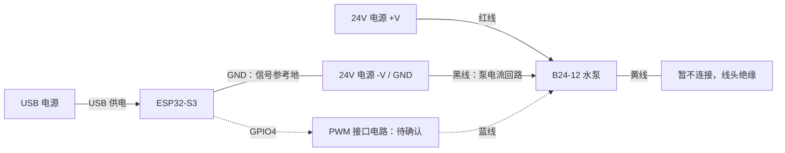

# B24-12 DC24V 四线无刷泵

2026-10-26，根据用户提供的商品图片，将主设备计划连接的水泵更新为 B24-12 / DC24V 四线无刷 PWM 泵，具体型号以实物铭牌为准。图片标示 8 米扬程、PWM 调速及转速反馈；未提供额定电流、PWM 电气规格或反馈脉冲规格。当前完成型号与接线记录，尚未完成新泵的固件参数适配或实机验收。

## 供电与线色

| 线色 | 图片标示 | 工程连接方案 |
| --- | --- | --- |
| 红 | 24V 正极 | 独立稳压 24V 电源正极；电源电流按泵额定/启动电流选型 |
| 黑 | 24V 负极 | 24V 电源负极；非隔离控制接口与 ESP32 GND 共地 |
| 蓝 | PWM 调速 | GPIO4 作为信号源，待确认电压、上拉和驱动形式后选择连接电路 |
| 黄 | 转速反馈 | 当前不接入，线头绝缘；后续按反馈电气参数设计采集接口 |

泵内置无刷驱动，红黑线负责持续供电，蓝线负责调速。不能沿用两线泵的电源斩波接法来推定控制方式。ESP32 由 USB 或合适的降压电源供电，不能从 ESP32 的 3V3 经 MT3608 给此泵供电，也不能将 24V 接入 GPIO、3V3 或开发板 5V 引脚。

蓝线可能需要推挽、开漏或电平转换接口，是否允许直连 3.3V 尚不清楚；若转换电路反相，还需在固件中匹配实际占空比与停止电平。黄线的电平、是否开集电极及每转脉冲数未确认，不能直接接入 ESP32，也不能凭转速推算实际出水量。

## 独立电源接线（2026-10-27）

用户确认水泵使用独立电源。采用泵用独立稳压 DC24V 电源、ESP32-S3 用 USB 供电的方式；电源的额定电流需满足商家提供的额定与启动电流。

以下为非隔离 PWM 接口的接线规划，虚线部分需收到商家规格后确定电路：

| 接线点 | 具体连接 |
| --- | --- |
| 24V 电源 +V | 接泵红线 |
| 24V 电源 -V / GND | 接泵黑线，并从同一负极接线端子另引一根线接 ESP32 GND |
| ESP32 USB | 接 USB 电源或电脑，为主板供电 |
| ESP32 GPIO4 | 预留给蓝线 PWM 控制；规格未确认前不要直接相连 |
| 泵黄线 | 单独绝缘，暂不接 GPIO、GND 或电源 |

泵的红黑供电线直接走 24V 电源接线端子，泵电流不要经过 ESP32 的引脚、板上走线或 USB。共地线用于建立 PWM 的电平参考，两路电源正极各自供电。上述方案以普通非隔离 PWM 接口为前提；如果最终采用隔离接口，按隔离器件的两侧供电和接地要求另行接线。

蓝线电路尚未定型：商家明确支持 3.3V 推挽、输入没有超出 GPIO 允许范围的上拉或回灌、且频率/极性匹配时，才可考虑 GPIO4 直连；否则选匹配的开漏、缓冲或电平转换接口。不能将泵的 24V 供电电压当作 PWM 信号电压，也不能自行把蓝线或黄线上拉到 24V。

接线前先断开泵的 24V 电源。蓝线悬空时泵可能自动运行，当前不能把“蓝线暂不连接”视为停止条件；确认控制接口及停止状态后再给泵通电联调。现有固件只有 PWM 输出，没有独立的泵电源开关控制；若该泵 0% 不能停止，需要补充可控断电或厂家认可的停泵接口后才能用于自动定量。

## 等待商家提供的参数

可直接向商家询问：

> 我用 ESP32-S3 的 3.3V GPIO 控制这款 B24-12 / DC24V 四线水泵，请提供接线及 PWM/转速反馈规格：额定功率、额定和启动电流；蓝线允许的信号电压与高低电平阈值、是否内部上拉及上拉电压、需要推挽还是开漏、支持的 PWM 频率；占空比与转速的关系、最低启动/运行占空比、0% 和 100% 分别是什么状态；蓝线悬空、持续低或持续高时是否停泵，是否有可靠的停泵控制；黄线输出电压、输出形式、所需上拉和每转脉冲数。另外请确认该泵是否允许空转、是否需要灌泵，以及允许的启动频率。

## 当前固件状态

| 项目 | 当前实现 | 新泵适配状态 |
| --- | --- | --- |
| PWM 引脚 | ESP32-S3 GPIO4 | 保留信号源，泵端接口电路待定 |
| PWM 频率/分辨率 | 20kHz / 10bit | 旧参数，待商家确认 |
| 低/中/高档 | 65/80/100% | 旧参数，尚未验证启动、调速范围或流量 |
| 关闭输出 | 停止 LEDC 并将 GPIO4 置低 | 不等于已确认新泵停转；若 0% 仅最低速，需另设可靠停泵手段 |
| 上电就绪 | `commissioned=true` | 既有软件配置，不代表新泵硬件验收通过 |
| 黄线转速采集 | 未实现 | 当前不显示或判断实际转速，不启用闭环调速 |
| 水量计量 | 从节点流量计 | 不使用转速替代流量；更换泵后需复核各档水量精度 |

代码入口：`include/board_profile.h` 的 GPIO/频率、`include/pump_safety_controller.h` 的三档占空比、`src/hardware.cpp` 的 LEDC 输出与关闭电平。收到规格后再调整这些参数和接口；当前没有修改 PWM 运行行为，也没有重建或刷写新泵固件。

最终适配需验证：上电、复位、蓝线断开和关闭命令时的泵状态；三个档位能启动且可区分；故障/超时/取消后的实际停泵；供电及水路条件下的计量精度。空转允许条件未确认，不以旧的短时空转测试作为新泵验收步骤。
