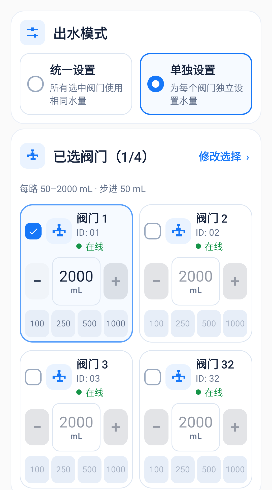

# 控制页与单独出水验收记录（2026-10-19）

## 交付范围

1. 控制页移除单路最长时间编辑器，在设置页统一维护 1～240 秒的全局值，保存在本手机。统一设置与单独设置均使用此值；恢复旧任务、复用历史目标不会覆盖全局设置。已经接受的任务继续使用接受时的时限。
2. 阀门列表按槽位编号排序，使用槽位与地址作为稳定标识，不随选择状态重新分组。后台清单刷新使用固定的状态行，避免刷新提示插入、移除造成阀门区域上下跳动。
3. 新建出水任务每路 50～2000 mL，只允许 50 mL 的整数倍；输入、加减、滑块、任务确认与启动边界使用同一限制。2000 是每路新目标上限，多路总目标可超过 2000，旧已接受任务和实际累计出水量保持原值。
4. 按参考图实现单独设置：蓝色模式卡片、双列阀门卡片、选中状态、每路独立数字输入与加减按钮、100/250/500/1000 快捷量。未选阀门的水量编辑禁用。窄屏与大字体切换单列；确认页展示各路目标、总目标及全局时限。

## 执行链路与兼容

APP → `start-each` → 主机完整计划持久化 → 按编号逐路 PREPARE/START → 从机独立计脉冲与关阀 → 原任务结果链路。

- 计划按 32 槽位编码为 64 位十六进制，每槽单位 50 mL；仅选中槽位有值。
- 整个计划作为一个任务受理，沿用客户端身份、序号、原请求重试、去重与冲突检查。手机断连不拆成多个手机驱动的子任务。
- 主机能力声明 `individual=1`；旧固件缺省为不支持，APP 阻止向其发送单独设置启动请求。
- 主机 NVS 格式 2 导入原格式 1，保留 PIN、节点登记、客户端高水位、原任务与结果。新格式追加逐客户端计划，升级禁止擦除 NVS；回退旧固件需使用升级前备份。
- 原统一出水协议不变，从机 PREPARE/START 协议不变。共享请求头在主从工程保持一致。

协议详见 [PROTOCOL.md](PROTOCOL.md)。

## 软件验收

| 检查 | 结果 | 覆盖内容 |
| --- | --- | --- |
| 主机固件构建 | PASS | ESP32 pump_master；格式 1 的 ESP32 存储布局大小静态检查通过 |
| 从机固件构建 | PASS | ESP32-C3 valve_slave_c3；共享协议头兼容 |
| 主机主机侧测试 | 23 组 PASS | 逐路计划解析、编码、重试冲突、不同目标调度、全局时限、旧存储迁移、原独立试泵兼容 |
| 从机主机侧流量测试 | PASS | 现有流量与关闭逻辑回归 |
| Android 单元测试 | 74 PASS | 水量边界、计划编码、命令、记录与旧任务兼容 |
| Android 模拟器界面测试 | 18 PASS | 设置全局时间、单独水量编辑、边界、确认总量、重复清单刷新与倒序输入不移动阀门卡片 |
| Android APK 与测试 APK 构建 | PASS | assembleDebug / assembleDebugAndroidTest |
| Android lintDebug | 0 errors，20 warnings | 构建未阻断；警告不等同于零警告验收 |
| 主从角色边界与共享契约 | PASS | tools/verify_architecture.py |
| 修改格式检查 | PASS | git diff --check |

360dp 宽度下检查了双列卡片，四位数字 2000 及 mL 完整显示。下图使用测试构造的阀门清单，不代表已连接四台实机；截图用于尺寸与布局验收。

## 构建产物与实机状态

- APP：`D:/pump-muti/pump-muti-app/app/build/outputs/apk/debug/app-debug.apk`
- 主机：`D:/pump-muti/pump-muti/dist/pump_master/firmware.bin`，应用分区偏移 `0x20000`。
- 固件清单：`D:/pump-muti/pump-muti/dist/manifest.json`，`hardwareValidated=false`。
- Android 单元测试报告：`D:/pump-muti/pump-muti-app/app/build/reports/tests/testDebugUnitTest/index.html`。
- Android lint 报告：`D:/pump-muti/pump-muti-app/app/build/reports/lint-results-debug.html`。

部署前主机只读检查显示泵输出关闭、无活动测试。随后主从串口与真实手机 ADB 连接消失，最终检查仅剩模拟器，未找到串口。因此本轮没有刷写实机固件、没有在真实手机安装 APK，也没有执行真实出水。软件与模拟器验收通过，实机升级、NVS 迁移实测及实际出水验收仍待设备恢复连接后完成。

设备恢复后：先只读确认空闲，备份 NVS，再仅升级主机应用并保留 NVS；核验新能力、原登记与任务记录，然后保留手机数据安装 APP。单独设置无需为执行协议升级从机。实际出水需在现场准备好水路后另行验证。
